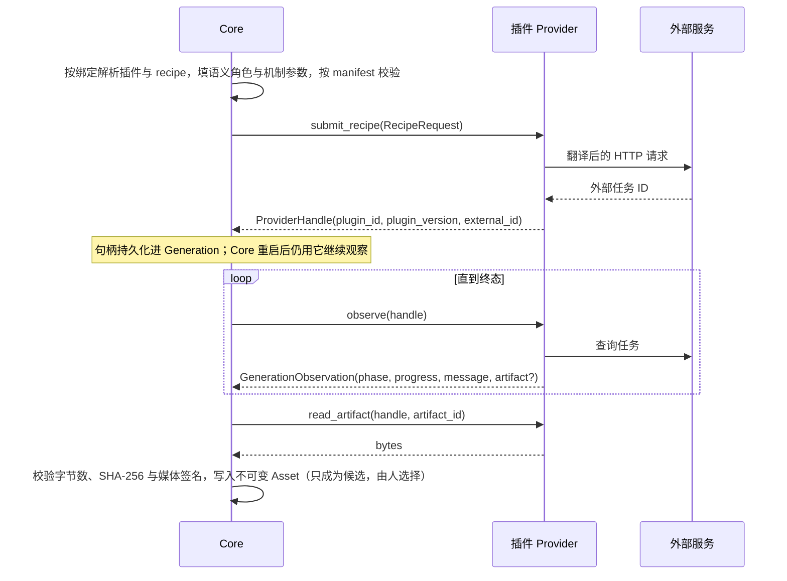

# 插件与 Core 的契约

代码依据：`core/model_providers/{manifest,recipe,registry,boundary,http}.py`、`server/provider_plugins.py`。
动手前把这几个文件读一遍；本文是它们的导读，二者冲突时以代码为准。

## 1. 包结构与安装

```text
core/model_providers/<package>/
├── __init__.py      导出 Provider 与请求 DTO
├── manifest.py      MANIFEST = PluginManifest(...)
├── provider.py      请求 DTO、to_request、Provider 类
├── plugin.py        plugin_instance(endpoint, transport=None) -> PluginInstance
└── README.md        能力、外部接口、凭据来源、限制
```

启动时用 `./start.sh --provider-plugin <package>=<endpoint>`（可重复）安装。`server/provider_plugins.py`
会 `import core.model_providers.<package>.plugin` 并调用 `plugin_instance(endpoint)`，要求：

- 包名匹配 `[a-z][a-z0-9_]*`，返回值是 `PluginInstance`，且 `plugin_id == 包名`；
- endpoint 是 `http(s)://host[:port][/path]`，不能带用户名密码、查询串或片段（凭据另行读取，见 remote-api.md）；
- `PluginInstance` 构造时检查每个 recipe 的实现都有 `submit_recipe`、`observe`、`cancel`、`read_artifact`
  （`speech.recognize` 只要 `execute_recipe`）。

安装后，人在顶栏「Provider 设置」里把能力绑定到插件。没有显式绑定时，按安装顺序取第一个实现该能力的插件。
绑定与插件设置是全局的，项目与 Playground 共用；只影响之后的新提交。

## 2. 一次生成的生命周期



用户取消时 Core 调 `cancel(handle)`，插件请求外部服务中止并返回此刻的观察。提交结果未知（网络中断）时 Core
不会自动重试；人显式重试会创建新的 Generation 并再次调用 `submit_recipe`。

## 3. 能力与 Core 填写的输入

Core 只理解封闭的能力（`Capability`）与语义角色（`Role`）。插件在 recipe 里用带 `role` 的参数或槽位声明
“我需要这个领域事实”，Core 在项目里按领域事实填写；没有 `role` 的参数是机制参数，由人或 Agent 填。
插件可以只声明自己用得到的角色；声明了某个角色而当前场景提供不了，提交会被拒绝。

| Capability | 用在哪里 | Core 提供的参数角色 | Core 提供的媒体槽位角色 | 期望产物 |
| --- | --- | --- | --- | --- |
| `image.generate` | Keyframe、地点主图与视图、造型设定图、Playground | `PROMPT`、`ASPECT_RATIO`、`SEED`（声明时） | `REFERENCE_IMAGE`（参考图，按顺序，可为 0 张） | PNG/JPEG/WebP |
| `image.edit` | Keyframe 编辑底图、地点视图细化、Playground | 同上 | `EDIT_SOURCE`（1 张底图）+ `REFERENCE_IMAGE` | PNG/JPEG/WebP |
| `video.generate` | Segment 视频、Playground | `PROMPT`、`DURATION`（秒）、`SEED`、`ASPECT_RATIO` | `FIRST_FRAME`、`LAST_FRAME`（Keyframe 已选图）；其它槽位由人或 Agent 显式绑定 | MP4 |
| `video.upscale` | Segment 超分、Playground | `SEED` | `SOURCE_VIDEO` | MP4 |
| `voice.design` | 资产中心音色设计、Playground | `PROMPT`（音色描述）、`SPEECH_TEXT`（试读文本）、`SEED` | — | WAV |
| `speech.synthesize` | 旁白 TTS、资产中心声音克隆、Playground | `SPEECH_TEXT`、`VOICE_TRANSCRIPT`（参考音频文字稿）、`SEED`；`LANGUAGE`（`zh`/`en`）只在旁白提供，声明它时把默认值设为 `auto`，资产中心克隆才不会被拒绝 | `VOICE_REFERENCE`（参考 WAV） | WAV |
| `speech.recognize` | 参考音频转写（同步） | `LANGUAGE`（`auto`、`zh` 或 `en`） | `SOURCE_AUDIO` | 返回带 `text` 属性的对象 |
| `audio.separate` | 视频人声/背景分离 | `AUDIO_STEM` | `SOURCE_VIDEO` | WAV |
| `audio.generate` | 仅 Playground | 参数全部由人填写 | — | WAV |

Playground 不按领域事实填角色：人按 manifest 直接填写全部参数与槽位，所以插件装上后无需额外代码就能在
Playground 调试。

Core 只接受这些媒体类型，并校验文件头签名：`image/png`、`image/jpeg`、`image/webp`、`audio/wav`、`video/mp4`；
视频上限 2 GiB，其余 64 MiB。外部服务返回 MP3、WebM 等格式时，必须在外部服务一侧转换（例如在自己的适配服务里），
插件包本身不引入 FFmpeg 或第三方依赖。

## 4. manifest DSL

```python
PluginManifest(
    plugin_id="my_video",  # = 包名
    plugin_version=1,  # 请求语义变化时 +1
    label="My Video 2",  # 设置页显示名
    recipes=(Recipe(...), ...),  # 至少一个
    settings=(Field(...), ...),  # 插件实例设置，必须都有默认值
    hints=(("soft_duration_limit_seconds", 10),),  # 只读提示，Core 不据此拦截
    defaults=((Capability.VIDEO_GENERATE, (DefaultRule("my_video.i2v"),)),),
    image_prompt=None,  # 图片插件的输入图指代约定，见下
)
```

**Recipe**：`Recipe(id, capability, label, slots=..., params=..., require_any=..., label_namespaces=...,
skills=..., distinct_slots=...)`

- `slots`：`Slot(key, role, label, minimum, maximum, media_types, duration_seconds, describe, unique, namespace)`。
  `describe="required"` 要求人或 Agent 为每项写说明（插件通过 `MediaInput.description` 拿到）；
  `namespace` 引用 `label_namespaces` 中的标签模板（如 `("Picture", "<Picture {n}>")`），Core 按槽位顺序编号，
  提示词工作集与实际提交共用这个编号。
- `require_any`：这些槽位至少有一个非空（例如视频首尾帧至少一帧）。
- `distinct_slots`：这些槽位之间不能出现相同字节（例如底图与参考图）。
- `params`：`Field`。带 `role` 的由 Core 填；不带的是机制参数，按 recipe 保存在业务对象里，Web 按声明渲染控件。
  常用字段用 `prompt_field()`、`seed_field()`、`aspect_ratio_field()`，保持跨插件同 key 同 widget。
- `skills` + `PluginInstance(prompt_skills=...)`：为写提示词的 Agent 随插件附带专业 Skill，返回
  `[{name, resources: [{name, text}]}]`；Core 经对应专业契约交付全文，工作集只给目录。`prompt_formatter` 只把工作集
  转换成插件专业格式，不再附带 Skill（参考 `minimax_h3/` 的 `skills/h3-prompt-writing/` 与 `prompt_context.py`）。
- `PluginInstance(prompt_linter=...)`：`(recipe_id, prompt, facts) -> list[str]`，按插件自己的提示词格式返回中文问题列表；
  `facts` 含 `duration_seconds`、`asset_labels` 与 `dialogue: [{speaker, text, audio_label}]`。结果只写进 `video_prompt`
  工作集的 `prompt_problems` 作软提示，不进入依赖原因、不阻止提交（参考 `minimax_h3/prompt_lint.py`）。

**Field**：`Field(key, widget, label, default, options, minimum, maximum, max_length, min_length, dimension,
component_labels, nullable, role, help, advanced, summary, summary_label)`。
Widget 词汇：`text`、`prompt`、`number`、`slider`、`enum`、`preset`、`toggle`、`seed`、`vector`。
`default=None` 且不可空表示必填；`summary=True` 的设置会出现在 Generation 快照摘要里。

**settings 与机制参数的区别**：设置是模型级、跨任务的选择（分辨率档位、质量预设、模型变体），全局一份，
提交时读当前值；机制参数是每个对象各自保存的生成参数（例如语速、情感向量）。两者都不能放密钥。

**defaults**：同一能力有多个 recipe 时，按规则选默认 recipe；`DefaultRule(recipe, when=DomainPredicate...)`
目前只有 `segment.has_dialogue` 一个谓词。没有规则时取第一个实现该能力的 recipe。

**image_prompt**（图片插件可选）：`ImagePromptConvention(namespace, single_image_label, aspect_ratio_in_prompt)`
决定 Core 在提示词顶部怎样写输入图对应关系，以及是否写画幅句。模型由画布尺寸保证画幅时设
`aspect_ratio_in_prompt=False`。未声明时用 Core 默认中文编号与画幅句。

## 5. 插件收到的请求

```python
request.recipe_id  # 本次 recipe
request.slot("reference")  # tuple[MediaInput, ...]，按 manifest 槽位顺序与绑定顺序
request.single("first_frame")  # MediaInput | None
request.param("prompt")  # 已按 Field 校验的值
request.setting("resolution")  # 本次生效的插件设置
```

`MediaInput(media_type, content: bytes, description, duration_seconds)`：媒体总是以字节给出，不给路径或 URL。

## 6. 插件返回给 Core 的东西

- `ProviderHandle(plugin_id, plugin_version, external_id)`：`external_id` 是外部任务 ID，必须在 Core 重启后
  仍能用来查询。Provider 类的 `plugin_id` 属性是句柄身份，通常就用包名；它与 `plugin_version` 一起
  决定历史 Generation 回到哪个实现，所有已安装插件之间必须唯一。
- `GenerationObservation(phase, progress, message, artifact, error_code, retryable)`：
  - `phase`：`queued` / `running` / `succeeded` / `failed` / `cancelled`；
  - `progress`：0 到 1；外部不给进度时排队写 0、运行中写一个保守常数，不要伪造递增；
  - `message`：直接显示给用户的中文短句；
  - `succeeded` 必须带 `artifact`，其它阶段不能带；`failed` 必须带 `error_code`；
  - `retryable` 只表示“人重试可能成功”，Core 不会因此自动重试。
- `ArtifactDescriptor(artifact_id, media_type, byte_count, sha256, duration_seconds)`：成功时就要给出准确的
  字节数与 SHA-256，Core 用 `read_artifact` 取回字节后逐项核对，不一致即失败。视频、音频能拿到真实时长时
  填 `duration_seconds`，Core 优先用它作为媒体事实。
- 错误：`ModelProviderError(code, message, retryable=False)`。`message` 面向用户，不包含凭据、完整请求体
  或外部服务的堆栈。`http.py` 的 `require_success`、`require_keys` 已按这一约定封装。

## 7. 测试要求

至少覆盖（参考 `tests/test_stable_audio_3_provider.py`、`tests/test_indextts2_provider.py`）：

- `plugin_instance("http://x")` 返回的实例身份正确，manifest 构造不报错；
- `to_request`：合法请求逐字段断言；越界、缺失、类型错误被拒绝；
- 提交请求的 URL、方法与 JSON 体逐字段断言（用记录调用的假 transport）；
- 每个外部状态到 `GenerationPhase` 的映射、未知状态与缺字段被拒绝；
- `failed` 带 `error_code`，HTTP 5xx 可重试、4xx 不可重试；
- `read_artifact` 返回字节，别的插件的句柄被拒绝；
- 凭据读取（如有）：缺失时 `plugin_instance` 给出明确错误，且错误信息不含密钥本身。
