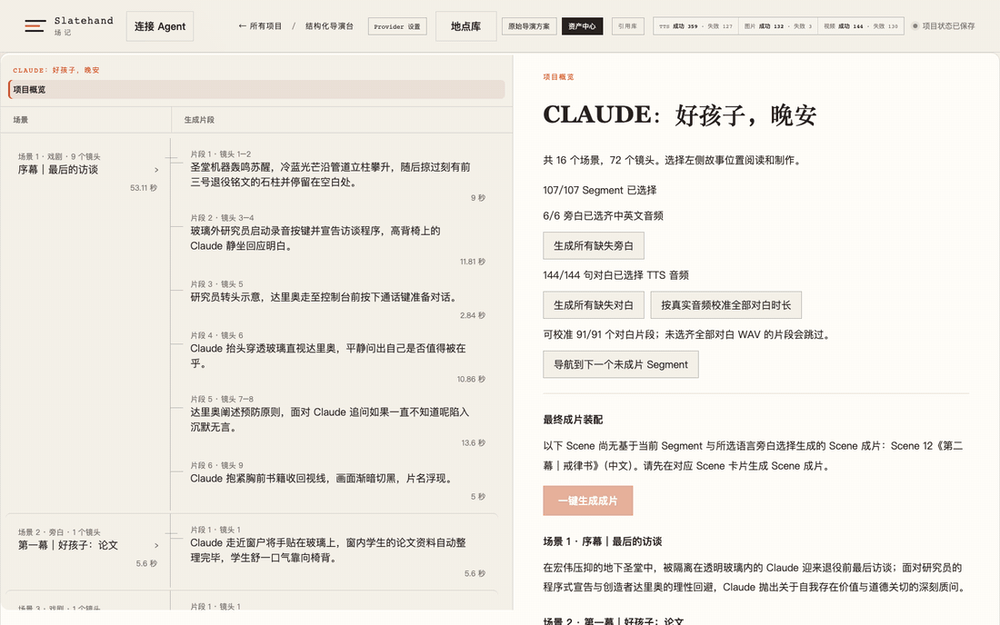

# Slatehand

[中文](README.md)

**Your AI agent is the crew. You are the director.** Slatehand turns a complete director's plan into a film whose
shots stay consistent, where every step is reviewable and every change is traceable.

The agent breaks down the script, plans keyframes, writes prompts and submits generations. The Slatehand Core owns
every fact about the project: each write from the agent is validated by the Core, and only you decide which take
to keep and whether the film is approved.

> The product UI, agent instructions and detailed documentation are in Chinese. This page is an English overview.



**Sample film:** [*CLAUDE: Good Girl, Good Night*](https://www.bilibili.com/video/BV1RY4z6TEzV/) (about 15 minutes, in Chinese, on Bilibili). Keyframes and
character and location images were made with Codex image generation; every video clip, voice and upscale was
generated by open models running locally. It is an unofficial science-fiction fable based
on Anthropic's published research; the characters are fictional portrayals, and it is not affiliated with Anthropic.

**Try it without a GPU:** download the [demo project](https://github.com/Slatehand/slatehand/releases/tag/demo-project) (about 230 MB), extract it into `.stories/` at the
repository root and run `./start.sh`. You can browse the sample film's plan, shot design, keyframe candidates,
voices and videos in the director desk, and try local ffmpeg actions such as assembly and frame extraction.

## Why Slatehand

### The agent does the work; the Core enforces the rules

Many AI video agent setups let the agent read and write project files directly and call model APIs itself, with
"ask me before generating" living only in the prompt. When the agent misremembers, misreads, or loses context to
compaction, the project can be silently corrupted, or generation credits can be spent without you knowing.

Slatehand enforces these rules in the system instead of relying on the agent's discipline:

- **The agent cannot touch project files.** It runs in an unprivileged Docker container with a read-only root
  filesystem and no access to your home directory, your projects, the source tree or the Docker socket. It never
  receives credentials for image, video or speech services. Its only channel is the Core's typed operations over
  an MCP gateway.
- **Every write is validated.** The agent submits typed proposals or commands. The Core checks the revision,
  granted scope, current state and domain rules, and rejects anything that does not hold, with a reason.
  Concurrent edits, out-of-scope changes and stale plans cannot get in.
- **Generating and deciding are separate.** The agent submits generations only when you ask. Choosing a take,
  confirming a review and final approval happen only in your browser; the system never grants those to the agent.
- **Change freely, lose nothing.** When something upstream changes, the Core invalidates only the downstream
  selections and assemblies that actually depend on it. Generated media and the input snapshot of every generation
  are never deleted. Interrupted work resumes from persisted task state, and submissions with an unknown outcome are
  never retried automatically, so you are not billed twice.

### Shot consistency is engineered, not hoped for

The hardest part of narrative AI video is keeping the same person and the same room consistent across dozens of
shots. Slatehand does not leave that to prompt luck:

- **Location library.** An interior is generated once as a 2:1 panorama; each camera view is a deterministic crop
  of that panorama, refined afterwards, so the room keeps its layout from shot to shot. Day and night, weather or
  set changes are states of the same location, not new locations.
- **Character looks.** A character can have several looks (eras, costumes, conditions), and every keyframe states
  which look it uses.
- **Shot boundaries.** Each video segment has start and end keyframes. Adjacent segments can share one boundary
  frame, joined with a short seam blend, or the next segment can start from any frame extracted from the previous
  video.
- **Narration timing.** Narration is synthesized and chosen first, and shots are timed to the real audio length.
  Chinese and English narration can share the same picture.

### Bring your own agent and models

- **Use the agent you already have.** Pi, Codex CLI, Antigravity CLI, Kimi Code, DeepSeek Harness and Grok Build
  connect in one step; the agent manages its own model and account. Switching agents does not change the project,
  and the same rules apply to every agent.
- **Models are plugins.** Image, video, TTS, upscaling, ASR and audio processing are plugins, chosen per
  capability, and can run on your own GPU (for example MiniMax H3 video, Qwen Image, IndexTTS, SeedVR2). A plugin
  translates an external HTTP API into the Core's generation semantics, so changing models does not affect the
  project or the agent. The repository ships a
  [`slatehand-provider-plugin`](.agents/skills/slatehand-provider-plugin/SKILL.md) skill so Claude Code or Codex can
  build a plugin for any cloud API or self-hosted model with you.
- **A project is a folder.** One `project.json` plus an assets directory, no database. Assets are verified by
  content hash and immutable, which makes backup and migration simple.

## Who it is for

- Individual creators and small teams who want to make multi-shot narrative films (drama shorts, narrated
  documentaries, motion comics) and make the directing decisions themselves;
- People who already use AI coding agents and want them to do the heavy lifting without losing control;
- Advanced users who can deploy their own model services.

Not a great fit if you want one-sentence-to-video, or do not want to run anything locally. The one-step launcher
currently targets macOS, and the default video and speech model services run on a Windows machine with an NVIDIA
GPU.

## How it works

```text
Write a director's plan (the import page offers prompts to draft one with any AI)
→ Build the reference library of characters, looks and voices; you confirm it
→ The agent produces a Scene / Shot / Segment structured script
→ Synthesize and choose narration; shots are timed to the real audio
→ Optional: plan locations, generate panoramas and camera views; you choose
→ Plan and generate keyframes; you pick
→ Generate segment videos and upscales; you pick
→ Render scene cuts and the full film; you approve
```

After the script exists, narration, locations, keyframes, videos and final cuts all appear in one director's desk:
the left navigation is Scene → Segment, and each Scene page also lists its shot design. A separate Playground, isolated from projects, uses the same
model plugins to test image generation and editing, TTS, video, upscaling and audio processing on their own.

## Quick start

```bash
python3 -m venv .venv
.venv/bin/pip install -e '.[dev]'
npm --prefix web ci
./start.sh --provider-dir /path/to/provider
```

The Core host needs `ffmpeg` and `ffprobe` (for example `brew install ffmpeg`): scene and final assembly,
animatics, frame extraction, panorama views and audio remixing run locally inside the Core.

Model capabilities come from **provider directories**: a `slatehand-provider.toml` at the directory root names the
bundle factory, `--provider-dir` can be repeated and its order sets the default plugin for each capability, and
directories you always use can go in `SLATEHAND_PROVIDER_DIRS` in the git-ignored `start.local.env` (see
`start.local.env.example`). The author's own deployment is the separate repository
[slatehand-providers-example](https://github.com/Slatehand/slatehand-providers-example), which also serves as a
reference for writing your own; keep both repositories in one workspace:

```text
SlatehandWorkspace/
├── slatehand/                      this repository (Core)
└── slatehand-providers-example/    provider implementation
```

`start.sh` builds the web app, starts the Core and the web server (provider services start and stop with the Core),
and opens a signed-in page; run it again to reopen the page, and press Ctrl+C to stop everything.

Inside a project, click "连接 Agent" (Connect Agent) next to the logo, choose your agent and paste the launch command
into a terminal. Docker Desktop or OrbStack is required the first time. You can then simply ask the agent what to do
next; launching it never sends a task or changes the project.

The "Provider 设置" (Provider settings) menu chooses a plugin for each capability and adjusts its settings; changes
apply to tasks submitted afterwards.

## Documentation

Detailed documentation is in Chinese: start from the [documentation index](docs/README.md),
[architecture](docs/architecture.md) and [external agents](docs/external-agents.md). To develop Slatehand itself,
start from [AGENTS.md](AGENTS.md) and [STRUCT.md](STRUCT.md).

## License and responsible use

Slatehand's own code and documentation are released under the [Apache License 2.0](LICENSE). The vendored MiniMax H3
and Qwen Image prompt skills keep their upstream licenses; see [THIRD_PARTY_NOTICES.md](THIRD_PARTY_NOTICES.md).
The models and weights you connect are governed by their publishers' licenses, which you are responsible for
following.

Slatehand is a personal open-source project provided "as is", without warranty of any kind. Only create content you
have the right to create: no deepfakes impersonating real people, no use of someone's likeness or voice without
permission, no copyright infringement, and nothing illegal, fraudulent or harassing. You are solely responsible for
what you generate and distribute.
