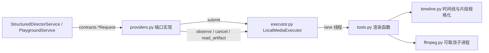

# core/media_tools

Core 本机执行的五个确定性媒体工具：Scene 成片与全片装配、Scene Animatic、按帧号抽帧、全景取景、
视频音轨重混。它们实现领域规则（接缝融合、旁白对轨、帧号、全景几何），不是可替换的模型能力，
所以不经 Provider 插件，也不需要任何远端服务。

## 运行要求

Core 主机需要 `ffmpeg` 与 `ffprobe`（`v360` 滤镜、`libx264`、`aac`）。按环境变量
`SLATEHAND_FFMPEG` / `SLATEHAND_FFPROBE` 或 `PATH` 查找；找不到时五个工具不注册，相关操作提示服务尚未配置。

## 结构

- `ffmpeg.py`：可执行文件发现、可取消子进程（取消时终止进程组）、`ffprobe` 探测与任务目录写入。
- `timeline.py`：成片与 Animatic 共用的时间线——片段统一为同一画布、24 fps、48 kHz 立体声，
  默认硬切，`seam_blend` 边界做不超过 `transition_seconds`（且不超过两侧时长一半）的淡化；
  旁白按起始片段的开始时间混入，旁白更长时冻结最后一帧补齐。
- `tools.py`：五个渲染函数，输入是 `core.model_providers.contracts` 的请求对象，输出是任务目录内的产物。
  全景取景单线程、bitexact，同输入逐字节相同。
- `executor.py`：进程内执行器。`heavy` lane（成片、Animatic、音轨重混）与 `light` lane（抽帧、全景）各 1 个并发；
  排队中的任务取消立即结束，运行中的任务取消会终止 ffmpeg。完成的任务目录保留 24 小时供读取产物。
- `providers.py`：五个端口实现，句柄 `plugin_id` 为 `ffmpeg.*`、版本 1。

## 生命周期

任务只存在于当前 Core 进程。Core 启动时清空工作目录（`.stories/.runtime/media-tools/`）；
重启前未完成的 Generation 再观察时得到 `local_task_lost` 失败，由用户显式重试。
