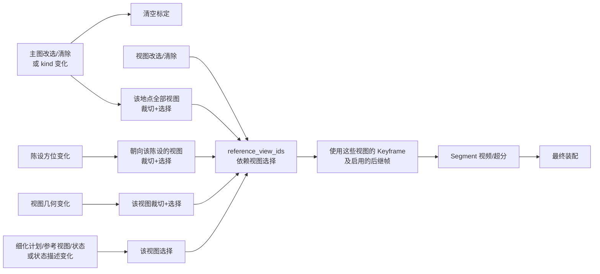
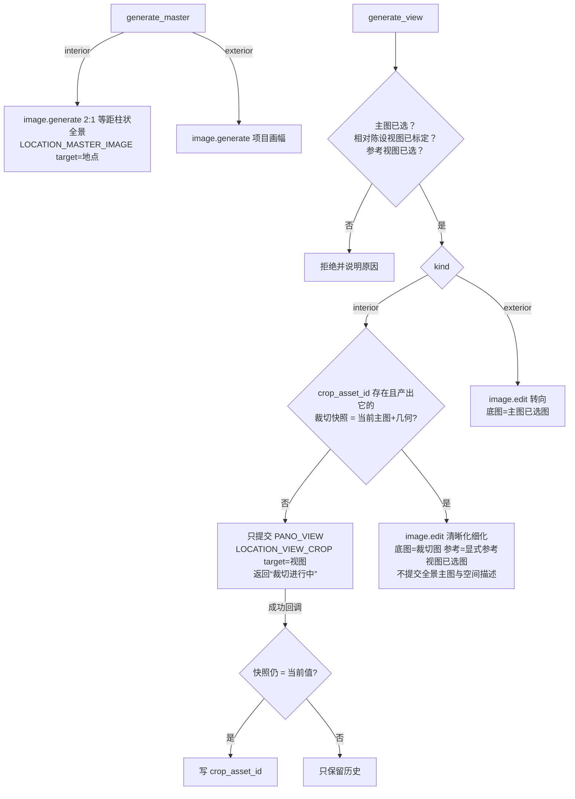
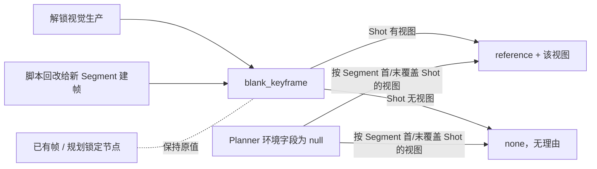

# Structured Director

本目录拥有 StoryRail schema v33 项目的结构化导演领域：模型、编解码、领域变换、Store、读取投影、媒体提交、Service 与
HTTP contract。`project.json` 的创建、读取、校验、revision compare-and-swap 与原子替换都在这里完成，它是唯一的项目写者。

行为说明在产品说明书中：[数据模型](../../docs/data-model.md)、[生产工作流](../../docs/production-workflow.md)、
[控制流](../../docs/control-flow.md)、[数据流](../../docs/data-flow.md)、[命令目录](../../docs/commands.md)。本文只说明代码组织。

## 分层

由 `tests/test_layer_rules.py` 守卫，只允许向下依赖：

| 层 | 位置 | 职责 |
| --- | --- | --- |
| L0 | `models/` | 不可变值对象与不变量 |
| L1 | `codec/`、`schema.py`、`errors.py`、`video_contracts.py`、`video_inputs.py`、`candidate_eligibility.py`、`script_index.py` | 严格 JSON 编解码、schema 版本、共享错误、视频输入与候选可选性判定、脚本访问层 |
| L2 | `mutations/`、`*_mutations.py`、`generation_lifecycle.py`、`assembly_timeline.py`、`narration_timing.py`、`dialogue_timing.py`、`production_context.py`、`run_state.py`、`asset_metadata.py`、`planning_inputs.py` | 纯函数领域变换、失效传播、时序与装配时间线 |
| L3 | `store/` | 唯一持久化入口：CAS、完整校验、fsync、原子替换 |
| L4 | `reads/`、`prompt_worksets.py`、`keyframe_requests.py`、`location_requests.py`、`director_steps.py`、`manual_commands.py` | 只读投影与输入编译 |
| L5 | `proposal_requests.py`、`proposal_request_guard.py`、`planning_proposals.py`、`reference_proposals.py`、`script_proposals.py`、`location_proposals.py`、`workflow_commands.py`、`application_requests.py` | 命令、proposal 生命周期与授权回执 |
| L6 | `service.py`、`media_submission/`、`generation_observer.py`、`external_batches.py`、`keyframe_batches.py`、`location_batches.py`、`production_commands.py`、`provider_ports.py` | 应用编排与 Provider 交互 |
| L7 | `http_api.py`、`http_requests.py` | HTTP 分派、严格请求解析与错误翻译 |

同层或向上的例外 import 必须登记在测试的 `DIRECTION_WHITELIST` 并注明理由；模块级 import 图无环。

## 模块

**应用与命令**

- `service.py`：`StructuredDirectorService`，持有项目 Store、`ProviderRegistry` 与两把 asyncio 锁（领域写入 / 外部应用请求），
  组合下列协作者；不内联持久化细节。
- `application_requests.py`：外部命令的原子回执、同 key 回放、生成请求 pending/uncertain 恢复。
- `production_commands.py`：生成、选择、装配等生产命令到 Service 用例的分发。
- `workflow_commands.py`：工作流确认（引用确认、脚本确认、视觉生产解锁）；解锁回执附未绑定地点提示。
- `manual_commands.py`：把 Web 手工编辑值对象翻译成与 Agent 相同的确定性命令（含地点编辑、标定与人类主图/视图选择）。
- `location_mutations.py`：地点库唯一 mutation：类型化操作、人类候选选择、删除引用检查与失效级联（见下文“地点失效”）。
- `errors.py`：命令、持久化与 HTTP 共享的领域错误类型。

**外部 proposal 与专业输入**

- `proposal_requests.py`：引用库、脚本、Keyframe、地点四类 proposal 共用的 request/get/submit/reject/cancel 生命周期。
- `proposal_request_guard.py`：proposal 请求的 caller 所有权与授权校验。
- `reference_proposals.py`、`script_proposals.py`：引用库与脚本冷启动的工作集、严格 parser 与 Store 调用。
- `planning_proposals.py`：Keyframe 规划的 proposal 处理。
- `location_proposals.py`：地点规划的项目级工作集与提交：proposal 编译成 `location.apply_operations` 的同一组操作，
  在 `LOCATION_PLAN` run 内经 `location_mutations.py` 原子落库（局部 key 映射、失效级联与手工编辑同源）并结束 run。
- `planning_inputs.py`：专业规划的纯输入构造（含局部 Keyframe 的完整 Scene 上下文、锁定节点与共享边界；地点规划的全部 Scene/Shot 与已有地点归属）。
- `prompt_worksets.py`：视频 recipe 与 Keyframe 专业工作集（实际 Provider 输入清单与 `<Picture N>` / `<Audio N>` / `<Video N>` 映射；视频另给已保存的 `recipe_inputs` 与当前 recipe 显式槽位的 `bindable_assets`），以及当前图片插件的提示词约定与随插件 Skill（`image_prompt_guide`）。

**生产**

- `keyframe_requests.py`：Keyframe 生成目标展开、图片输入编译与 instruction（预览与实际提交共源；见下文“Keyframe 使用地点视图”）。
- `location_requests.py`：地点主图与视图生成的前置检查、实际输入映射与名额、提示词编译（见下文“地点生成”）。
- `image_inputs.py`：单次图片调用的实际输入：按名额优先级去重、超过 `MAX_IMAGE_INPUTS`（5）时拒绝并列出被挤掉的输入、编辑底图排第一；Keyframe 与地点生成共用。
- `image_prompt_style.py`：按当前绑定图片插件的 `image_prompt` 约定解析输入图指代与画幅句；预览、工作集与提交共用。
- `video_inputs.py`：Segment 视频实际输入、输入签名、候选可选性、首帧抽取来源。
- `keyframe_batches.py`：Keyframe 波次执行（只提交依赖已满足的目标；前置帧未完成或地点视图未选图的帧留作等待项）。
- `location_batches.py`：地点成套生成批次（`location.generate_set`）的单轮执行：按固定地点范围分类
  当前可提交项（主图 / 室内裁切 / 细化 / 室外转向），经单项入口的内部提交函数提交；回调不续推进。
- `external_batches.py`：外部批次（Keyframe 波次与地点成套生成）的 start/continue、稳定 `batch_id` 与执行轮次关联。
- `director_steps.py`：确定性生产步骤与 Keyframe scope 硬约束。
- `generation_lifecycle.py`：Generation 重试签名、阶段与错误归类（不调用 Provider）。
- `candidate_eligibility.py`：候选可审核性的共源判定。
- `run_state.py`：DirectorRun 开始、唤醒与默认授权的对象变换。
- `production_context.py`：从快照构造只读生产上下文。
- `script_index.py`：脚本访问层：Scene 的 Segment 序列、Segment 覆盖的 Shot、派生可见角色与首尾视图；
  只读遍历经它读取，不直接访问 Scene 的存储形状。
- `provider_ports.py`：各媒体能力的 Core 侧窄 Protocol。
- `asset_metadata.py`：媒体字节校验、时长读取与可读文件名（封装 `core/media_assets`）。

## 关键约束

- 只有 Store 读写 `project.json`；用例模块不调用原子写入细节，也不新建 Store 或 Registry。
- 手工按钮、Agent 命令与 proposal 应用共用同一套 L2 变换与 Store 方法，不存在第二条写路径。
- Generation 的百分比与同阶段进度只在 Store 的内存观察缓存中，不写 `project.json`；阶段、句柄、取消意图、错误与产物持久化。
- Scene 成片有稳定的“当前文件”：重新装配成功后原子替换当前文件，上一版改名为带内容哈希的归档，旧 Asset 仍指向归档字节。
- Provider 只接收任务所需的受控字节与参数；`.runtime/` 不参与业务决策；Windows、CUDA、盘符、SMB 与模型安装不进入本目录协议。
- 不包含旧 schema 迁移、shadow document、双写或数据库；schema 变化后通过正常创建入口建立新项目。

## 地点失效

`location_mutations.py` 在一个事务里应用全部操作，再对比新旧地点库传播失效；写入、HTTP 人类入口与 `project.preview_impact`
共用同一纯函数，预览即实际影响。

- 改名、purpose、地点描述、陈设名称/描述、主光描述与方位、主图计划文本都不失效。
- Scene/Shot 改绑只改绑定（换地点时清空该 Scene 的 Shot 视图），不改写已建立的 Keyframe；生产基线同 ID 的绑定一起同步。
  Keyframe 的继承值在建帧时已写成显式 `environment_view_id`，级联只看这个字段，没有“隐式继承帧”。
- 删除视图或地点时，只被 Shot 软引用的允许删除，同一事务清空当前脚本与生产基线中这些 Shot 的 `view_id`，影响预览放在
  `soft_reference_clears`；被 Keyframe `environment_view_id`、其它视图 `reference_view_ids` 或 Scene 地点绑定硬引用时拒绝，
  错误列出全部引用者。状态与陈设仍被 Scene 或视图引用时拒绝。
- 失效目标（地点、视图、Keyframe、Segment、Scene、项目）有进行中或结果不确定的 Generation 时拒绝整笔修改。
- 历史 Asset 与 Generation 永不改动。

## 地点生成

主图与视图都是单目标生成：Web 卡片按钮（`POST /locations/{id}/master/generate`、`POST /location-views/{id}/generate`）
与 Agent 的 `location.generate_master` / `location.generate_view` 走同一用例，成功回调只保存候选，不自动选择、不续提交。

- 裁切 Generation 用 `location_crop_request` 冻结主图 Asset 与绝对机位（相对陈设的视图按当前标定换算 yaw），
  `provider_snapshot` 为空（Core 确定性工具），不分配 seed；裁切产物不是候选，不参与选择。
- 细化/转向与主图记录 `provider_snapshot`；声明 Seed 的图片插件由 Core 按目标递增分配 seed，重试沿用原 seed。
  三类重试都新建 Generation 并保留 `retry_of`，重试前重新编译的请求必须与原请求一致。
- 输入顺序：底图（室内为裁切图、室外为主图）→ 参考视图已选图；合计超过 5 张时拒绝并列出会被挤掉的输入（`image_inputs.py`）。
- 提示词：输入图对应关系位于顶部，指代与是否写画幅句跟随当前图片插件 `image_prompt` 约定，画幅最多写一次；
  室内主图写明等距柱状投影、无人物、左右边缘无缝，有方位的陈设与主光按“正前方/右侧/身后/左侧”描述；
  室内细化只做清晰化（保持构图、去除拉伸与模糊、补足细节，状态视图附状态差量），不附空间描述、陈设或正文；
  室外转向由 Core 写出相对主图的水平转向角、俯仰与景别，并附空间描述、可能可见的陈设与视图 purpose。
- 选择（仅人类）只接受属于该地点/视图、成功、未隐藏的候选；室内主图还必须满足全景裁切输入契约（2:1、PNG/JPEG、宽 1024–16384）。

## Keyframe 使用地点视图

- 继承只在建帧时发生（`models/keyframe.py::blank_keyframe`，解锁与 `script_mutations._rebase_keyframe_plan` 共用），
  之后 Shot 改绑不回写；重建时仍在的 Segment 沿用原帧。
- Keyframe Planner proposal 的 `*_environment_mode/view_id/none_reason` wire 必填可为 null：三者都为 null 由 Core 按本
  Segment 首帧/尾帧的默认视图填值（`keyframe_codec.resolve_keyframe_environment`，与 `blank_keyframe` 同一规则：默认视图
  来自首个/末个覆盖 Shot，无视图时 none、无理由）；显式 `none` 理由可选，
  edit/reference 必须给视图。规划锁定节点不产生字段修改。共享边界是同一个 Keyframe，两侧天然同视图同模式；
  `continues_from_previous` 时首帧字段必须为空并沿用左侧 Segment 的尾帧。
- `none` 理由只解释退出原因、不进入提交，所有入口都可选：Planner proposal、手工保存与预览（HTTP）和
  `keyframe.apply_operations` 统一经 `normalize_environment_none_reason` 把空白归一为 null、超过 500 字拒绝。
- 预览（`KeyframeSubmissionPreview`）逐图带 `input_roles`（地点视图、角色参考、前置帧、辅助参考）与 `purpose`（用途说明），
  取自实际输入编译 `ImageInputs.roles/mapping`；Web 弹窗据此展示底图或参考位置，不解析提示词文本。
- 视图未选图时允许规划；单帧生成拒绝：“请先选择视图图片，或把本帧改为 none”。Keyframe 批次把它当作未满足依赖：
  该帧不提交、留作等待项（“等待地点「X」视图「Y」选图”），批次观察标为 `dependency_blocked` /
  `location_view_unselected`，选图后需要显式继续。三处共用 `keyframe_pending_view` 判定。
- 输入名额：视图 → 可见角色参考 → 前置帧 → 辅助图，超额拒绝并按此顺序列出被挤掉的输入；提交顺序中编辑底图
  （`edit` 视图，否则启用首帧时的前置帧）排第一。
- 文案：`edit` 视图写“同一地点该机位的空环境，这是本次图片编辑的底图；保持其中陈设、材质与光线不变，只加入本帧的人物与动作”；
  `reference` 写“同一地点的空间参考；保持其中固定陈设、方位关系、材质与主光一致，只允许改变构图和景别”。
  对应关系置顶，指代与画幅句跟随 `image_prompt` 约定，画幅最多一次。
- keyframe 专业工作集：每个 Shot 带 `view_id`；`location_views` 列出全部视图的 `view_id/name/purpose`、所属地点
  `location_id/location_name/location_kind`、`state_id/state_name` 与 `selected_asset_id`。

## 地点卡快照

`reads/location_view.py` 为 HTTP snapshot 的地点库追加只读投影，持久化 codec 不包含这些字段。
库、地点、陈设和状态携带 `allowed_actions`；主图与视图携带 `production`：`status`、中文
`status_label/reason/generate_label`、`generation_step`（master/crop/refine/turn）、
`active_generation_id`、`candidate_generation_ids`、`selectable_generation_ids` 与 `allowed_actions`。
视图另有 `has_valid_crop`，按裁切请求快照与当前主图、几何比较；裁切始终不进入候选列表。

状态复用 `location_requests.location_set_items`；已选资源再次生成时，进行中/提交结果未知优先显示。
生成动作复用单项 plan 校验实际依赖和 Provider 可用性，并排除同目标非终态任务。
人类编辑/创建/改绑在项目未 Approval 且无活跃 DirectorRun 时开放；字段级冲突由影响预览与正式写入校验。
地点投影一次建立 `LocationActionIndex`，索引 Asset、目标 Generation、成功候选、引用者和实际使用关系；
状态分类复用该索引，不逐项扫描候选 Asset。删除、清除选择与候选选择复用写入路径的纯拒绝判定，
不试跑 mutation、不重建文档或传播选择清空。删除只被 Shot 软引用的视图开放，同一事务清空这些 Shot 的 `view_id`；
被 Scene、Keyframe 或其它视图硬引用的资源不开放，失效使用者包含非终态任务时也不开放相应动作；
同一选择是 no-op，保持可选。写入事务的引用检查使用当时的工作副本，任务冲突仍在最终提交处检查。
室内主图快照校验由 Store 按不可变 Asset 的 SHA-256 在进程内缓存（最多 4096 项），
首次读取并校验内容，后续快照和新 Service/Store 实例复用布尔结果；I/O 失败不缓存。
正式选择始终重新读取、校验 SHA-256 与全景字节约束，不使用该缓存授予写入。
Web 仅按这些动作和候选 ID 渲染，编辑、改绑与选择提交前调用 `project.preview_impact`，保存携带预览 revision。

## 地点成套批次

`location.generate_set`（Agent 白名单；MCP `media_batch` 的 `kind="location"`）一次授权生成若干地点的整套
参考图：`target_ids` 固定地点范围启动，`run_id` 携带原 `batch_id` 或任一 `execution_run_id` 继续。与 Keyframe
批次共用 `external_batches.py` 的 DirectorRun scope/cursor 与执行轮次关联：每轮建立并结束自己的 DIRECTOR run
（与 `LOCATION_PLAN` 等任何活跃 run 互斥），scope 持久化为 `location:<id>`；范围在开始时被 `scope_location_generation`
校验为现存地点，继续时被删除的地点只报告“已不存在”，不扩大范围。

单轮规则（分类与观察共用 `location_requests.location_set_items`）：未选主图且无进行中任务 → 提交主图；
主图已选 → 逐视图推进（室内无有效裁切先提交裁切，否则提交细化；室外提交转向）；已有成功未隐藏候选的项不重复
提交，报告等待选择；相对陈设未标定报告等待标定；参考视图未选定报告等待参考视图选择；同目标已有进行中任务计为
进行中。提交全部复用单项入口的内部提交函数（seed、provider_snapshot、重试签名同源）。本轮无可提交项时只写回执与
原因，继续需要新的显式 `location.generate_set`；裁切与候选回调都不触发下一轮。
