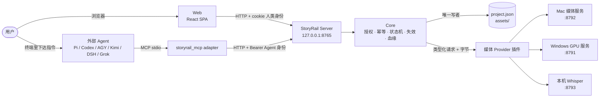

# StoryRail 产品说明书

本目录描述 StoryRail **当前**的产品行为与技术实现。它不记录决策过程或验收历史；那些属于本机
`wip/`（Git 忽略）。代码目录的模块职责见 [STRUCT.md](../STRUCT.md) 与各目录 README。

## 阅读顺序

| 文档 | 回答的问题 |
| --- | --- |
| [产品概览](product.md) | StoryRail 做什么、不做什么，核心概念与人工控制边界 |
| [系统架构](architecture.md) | 由哪些进程和模块组成，依赖方向，单写与并发模型 |
| [数据模型](data-model.md) | `project.json` v32 里有什么，每个实体的字段语义与约束（含地点库与失效规则），Asset 如何落盘 |
| [生产工作流](production-workflow.md) | 从导演方案到批准成片的每一步：谁触发、输入什么、产出什么、被什么门禁 |
| [控制流](control-flow.md) | 一个请求如何穿过 Server、授权、幂等、Store 与 Provider；Generation、proposal、批次、恢复 |
| [数据流](data-flow.md) | 旁白时序、地点图片、Keyframe 与 H3 的输入编译、Scene 成片与最终装配、失效传播、资产使用判定 |
| [命令目录](commands.md) | 全部 Core 命令、参数要点、谁能调用、回执语义 |
| [外部 Agent 接入](external-agents.md) | 本机一键接入、授权模型、MCP 工具、专业 Skill 与工作集、主流程读取 |
| [错误契约](error-contract.md) | Agent 面对的错误信封、分类与恢复策略 |
| [业务状态保护](business-state-protection.md) | Agent 不得直接改项目文件；唯一 break-glass 例外 |
| [Playground](playground.md) | 与项目平行的媒体实验台 |
| [媒体 Provider 与部署](providers-and-deployment.md) | Provider 插件与 manifest、全局 Provider 设置、默认 Mac + Windows 部署与 `start.sh` |

## 一张图看全局

## 术语速查

| 术语 | 含义 |
| --- | --- |
| Core | 进程内业务核心，所有业务事实的唯一 authority |
| Project / `project.json` | 一个视频项目及其唯一权威结构化状态（schema v32） |
| Scene / Shot / Segment | 叙事块 / 连续镜头 / 单次视频生成切片 |
| Cue | Scene 旁白，按项目所选中文或英文语言建立轨道 |
| Location / State / View | 跨 Scene 共享的固定空间 / 同一空间的可见状态变体 / Shot 可绑定的机位视图 |
| Keyframe | Segment 首帧或尾帧的静态时间锚点；默认以所属 Shot 的视图为编辑底图 |
| Asset | 内容不可变的媒体字节（SHA-256 校验） |
| Generation | 一次媒体生成或处理尝试，记录输入、参数、状态与产物 |
| Candidate / Selection | 成功 Generation 的产物 / 用户显式采用其中一个 |
| Approval | 用户对最终中英两版成片的明确批准 |
| `workspace_layers` | 已解锁内容层，单调累加 |
| Production baseline | Core 按真实旁白音频自动校准后记录的脚本快照，决定视觉生产是否有效 |
| DirectorRun | Core 持久化的领域长任务（proposal 请求、Keyframe 批次与地点成套批次的轮次） |
| ApplicationRequest | 外部写命令的持久幂等回执 |
| Proposal | 外部 Agent 提交的结构化草稿，由 Core 校验并分配 ID |
| Workset / Contract | Core 为某项专业能力构造的事实工作集 / Skill 正文 |
