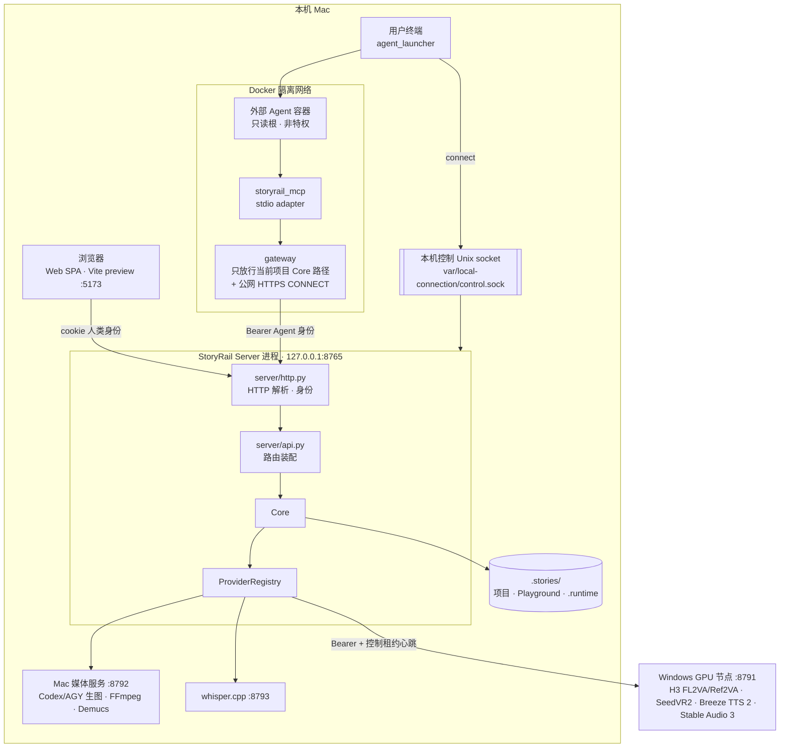
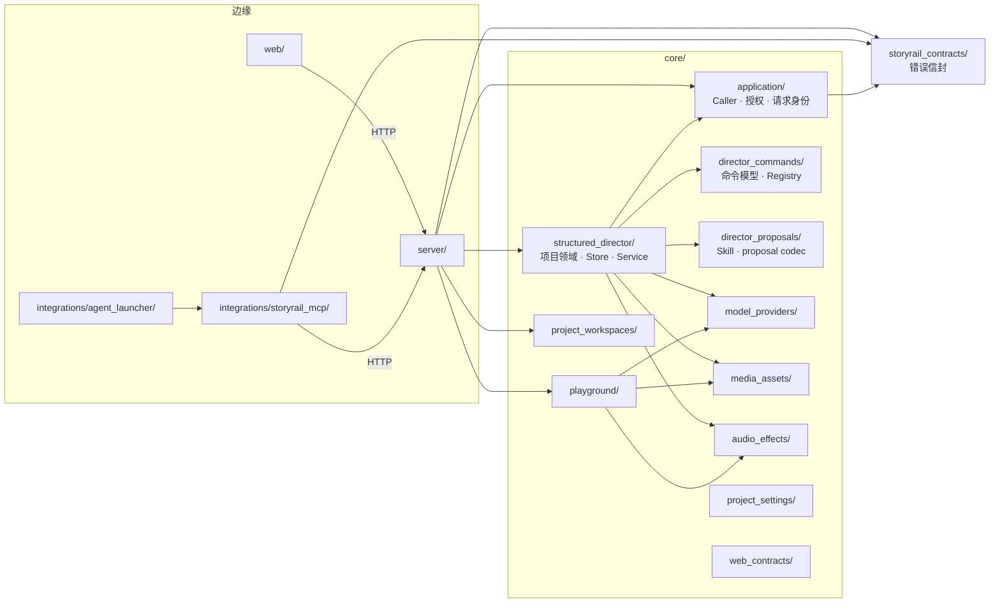
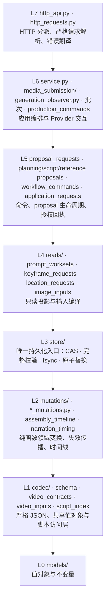
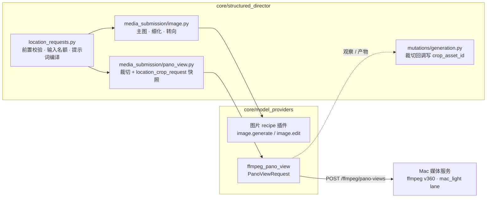
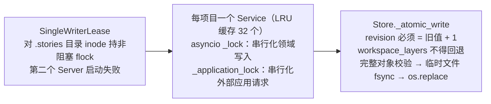

# 系统架构

StoryRail 是一个**进程内模块化单体**。Web、HTTP Server、MCP adapter 与 Agent 启动器位于边缘；Core 持有全部
业务规则；媒体 Provider 通过窄插件接口接入外部服务。所有依赖都指向 Core 定义的协议。

## 进程与部署视图



- Server 只允许监听回环地址；同一 `.stories/` 目录只能有一个写服务（见下文“单写”）。
- 外部 Agent 跑在用户终端启动的隔离容器里，只能经 gateway 访问**当前项目**的 Core 路径；它看不到作品目录、
  源码、Provider 或人类凭据。
- Windows、CUDA、SMB、模型安装等细节只存在于 `default_model_providers_implement/` 私有部署，不进入 Core 协议。
  部署细节见 [媒体 Provider 与部署](providers-and-deployment.md)。

## 代码模块



| 包 | 职责 |
| --- | --- |
| `core/structured_director/` | 项目领域：模型、编解码、纯函数变换、Store、读取投影、媒体提交、Service 与 HTTP contract；`project.json` 的唯一写者 |
| `core/director_commands/` | `DirectorCommand` / `CommandReceipt` 模型、严格参数 parser、按命令名分派的 Registry |
| `core/director_proposals/` | 六项专业 Skill 包与 proposal 严格 codec；不依赖任何 Agent SDK |
| `core/application/` | 服务端授予的 Caller、能力与 grant 校验、Agent 操作白名单、请求身份摘要 |
| `core/playground/` | 与项目平行的 Playground 领域（`playground.json`）；与项目包互不 import |
| `core/project_workspaces/` | `.stories/` 下的项目容器发现、受控 ID、移入回收站 |
| `core/model_providers/` | Provider manifest/recipe SDK、能力绑定、确定性工具请求、每个具体模型一个插件 |
| `core/media_assets/` | 与项目无关的媒体字节校验、时长读取、可读文件名、MP4 帧数 |
| `core/audio_effects/` | 无项目状态的确定性 WAV 截取与后处理 DSP |
| `core/project_settings/` | 画幅等项目设置值对象 |
| `core/web_contracts/` | 由 Core 类型生成 Web 合同（CI 校验新鲜度） |
| `storyrail_contracts/` | Agent 错误信封的唯一构造入口 |
| `server/` | HTTP 解析、身份认证、路由、Provider 装配、单写租约、本机控制通道、跨域资产复制 |
| `integrations/storyrail_mcp/` | 把固定 MCP 工具翻译成 Core HTTP 命令；不持有 Store |
| `integrations/agent_launcher/` | 在用户终端准备隔离容器、gateway 与原生 Agent |
| `web/` | React SPA；只消费 Core 快照、`allowed_actions` 与影响预览 |

## Structured Director 内部分层

`tests/test_layer_rules.py` 守卫：每层只能向下依赖。



- L0 模型都是 `frozen` dataclass，构造时即校验不变量；非法对象无法存在于内存中。
- L2 只接收对象、返回新对象，不碰文件；同一套变换被手工按钮、Agent 命令和 proposal 应用共用。
- L3 Store 是唯一调用原子写入的地方，所有写操作走 `commit_mutation(loader, mutator)` 骨架。
- L4 只读，不推进 revision；投影不授予权限，最终授权仍在提交时校验。
- 同层或向上的例外 import 必须登记在 `DIRECTION_WHITELIST` 并注明理由；函数体内不得 import `core` 兄弟模块；模块级 import 图无环。

## Authority 划分

| 决定 | 谁拥有 |
| --- | --- |
| 业务 ID 分配、实体存在性与邻接关系 | Core |
| 命令 schema、scope、授权、revision、幂等 | Core（`application/` + Registry + Store） |
| 当前选择、依赖失效、历史保留 | Core（L2 变换 + Store 校验） |
| Asset/Generation 血缘、Provider 提交与状态迁移 | Core |
| 领域长任务（proposal 请求、Keyframe 批次、地点成套批次）的 run/cursor | Core |
| 意图理解、专业创作、正文撰写 | 外部 Agent（只能以 proposal 或类型化命令提交） |
| 候选采用、审核确认、Approval | 人类（Web） |
| 媒体推理 | 外部媒体服务，经 Provider 插件 |

Web 不复制状态机：按钮是否可用只看 Core 返回的 `allowed_actions`，依赖与影响只看 Core 的预览。

## Core 确定性工具与地点生成链路

装配、Animatic、抽帧（`Tool.VIDEO_FRAME`）、全景裁切（`Tool.PANO_VIEW`）与混音是 Core 的确定性工具：同输入必得同字节，没有可选实现，
产物不是候选。它们和模型插件一样经 `provider_ports.py` 的窄 Protocol 提交、观察、取消与回收产物，只做媒体协议，不认识项目语义。



- 室内地点：主图是 2:1 等距柱状全景；视图先由 `PANO_VIEW` 按视图几何裁成项目画幅透视图（Core 直接写入 `crop_asset_id`），
  再由图片插件以裁切图为底图细化。室外地点：视图由图片插件以主图为底图转向编辑。两条路径都只新增候选，选择由人类完成。
- `PanoViewRequest` 在 Core 与媒体服务两侧各校验一次：源图 PNG/JPEG、宽高 2:1（±1px）、宽 1024–16384、≤ 64 MiB；
  yaw ∈ [0, 360)、pitch ∈ [-60, 60]、hfov ∈ [20, 120]、画幅 ∈ `16:9` / `9:16` / `2:1`。Playground 的 `image.pano_view` 复用同一校验。

## 单写与并发



1. **进程级**：Server 启动时对 `.stories/` 目录持有 `flock`，同目录第二个写服务直接拒绝启动。MCP 与 CLI
   只连接已有服务，从不自行打开 Store。
2. **项目级**：同一项目的写入在 Service 的 asyncio 锁内串行执行；Provider 网络调用与等待不持有业务写锁。
3. **提交级**：Store 每次写入都重新读取磁盘版本，要求新 revision 恰好是旧值 + 1、`workspace_layers`
   不回退、对象图整体合法，然后写临时文件、`fsync`、`os.replace` 原子替换。失败不留半写状态。
4. **请求级**：每个命令带 `expected_revision`；不等于当前 revision 即返回 `revision_conflict`，调用方必须重读。

当前只支持单进程、单 Store authority；不提供多进程文件事务。

## 持久状态布局

```text
.stories/
├── <项目名>-<project_id>/
│   ├── project.json            唯一项目 authority（schema v33）
│   └── assets/                 不可变媒体字节（路径规则见数据模型）
├── .playground/
│   ├── playground.json         唯一 Playground authority（schema v2）
│   └── assets/
├── .trash/                     Web 删除的项目被移到这里
└── .runtime/                   服务级本机状态，不是业务事实
    ├── providers.json          全局 Provider 能力绑定与插件设置
    └── breeze-tts2/            Breeze 插件本机状态
```

本机一键接入的控制 socket、caller 策略与连接文件位于 `--local-connection-directory`
（`start.sh` 默认 `var/local-connection/`，文件权限 0600），同样不是业务事实。

- 项目不使用数据库、shadow document 或双写；无法通过当前 schema 校验的目录不会出现在项目列表，也不会被改写。
- 外部 Agent 的工作区与对话由外部工具管理，Core 不读取。
- Generation 的百分比与同阶段进度消息只存在 Store 的内存观察缓存里，不写 `project.json`、不推进 revision；
  重启后由下一次观察重建。阶段、句柄、取消意图、终态错误与产物都持久化。

## 边缘职责

**Server**：严格解析 HTTP、认证 caller、路由到 Service、返回媒体字节；路由从不直接赋值领域状态。启动时装配
Provider 插件（见 [媒体 Provider 与部署](providers-and-deployment.md)）。`server/asset_transfer.py` 是唯一同时
接触项目与 Playground 两个 authority 的模块，只做人类发起的资产复制。

**Web**：`api/types.ts`（类型）、`api/validation.ts`（运行时严格校验）、`api.ts`（请求）分离；
`director_workspace/` 按业务编辑边界拆组件；`playground/` 独立。上传直接发送媒体字节，不把媒体编码进 JSON。
有活动任务时页面轮询 `POST .../generations/refresh` 推进 Provider 观察；局部保存携带编辑起点 revision，
冲突时保留草稿。导演台的导航是 Scene → Segment：Segment 标签显示覆盖的 Shot 区间与是否承接上一段；Shot 在 Scene 页
的“镜头设计”列表中编辑，并显示被哪些 Segment 覆盖。

**MCP adapter**：固定工具集，每个工具有严格嵌套 schema 与固定翻译；没有任意 command、shell、路径或 URL 工具。
详见 [外部 Agent 接入](external-agents.md)。

## 依赖守卫

| 规则 | 守卫测试 |
| --- | --- |
| structured_director 分层只能向下依赖 | `tests/test_layer_rules.py` |
| 纯领域模块不获取文件或运行时 authority | `tests/test_domain_module_boundaries.py` |
| Playground 与项目包互不 import | `tests/test_playground_boundaries.py` |
| 不存在厂商 Agent runtime 模块或注入 | `tests/test_runtime_exit.py` |
| 命令表、HTTP 路由矩阵与实际实现一致 | `tests/test_command_registry_table.py`、`tests/test_http_api_route_matrix.py` |
