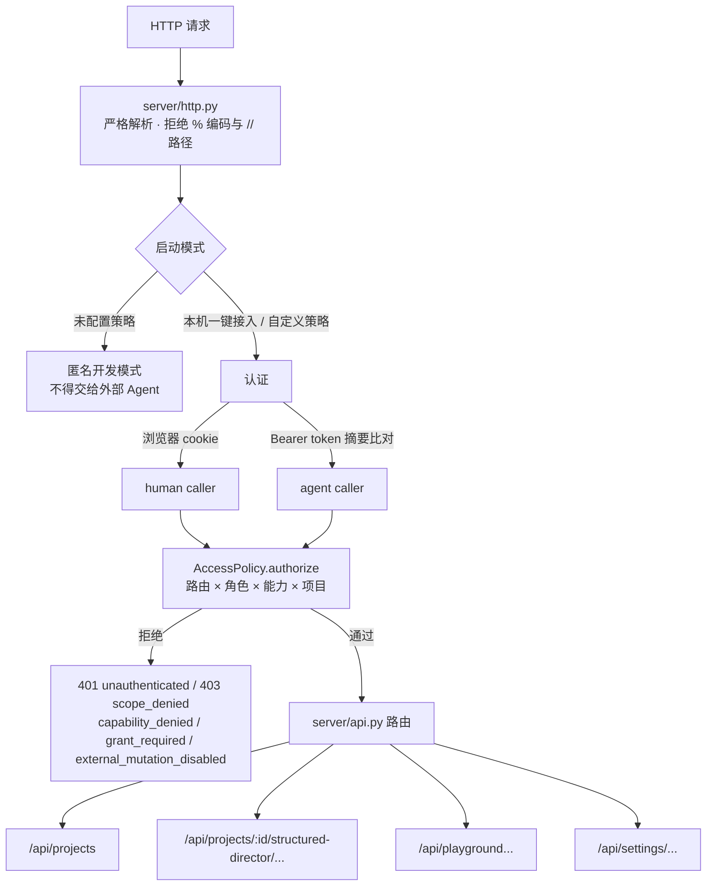
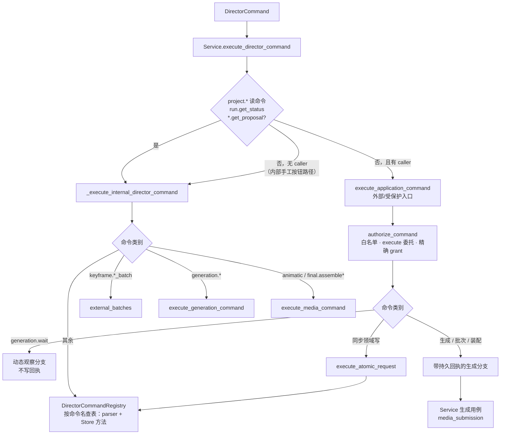
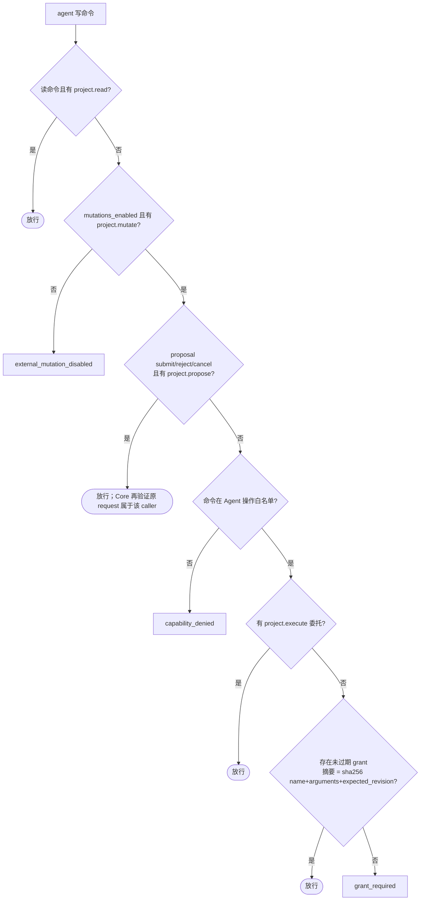
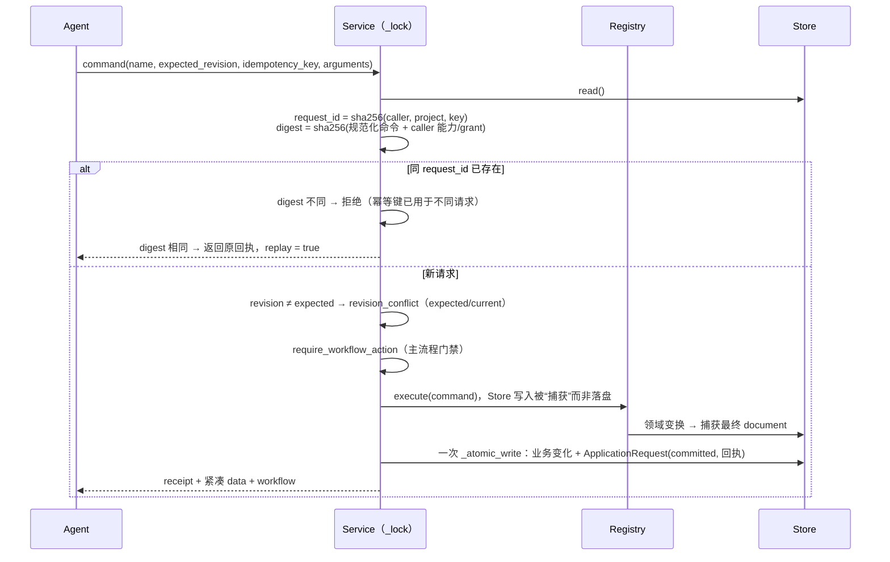
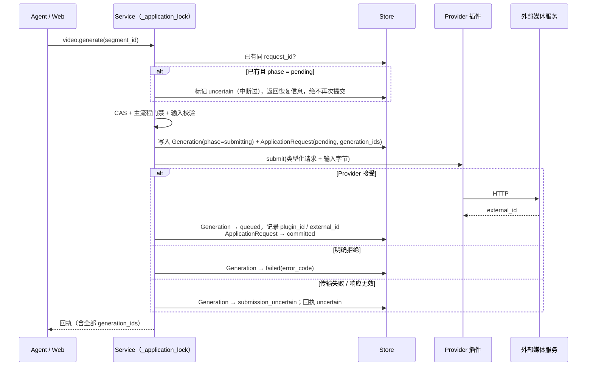
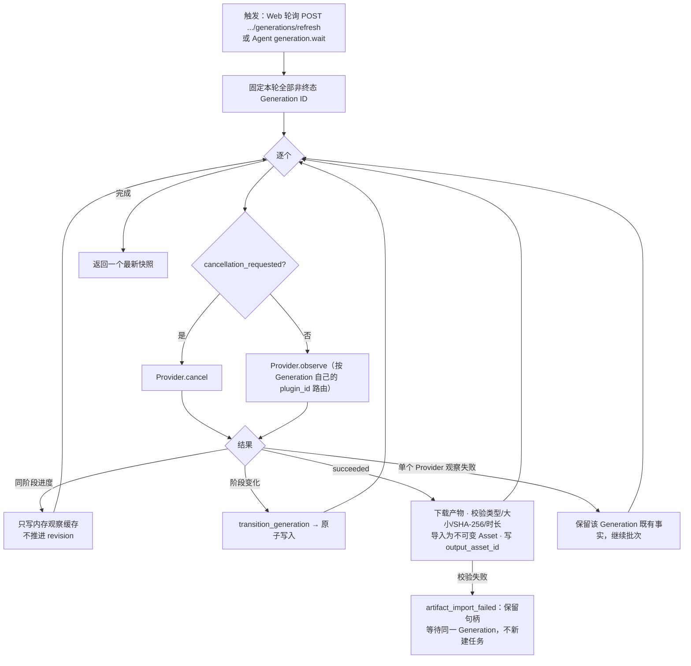
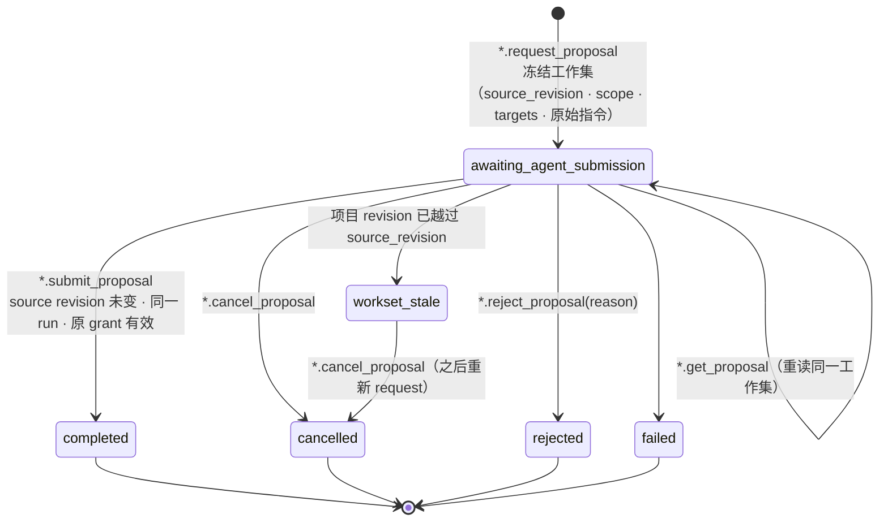
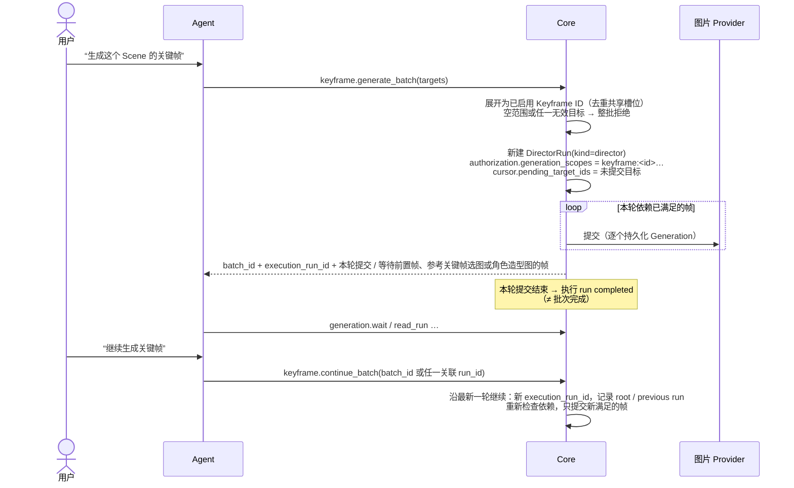
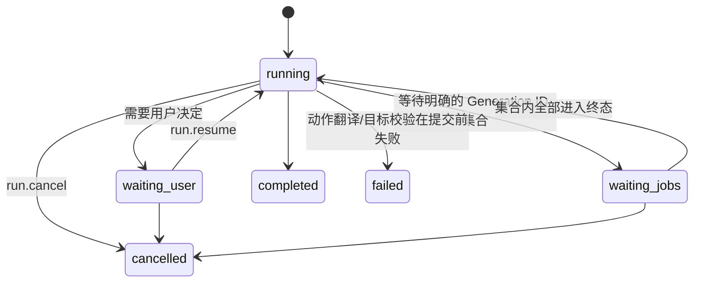
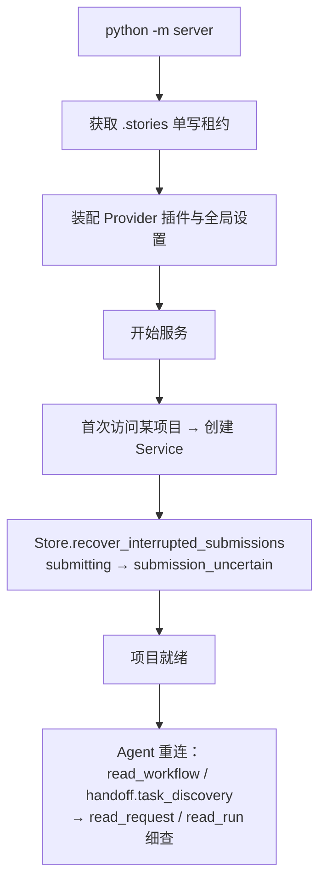

# 控制流

本文描述请求如何穿过系统：身份与授权、命令分发、幂等与 CAS、原子提交、Generation 生命周期、外部 proposal、
Keyframe 批次和重启恢复。数据结构见 [数据模型](data-model.md)，命令清单见 [命令目录](commands.md)。

## 1. 请求入口与身份



- caller 由服务端签发：`id`、`role`（human / agent）、`project_ids`、`capabilities`、`expires_at`、精确 `grants`。
  请求正文永远不是身份来源，模型自报的角色、scope 或“用户已批准”都不授予任何能力。
- 能力：`project.read`、`project.mutate`、`project.propose`、`project.execute`、`playground.use`、
  `human.write`、`workspace.manage`、`diagnostics.read`。
- 授权规则摘要（`core/application/caller.py`）：

| 路由 | 允许 |
| --- | --- |
| `/api/settings/providers`、`/api/settings/providers/*` | human + `workspace.manage`，GET/PUT |
| `/api/projects`（列表、创建） | human + `workspace.manage` |
| 项目内 GET | human + `project.read`；agent 只能 GET Asset 内容 |
| 项目内 `POST .../commands`、`.../application/commands` | 读命令：`project.read`；agent 写命令：见第 3 节 |
| 项目内其它写路由 | human + `human.write`；agent 一律 `external_mutation_disabled` |
| `/api/playground*` | human + `human.write`；agent 只有 `playground.use` 且只能 `POST /api/playground/commands` 白名单命令 |

## 2. 命令信封与分发

所有类型化写入都以 `DirectorCommand` 进入 Core：

```json
{"name": "script.apply_operations", "expected_revision": 42, "idempotency_key": "…", "arguments": {}}
```



Registry 用单一模块级命令表声明每个命令的 parser、Store handler 与 scope 规则；proposal、workflow 与领域命令都走同一
查表入口。parser 拒绝缺失字段、未声明字段、错误类型、无效枚举、重复或格式错误的 ID；Store 继续校验存在性、实体类型、
scope、邻接、业务状态与完整对象图。

**Web 手工按钮与 Agent 命令最终进入同一个类型化 handler**；UI 没有任何直接赋值状态的路径。

## 3. Agent 写入的授权判定



- Agent 操作白名单只包含编辑计划、单目标生成、批次、装配、Generation 观察/取消/重试/隐藏、proposal 请求、run 取消与
  旁白解绑与 Keyframe 候选采用；**不包含**其它候选采用、审核确认、Approval、重新开放、repair 或旧写路由。
- 本机一键接入为当前项目签发 12 小时的 `project.execute` 委托，覆盖整个白名单；没有委托的部署必须为每条命令签发精确 grant。
- 每次重放也重新授权；撤权后旧幂等键无法恢复权限。

## 4. 同步写命令：原子回执



- 业务变化与回执在**同一次**原子替换中落盘：要么都在，要么都不在。
- 同步命令只允许一次 Store 提交；嵌套应用事务被拒绝。
- 目标已处于请求状态时返回 `noop`，不推进业务内容。
- Agent 专用 `/application/commands` 的写响应只返回 workflow、完整回执、ApplicationRequest/replay 与紧凑目标 data，
  不附带全项目快照；人类 `/commands` 可在需要时附带 Web 快照。两者共用同一执行与回执。

### 回执（`CommandReceipt`）

`command_id`、`status`（succeeded / noop）、`old_revision`、`new_revision`、`changed_ids`、`invalidated`、`preserved`、
`decision_summary`、`applied_summary`、`assumptions`、`warnings`。最新主流程建议在响应顶层 `workflow`，而不是回执里。

### 脚本原子操作与覆盖校验

`script.apply_operations` 在一个显式 `scope.scene_ids` 内按顺序原子执行 1–100 项操作：`update_scene_fields`、
`insert_scene`、`move_scene`、`delete_scene`、`update_shot_fields`、`insert_shot`、`delete_shot`、
`update_segment_fields`、`insert_segment`、`move_segment`、`delete_segment`、`split_segment`、
`merge_adjacent_segments`。不支持单独移动 Shot；需要重排或跨 Scene 迁移 Shot 时走脚本 proposal 的 `replace_scene`
整卡替换，或在同一 patch 内删除并重新插入、同时补足覆盖。

- Segment 以 `scene_id` 为容器；已有 Scene 的 Segment 用 `shot_ids` 表达覆盖，新 Scene 的 Segment 用本 Scene
  新 `shots` 数组的 `shot_indexes`。
- `insert_shot` 必须且只能给出 `attach_to_segment_id`（并入已有 Segment 的覆盖）或 `new_segment`（新建一个只覆盖
  新 Shot 的 Segment）之一。
- `split_segment` 的 `first` / `second` 各自给出完整 `shot_ids`；在某个 Shot 内部拆分时两段共享该 Shot，第二段必须带
  `boundary_from_previous`。`merge_adjacent_segments` 只接受同一 Scene 中真实相邻的左右 Segment，合并后的 `shot_ids`
  必须是两段覆盖的并集。

整批操作先应用在内存草稿上，结束后构造完整 `DirectorScript` 做一次覆盖校验：每个 Segment 连续覆盖、按顺序拼接后
恰好覆盖全部 Shot，不跳过、不倒序、不重复，只允许相邻 Segment 共享边界 Shot；失败则整批拒绝并指出 Scene 与原因。
成功时同一次写入重建 Keyframe/视频绑定与生产基线。

## 5. 生成命令与 Generation 生命周期

### 提交



关键规则：

- **先持久化、后调用**：Generation 以 `submitting` 落盘后才触网。进程若在提交窗口崩溃，重启时 Store 把所有
  `submitting` 迁移为 `submission_uncertain`，同时把 `pending` 回执标为 `uncertain`。
- **未知提交绝不自动重试**：`submission_uncertain` 只能由人或 Agent 先核查，再显式 `generation.retry`（由新 Generation 接替）
  或 `generation.dismiss`（放弃）。处理之前它占用目标、计入 `active_generation_count` 与 `task_discovery.active`，并阻止删除其输入；
  隐藏或已有 retry child 后即视为已处理，不再阻塞。判定集中在 `models/generation.py::unresolved_uncertain_ids`。
- 同一应用请求产生的多个 Generation（如批次一轮）全部记入同一回执；用原 key 重试只回放。
- Provider 网络调用不持有项目业务写锁。
- **Core 确定性工具**（抽帧 `VIDEO_FRAME`、全景取景 `PANO_VIEW`）走同一套 submit/observe/cancel/read_artifact 生命周期，
  `provider_snapshot` 为 null。全景取景先创建普通地点图片，以新图片为 target 并记录 `panorama_capture_request`；成功回调导入
  不可变 Asset 并直接设为该子图的选择。父全景图与角度只作为冻结 provenance，不形成活依赖。

### 观察与产物回收



- 本轮观察期间新产生的依赖任务留到下一轮，避免单轮无界扩展。
- **观察从不扩大生成授权**：单目标完成后只导入该目标产物，不触发任何其它目标；批次的下一波必须显式 continue。
- `generation.wait` 是动态观察：对明确的 Generation ID 集合最多等待约 18 秒（默认，每 2 秒一轮），
  在 MCP bridge 20 秒超时前返回 `wait_again`。Provider 事实无变化时不写 ApplicationRequest、不递增 revision；
  因此断连后可以安全再次 wait，但上一次响应不代表当前状态。wait 不校验 `expected_revision`，可以省略：Generation 回调本身
  会推进 revision，观察动作不应因此冲突。

### 取消、重试、隐藏

| 动作 | 前置 | 行为 |
| --- | --- | --- |
| `generation.cancel` | 非终态 | 先持久化 `cancellation_requested = true`，再调用 Provider；HTTP 失败时意图仍保留，后续观察沿原句柄继续确认取消 |
| `generation.retry` | `failed` / `cancelled` / `submission_uncertain` | Core 从**当前项目事实**重建 target、prompt、mode、seed、输入与参数，与原规范化签名逐项比较；任何业务输入变化都拒绝（新的相似生成不能伪装成重试）；通过则创建带 `retry_of` 的新 Generation；已有 retry child 时返回 noop |
| `generation.dismiss` | 未被当前业务对象采用 | 只隐藏候选卡片，不删除 Generation 或 Asset |

## 6. 外部 proposal 生命周期

引用库、脚本、地点、Keyframe 四类专业规划共用同一生命周期（`proposal_requests.py`），持久任务复用对应
kind 的 `DirectorRun`（`reference_proposal`、`script_proposal`、`location_plan`、`keyframe_plan`）。



- `awaiting_agent_submission` 表示**当前外部 Agent** 应基于冻结工作集撰写并显式 submit；Core 后台没有任何模型在跑。
- request 回执保存原始用户指令、scope、目标与完整 Core 工作集（`raw_user_instruction` 与 `core_facts` 分开）；
  get 与重放恢复同一输入，不会根据当前环境偷换工作集。
- submit/reject/cancel 需要 `project.propose`，并验证原 request 属于当前 caller、原 grant 未撤销；Agent 不能借
  request_id 接管其它 caller 的任务。拒绝与取消在 run 上都是 `cancelled` 终态，投影按回执 outcome 区分 `rejected` 与 `cancelled`。
- 迟到的 submit（已取消/拒绝/完成/过期）被拒绝。
- 已有引用库不能被首次请求覆盖；脚本 request 只用于无脚本的冷启动。
- 地点 request 是项目级 scope，要求已有结构化脚本（否则 409）；规划期间 `location_plan` run 锁住其它业务写入。submit 把 proposal
  编译为与 `location.apply_operations` 相同的操作（新建地点、陈设、状态与图片用局部 `key` 互引），在同一次提交里落库并结束 run；
  图片说明为空、来源不属于同一地点或 Scene/状态归属不合法时整体拒绝为 `invalid_proposal`。
- Keyframe 请求可读目标 Segment 所属完整 Scene 作上下文，但 proposal 只能覆盖原请求的 `target_ids`（Segment；给 Scene
  表示其全部 Segment）；触及跨范围共享边界时拒绝，并给出最小扩展范围让用户重新授权。
- 地点仍被 Scene 绑定时拒绝删除并列出引用者；地点图片没有 Shot/Keyframe 硬引用，删除条目只保留历史 Asset、Generation 与
  已生成的全景子图。地点修改不产生 Keyframe、视频或装配失效。
- 观察投影 `proposal_observation` 同时给出 `source_revision` 与本次 `observation_revision`，以及同一 request_id 的精确工具动作。

## 7. Keyframe 批次



- 每个 start 建立独立稳定 `batch_id`；每轮使用新的 `execution_run_id`，在原回执中保存 root/previous 关联与原目标。
  continue 不能携带新范围，也不能凭目标相同合并两个独立批次。
- 依赖包括前置帧已有成功候选、参考关键帧与参考地点图片已有选中图（`dependency_kind = reference_keyframe` / `reference_location_image`），以及每个显式选择的角色造型已有造型图。未满足的帧留作等待项并写明原因；满足后同样需要
  显式 continue。地点图片不是 Keyframe 绑定或批次依赖；只有人类已加入 Segment 辅助参考的 Asset 才作为普通显式输入。
- 批次跳过已有成功候选或已选 Asset 的帧；要为这类帧追加候选，使用单帧 `keyframe.generate`。
- 空提示词的帧被拒绝；不存在内置 Planner 兜底补写。
- `batch_observation` 从原范围、各轮回执与当前 Generation 动态派生逐目标状态，区分：等待 Generation、等待显式 continue、
  依赖阻塞（例如 `dependency_kind = predecessor_keyframe`，`dependency_target_id` 为前置 Keyframe ID）、失败/取消/
  提交不确定、全部成功。读取从不提交下一波或自动重试。
- 中断时先读 request 与 run；原 run 未结束时必须先显式取消它，再以原 batch 身份继续，不扩大范围、不重复已有提交。

### 地点成套批次

`location.generate_set` 复用同一批次骨架（单活跃 run、`begin_production_instruction` 建立 `director` run、回执关联、`batch_observation`），
一个命令两种参数：`{target_ids: [image_id…]}` 启动，`{run_id}`（`batch_id` 或任一 `execution_run_id`）继续；MCP 都经
`media_batch`（`kind=location`）。范围持久化为 `location-image:<id>`，开始时校验图片存在且不重复。

```mermaid
flowchart TB
    start[start / continue] --> items[location_set_items：逐个独立图片分类]
    items --> ready{ready?}
    ready -- 是 --> g[按图片 kind 和显式参考图提交 generate / edit]
    ready -- 否 --> why[in_progress · awaiting_selection · selected ·<br/>failed · target_missing …]
    g & why --> done[本轮结束，执行 run completed<br/>继续须再次显式 generate_set(run_id)]
```

- 分类函数 `location_requests.location_set_items` 同时服务提交与观察；判定顺序与 Keyframe 批次一致：进行中 → 提交不确定 →
  已有成功候选（等待选择）→ 失败/取消不自动重试 → 前置校验。
- 批次只调用单项入口的锁内提交函数，seed、`provider_snapshot` 与重试签名逻辑与单项生成相同；全景取景不进入成套批次。
- 每轮结束自己的 run，不进入 `waiting_user`：等待的正是人类选择图片，活跃 run 会挡住选择。等待由观察 phase
  （`awaiting_selection`、`blocked_on_dependency`、`awaiting_explicit_continue`）表达；批次观察带 `batch_kind = location`，与 Keyframe 批次不混淆。
- 图片或所属地点被删除时该项报告 `target_missing`，范围不扩大。

## 8. DirectorRun 状态



- 同一项目最多一个非终态 run；它与业务审核状态正交。
- `waiting_jobs` 只等待当前步骤明确给出的 Generation ID；建立后出现的无关任务不加入；
  `succeeded` / `failed` / `cancelled` / `submission_uncertain` 都算终态。
- 命令完成与 cursor/回执更新原子持久化；重启后跳过 `completed_command_ids`，已提交的 Provider 任务不会重发。
- `run.cancel` 只停止后续步骤并释放 active run；已提交的 Provider 任务、候选与 Asset 保留，不会被隐式取消。

## 9. 读取路径

| 读取 | 用途 | 特性 |
| --- | --- | --- |
| Web 快照（GET structured-director） | 人类导演台 | 完整快照 + `allowed_actions` + Asset 使用状态 + 内存进度 |
| `project.get_projection` / `read_story` | 故事语义投影 | 显式 scope；outline/scene/shot/segment 分层；默认长文本截至 240 字符（`text_mode=preview`），`extensions=["text"]` 取完整正文；`limit` 默认 30、最大 100 |
| `project.locate_story` | 把“场景 N－镜头 N”或“场景 N－片段 N”解析为稳定 ID | 只读 |
| `project.get_contract` / `get_workset` | 专业 Skill 与工作集 | 超过 64 KiB 自动切成 ≤ 24 KiB UTF-8 chunk；cursor 绑定 project/revision/capability/scope/targets/page size/内容 SHA-256，拼接后校验摘要 |
| `project.get_workflow_state` / `get_handoff` | 主流程与人类交接 | 见 [外部 Agent 接入](external-agents.md#主流程读取) |
| `project.get_request` / `run.get_status` | 恢复 | 只返回紧凑状态与恢复入口，不重复展开大型工作集 |
| `project.list_candidates` / `get_dependencies` / `preview_impact` | 候选、依赖、影响预览 | `preview_impact` 复用正式 parser 与影响计算，与同 revision 真实执行结果一致 |
| `project.get_asset_manifest` + Asset content | 实际媒体字节 | 仅 PNG/JPEG/WebP/WAV/MP3，单项 ≤ 8 MiB，核对 MIME/长度/SHA-256 |

- 只读命令可省略 `expected_revision` 读取最新快照；显式给出时精确读取，不匹配返回 expected/current。
- 通用读取受 128 KiB / 500 对象信封约束，超限明确报错要求缩页，不静默截断。
- 所有 cursor 绑定 revision 与完整查询；revision 或查询变化后必须从第一页重读。cursor 不是授权 token。

## 10. 启动与恢复



恢复原则：

1. 业务事实只从 `project.json` 恢复；外部 Agent 会话丢失不等于业务任务丢失。
2. 先读原 request / run / Generation，再决定下一步；丢响应只用**原参数、原 revision、原幂等键**重放取得 Core 原回执。
3. 写请求不得换 revision 自动重试；未知提交不得盲目重提。
4. 协议层取消（MCP 请求取消、进程退出）只终止等待，不是业务取消；业务取消必须显式调用对应命令。
