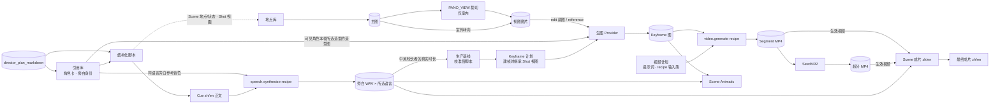
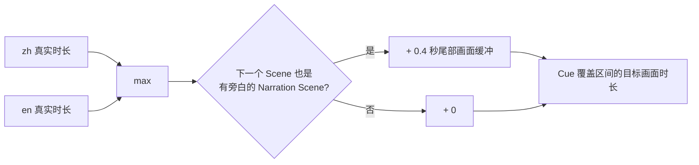
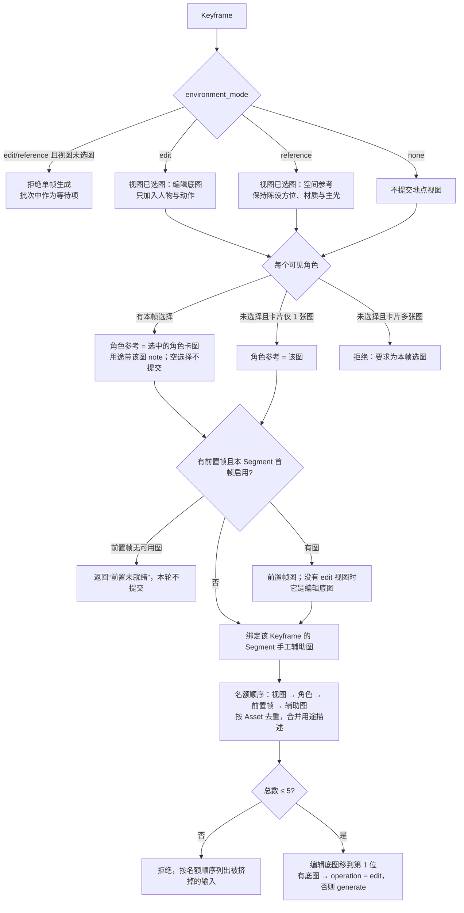
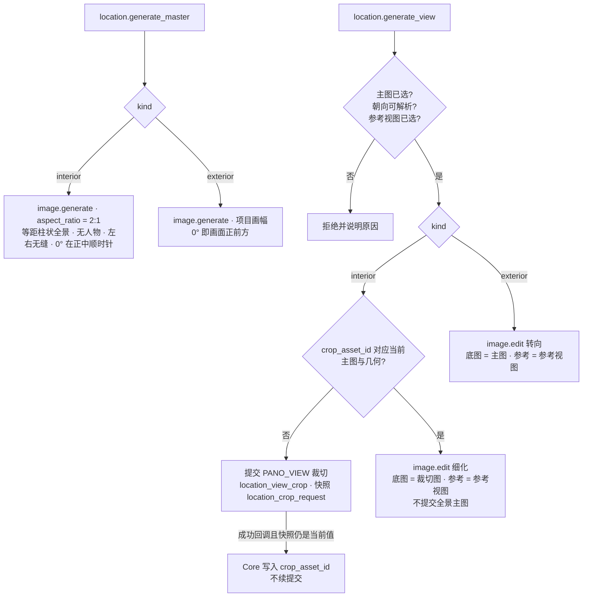
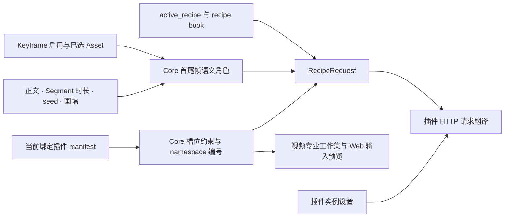
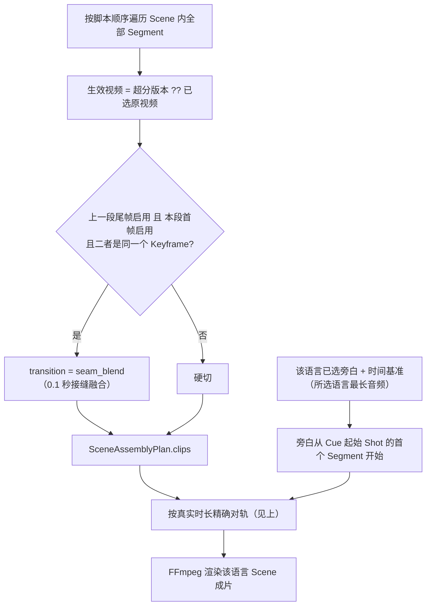
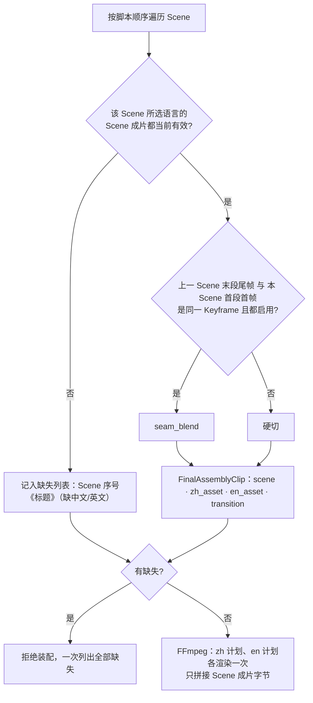
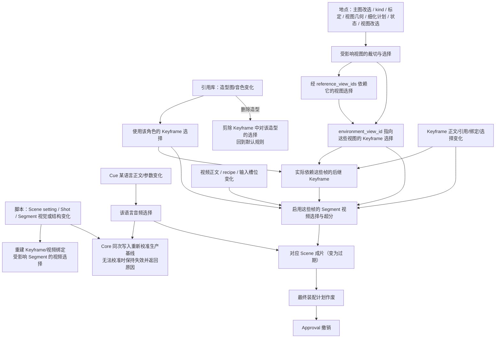
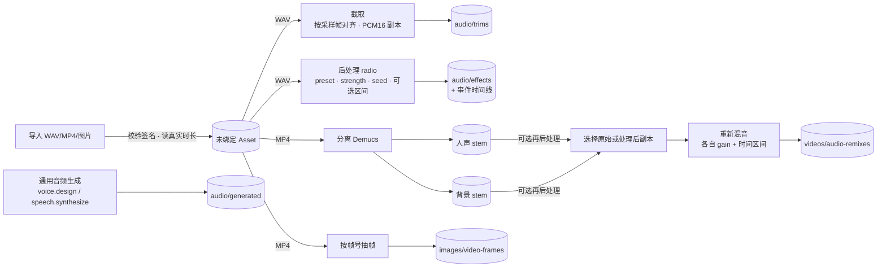

# 数据流

本文描述数据在生产链路中如何被编译、组合与失效：旁白时序、地点图片、Keyframe 与视频 recipe 的输入编译、Scene 成片与最终装配、
失效传播、资产使用与删除，以及资产中心的处理链。流程顺序见 [生产工作流](production-workflow.md)。

## 生产数据总览



## 旁白时序

### 时间基准

每条 Cue 只包含项目所选语言的音频。单语言的时间基准是该音频真实时长；双语言的**时间基准 = 两者真实时长中较长的一条**（等长取中文）。双语言从同一起点开始，
短的一条提前结束。Scene 成片的中、英两版画面完全一致，只换旁白音轨；因此一版成片的输入血缘同时包含两种语言的
已选旁白，任一语言改选都会让两版 Scene 成片一起过期。

### Narration Scene 的画面长度



- 0.4 秒缓冲只加在前一个 Scene 最后一个 Shot 的结尾，不按 Segment 重复累加；它让下一段旁白开始前形成确定性的呼吸间隔。
- 规划 Shot/Segment 时，Core 把真实时长、缓冲值与目标画面时长一起提供给 Agent。
- 旁白层解锁后的每次脚本/旁白写入，Core 都按同一规则把 Cue 覆盖范围内的 Segment 时长等比校准到目标值（余数落在最后一个
  Segment），并在同一次写入里写入生产基线；覆盖区间已对齐（误差 ≤ 1e-6 秒）时保持原值，重算不改写时长。
- 同一个确定性函数（`narration_timing.py`）被脚本规划、生产基线、Animatic 与成片装配共用。

### 装配时的精确对轨

装配时 Core 用**已选视频的真实时长**（不是脚本预估）重新计算时间轴：

- **Narration Scene**：从 Cue 起始 Shot 的第一个 clip 到结束 Shot 的最后一个 clip，考虑接缝重叠后，画面区间必须
  精确等于目标画面时长。Core 迭代调整该区间**最后一个 clip** 的时长（裁切或补足，最多 24 轮收敛）；需要的调整使该
  clip 短于 0.05 秒时拒绝，提示缩短前序视频或调整 Cue 的 Shot 范围。
- **Drama Scene** 没有旁白，不参与对轨，按已选视频真实时长拼接。
- 不用延长整部成片来掩盖局部时长不足。

## Keyframe 输入编译

单个 Keyframe 生成时，Core 从当前项目事实编译有序输入图与 instruction（`keyframe_requests.py`），
顺序就是 Provider 输入顺序，并原样记入 `Generation.input_asset_ids`。



前置帧图取其已选 Asset；未选择时取最近一个成功、未隐藏的候选。最终提交给图片 Provider 的 instruction 结构固定：

```text
输入图对应关系（按实际传入顺序，禁止混淆身份）：
第 1 张输入图「<可读名>」：<用途>
第 2 张输入图「<可读名>」：<用途>
…
项目固定画幅：16:9。关键帧硬约束：只生成一张单一静态画面……（Core 固定文本，画幅只在这里出现一次）

本帧创作正文：
<Keyframe.prompt_text>
```

输入图的指代与画幅句跟随当前绑定图片插件 manifest 的 `image_prompt` 约定，预览、工作集与提交共用
`image_prompt_style.py`：

| 约定 | 未声明（Codex / AGY） | `qwen_image` |
| --- | --- | --- |
| 输入图指代 | `第 N 张输入图` | 按 `label_namespaces` 写 `<imageN>`；只有一张输入图时写 `图片` |
| 画幅句 | 写 `项目固定画幅：…` 与保持画幅要求 | 不写；画幅由插件画布保证 |

- 图片对应关系永远在 instruction 顶部；画幅最多由 Core 编译一次，Agent 的正文不得重复画幅标签或自行给图片编号。
- Agent 只创作可见画面正文，不能通过正文改变类型化引用关系；只有明确启用的图片才会提交。
- 角色的多套造型对应不同时期、服装或身体状态；Core 只提交本帧 `character_references` 所选造型的造型图，
  每个角色每帧至多一张，不同造型不会同时进入同一帧，避免特征被平均。
- Keyframe 辅助图、角色卡与地点视图**只用于关键帧生图**，不会自动进入视频 recipe 输入。
- Keyframe Skill 与手工弹窗读写同一份计划；弹窗展示的实际提交映射与上面的编译结果同源。

## 地点图片输入编译

地点主图与视图的输入、instruction 与提交由 `location_requests.py` 编译，名额与 Keyframe 共用 `image_inputs.py`
（合计 ≤ 5 张，超额按顺序列出被挤掉的输入）；指代与画幅句同样跟随图片插件的 `image_prompt` 约定。



- **主图正文**：输入映射 → 画幅句（插件约定需要时）→ 硬约束 → 空间描述（结构、材质、固定陈设、主光；有方位的陈设与主光写成
  “正前方/右前方/右侧/…/身后”等八方位词加度数）→ 主图正文。主图参考图来自 `master.reference_asset_ids`。
- **裁切**：输入是主图已选 Asset 与绝对方位（`azimuth_deg`，或陈设方位 + 偏转）、pitch、hfov、项目画幅；没有 seed、
  没有 `provider_snapshot`，产物不是候选。
- **细化**：修复全景裁切底图：输入映射 → 画幅句（插件约定需要时）→ 修复指令（保持取景中心、镜头朝向、景别、主体层次及
  物体身份、数量和相互位置关系；修正直线弯曲、边缘拉伸、比例失衡和不自然透视，允许为恢复可信单一透视而调整局部轮廓、
  尺度和边缘位置，但不改变空间布局、增删物体或改换机位；同时去除模糊、补足纹理细节）→ 视图有状态时附该状态的可见差量。
  不附空间描述、陈设清单、purpose 或正文，避免编辑模型按描述重画整个空间。
- **转向**：写明相对主图的水平转向角、俯仰与按 hfov 判定的景别（≥ 90° 广角远景、≥ 60° 远景、≥ 40° 中景，其余近景），
  并要求保持建筑、地形、材质、天气与光线一致。
- 参考视图的已选图以“同一地点已选定的视图；保持材质、陈设外观与光线一致，不复制其构图”进入输入。

## 视频 recipe 输入编译



- Core 按 recipe 的 slots 顺序读取已选边界与显式 bindings，校验 MIME、数量、唯一性、说明和时长；机制参数取当前 recipe 的保存值或默认值。
- 标签由 Core 的同一编号器按 namespace 计算。H3 的 Picture 顺序是首帧、尾帧、附加图；不存在的输入不占号，Audio 与 Video 各自从 1 编号。
- `video_prompt` 专业工作集暴露相同的实际 Asset ID 与标签，H3 插件提供自己的 HTTP 输入映射和提示词 Skill；关键帧辅助图不会自动进入视频输入。
  工作集另给出已保存的 `recipe_inputs`（`video.update_recipe_inputs` 的整体替换形状）与 `bindable_assets`：当前 recipe 显式槽位
  按媒体类型与时长可接受的项目 Asset（ID、名称、媒体类型、时长、可进入的槽位）。列表只含导入素材、引用库与地点库的已选资源，
  以及本 Scene 已选的关键帧、旁白与视频；未被选择的生成候选不列出，Core 校验仍接受任意本项目 Asset。FL2VA 没有显式槽位时为空。
- 视频卡通过只读 `inputs-preview` 请求预览未保存输入。Core 返回切换选项与原因，Web 不推导厂商模式规则或标签。
- Generation 保存有序去重输入 Asset ID、recipe 机制参数和 `provider_snapshot`。H3 完整引用最多 17 个 Asset：2 张边界图、4 张附加图、8 条音频、3 条视频。
- H3 插件自行将分辨率设置与画幅换算成 32 像素网格画布；Core 不解释它的采样参数。

### 输入签名与软提示

提交时 Core 对“启用的首尾帧 Asset、视频正文、active_recipe、该 recipe 的 bindings/params、Segment 时长、画幅”计算 SHA-256 输入签名，
存入 `video_input_snapshot`。之后若签名变化，候选显示 `inputs_outdated` 软提示——**只是提示**，不阻止选择、超分或装配。

## Scene 成片与最终装配

### Scene 成片（每种语言一版）



- `seam_blend` 只由“边界 Keyframe identity 相同且两侧都启用”触发，不是导演 dissolve；角色、环境、辅助图的复用不参与判断。
- 输入血缘 = 全部生效视频 + 该语言旁白；双语言时另包含决定画面时长的另一语言旁白。
- **当前有效判定**：对每个 Scene 与语言，取最近一个成功、未隐藏、有产物的 `scene_final_video` Generation；
  只有它的 `input_asset_ids` 与按当前事实重建的输入**完全相等**时才算当前有效，否则视为过期。

### 最终成片



最终装配不读取原始 Segment，也不重新混入旁白；Scene 内转场与对轨已固化在 Scene 成片里。FFmpeg Provider 只接收媒体字节
和受控计划，不接收路径、滤镜字符串或项目语义。

### Scene Animatic

- 输入：已审核旁白与已选 Keyframe 图；只读已有审核产物，不影响生产基线。
- 每个 Segment 展示其已选关键帧图；首尾帧都齐备时，Segment 时长内两张图**平分时长硬切**。
- 段间转场复用最终装配的接缝规则；旁白按成片同一算法精确对轨。
- 历史版本保留，再次点击生成新版。

## 失效传播



不变量：

- 只撤销**已过期的当前选择、派生计划与 Approval**；Asset、Generation、候选、seed、retry 血缘一律保留。
- `workspace_layers` 只累加，上游回改不重锁任何内容层。
- 地点、陈设、状态、视图**改名**与描述类修改不失效；Scene/Shot 改绑不改写已建立 Keyframe 的视图引用。完整规则见
  [数据模型 · 失效规则](data-model.md#失效规则)。
- 未启用的槽位、未引用受影响视图的 Keyframe、无关 Segment 不受影响。
- 相关任务进行中或提交结果未知时，冲突修改被拒绝。
- `project.preview_impact` 调用同一 parser 与影响计算，预览的 `invalidated` / `preserved` 与同 revision 上真实执行一致。

## 资产使用与删除

资产是否“在用”只由 Core 判定（`models/asset.py`），并逐 Asset 投影为 `is_in_use`、`usage_reasons`（英文 `code` + 中文 `label`）
与 `retains_derived_assets_on_delete`。Web 只展示这些字段，不从 Generation 数量、血缘或文件名推断。

| `code` | 含义 |
| --- | --- |
| `character_reference_image` / `character_voice_reference` / `narrator_voice_reference` | 引用库参考 |
| `narration_audio` | 旁白已选音频 |
| `location_master_image` / `location_view_image` | 地点已选主图 / 视图已选图或当前裁切图 |
| `keyframe_selected_asset` / `keyframe_reference_image` | Keyframe 已选图 / Segment 辅助图 |
| `segment_video_selected` / `segment_video_upscaled` | Segment 已选视频 / 超分视频 |
| `segment_video_input_image` / `_audio` / `_video` | Ref2VA 其他图片（`additional_images`）/ 参考音频 / 参考视频 |
| `final_assembly` | 最终装配成片 |
| `visible_candidate` | 仍是某目标的可见候选 |
| `unfinished_generation_input` | 未结束或结果未知任务的输入 |
| `director_wait` | Director 任务正在等待 |

- Generation 的 `input_asset_ids` / `output_asset_id` **只表示血缘，不是使用关系**。例如资产中心对任意 MP4 抽帧得到的 PNG，
  在被 Keyframe 选择前保持未使用、可以单独删除（首帧卡抽帧产物例外：它是该 Keyframe 的可见候选）。
- 角色或造型删除后，其设定图 Generation 与 Asset 保留为历史，但不再产生 `visible_candidate` 使用原因；
  若图片仍被其它项目字段引用或作为未结束任务的输入，仍然阻止删除。
- 永久删除只能由用户在资产中心显式触发，且 Asset 不能有任何使用原因。删除时：
  - 已隐藏、只服务于该 Asset 的下游血缘按封闭闭包一并清理；
  - 若某个终态 Generation 只把它当作源输入，Core 删除失去可复现性的那条 Generation 记录，**保留**已物化的派生 Asset
    （删除前提示用户：派生结果可继续用，但不能再从该源重新处理）。

## 资产中心处理链



- 截取与后处理是 Core 内同步操作：`core/audio_effects` 是无项目状态的 DSP 后端；Store 在一次 CAS 写入中保留源 Asset、
  登记处理后副本，并追加已完成且隐藏的 `audio_trim/process` 或 `audio_effect/process` Generation（含处理器版本、seed、
  实际区间与事件时间线）。截取不归类为效果，不会被误当成“最近一次处理结果”。
- 分离以共享 `batch_id` 原子创建 voice/background 两个 Generation，各回收一个 WAV；background 是去除主要人声后的剩余声音，
  不承诺纯音乐。混音 Provider 复制视频流、输出新 MP4，源视频与全部中间产物不变。
- 所有产物都是新的不可变 Asset，不自动绑定任何生产节点。
