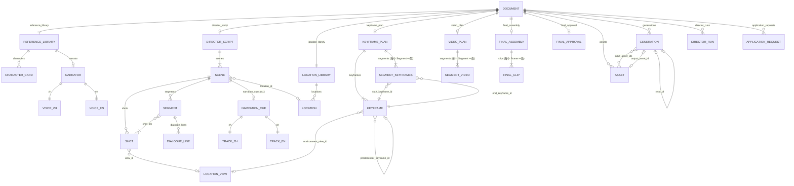
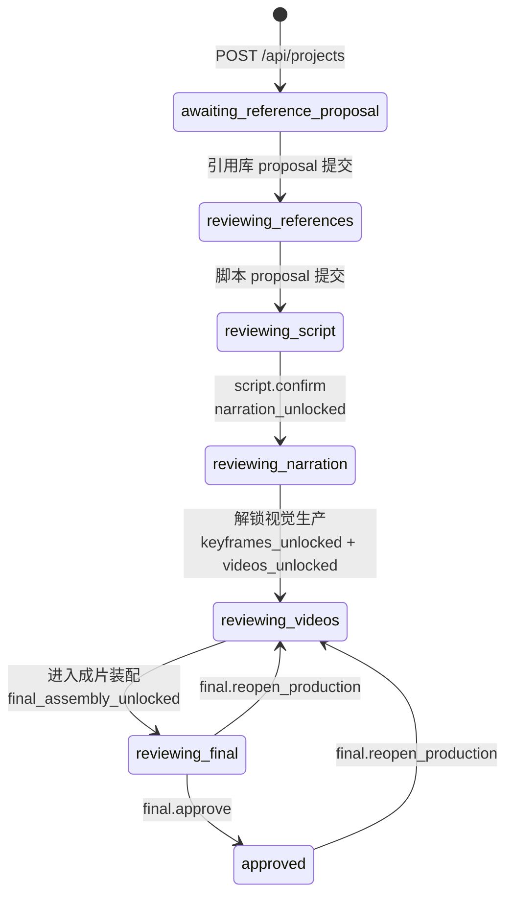
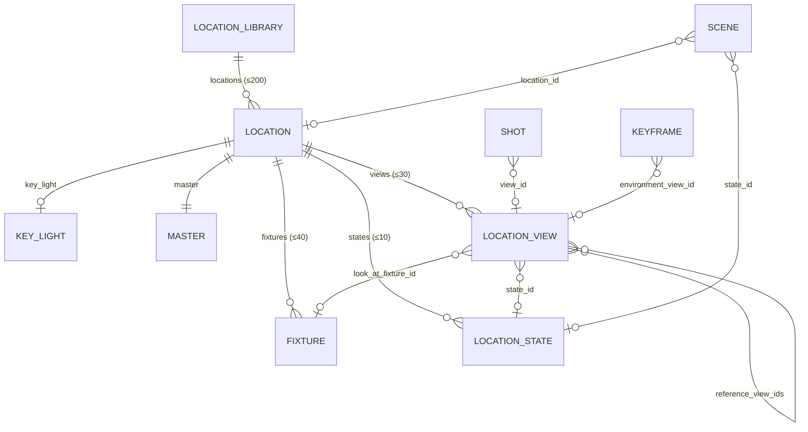
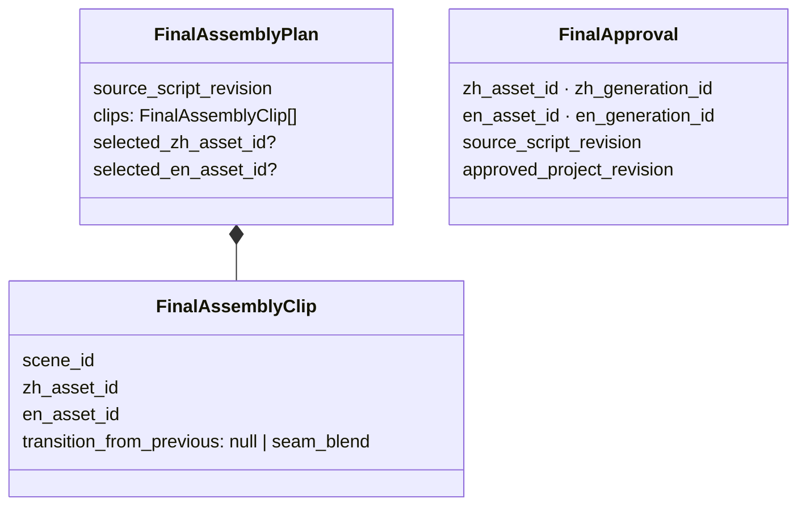
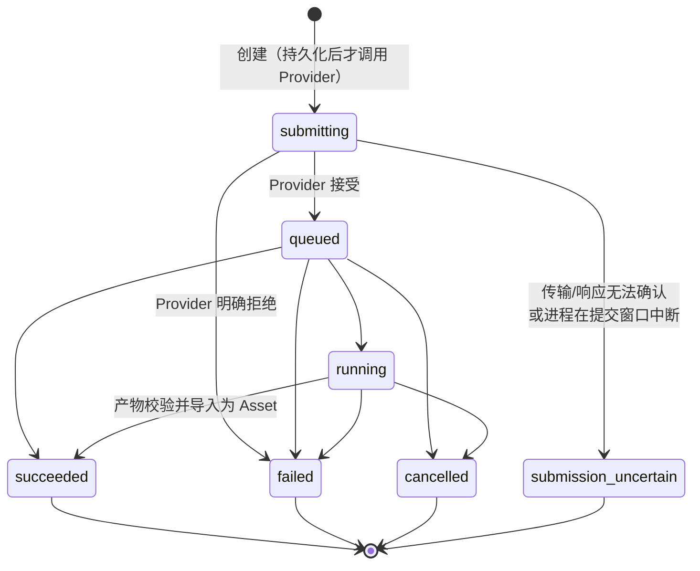

# 数据模型

`.stories/<项目名>-<project_id>/project.json` 是项目唯一权威结构化状态，当前 `schema_version = 32`。
更早版本按开发期规则不迁移，一律拒绝读取，需要新建项目。代码位置：
`core/structured_director/models/`（值对象与不变量）、`codec/`（严格 JSON）、`schema.py`（版本号）。

所有模型都是不可变 dataclass，构造时即校验；JSON 解码拒绝未声明字段与缺失字段。ID 统一是 32 位小写十六进制，
由 Core 分配；Agent 与 Web 都不能自造 ID。

## 实体关系总览



`SEGMENT_KEYFRAMES` 与 `SEGMENT_VIDEO` 通过 `segment_id` 一对一对应当前脚本中的每个 Segment；Core 在每次脚本
回改后立即重建这两份计划，保证不缺卡、不多卡。

## 文档根（`StructuredDirectorDocument`）

| 字段 | 类型 | 语义 |
| --- | --- | --- |
| `schema_version` | int | 固定 32 |
| `project_id` | id | 项目 ID |
| `revision` | int ≥ 1 | 项目 revision；每次持久写入恰好 +1，是全部 CAS 的基准 |
| `title` / `aspect_ratio` / `director_plan_markdown` | 创建时固化 | 没有修改 API；导演方案最多 50,000 字符 |
| `narration_languages` | 数组 | 必填，`["zh"]`、`["en"]` 或 `["zh", "en"]`；创建后不可修改 |
| `status` | 枚举 | 主要审核位置（见下） |
| `workspace_layers` | 4 个布尔 | 已解锁内容层，单调累加 |
| `reference_library` | 对象 | 角色卡与旁白身份 |
| `director_script` | 对象或 null | 结构化脚本与生产基线 |
| `pending_script_edit` / `pending_narration_edit` | 对象或 null | 进行中的脚本/旁白编辑请求原文 |
| `location_library` | 对象 | 地点库：地点、固定陈设、状态与机位视图 |
| `keyframe_plan` / `video_plan` | 对象或 null | 视觉生产解锁后建立 |
| `final_assembly` / `final_approval` | 对象或 null | 最终成片计划与批准 |
| `assets` / `generations` | 列表 | 全部媒体与生成历史 |
| `capability_gap_alerts` | 列表 | `project.apply_repair_patch` 的审计记录 |
| `director_runs` / `director_directives` | 列表 | 领域长任务与其用户原话 |
| `application_requests` | 列表 | 外部写命令的持久幂等回执 |

### `status` 与 `workspace_layers`



`status` 只表示“用户主要停在哪一层审核”。真正决定能力的是 `workspace_layers`：

| 层 | 何时置 true | 约束 |
| --- | --- | --- |
| `narration_unlocked` | `script.confirm` | — |
| `keyframes_unlocked` | 解锁视觉生产 | 不能早于旁白层 |
| `videos_unlocked` | 解锁视觉生产（与 Keyframe 同时） | 不能早于 Keyframe 层 |
| `final_assembly_unlocked` | 首次进入成片装配 | 不能早于视频层 |

Store 拒绝任何让某层从 true 变回 false 的写入。上游回改只清掉过期的选择、生产基线或装配计划，状态停在最深已解锁层
（`review_status`），不会退回。因此“状态是 `reviewing_final`”不代表“当前一定有有效成片”。
`reviewing_keyframes` 是保留的枚举值，当前流程直接从旁白进入视频审核位置。地点库不是内容层：项目创建起即可编辑，
解锁视觉生产本身就是跳过地点规划。

## 引用库

| 实体 | 关键字段与约束 |
| --- | --- |
| `CharacterCard` | `name`（项目内大小写不敏感唯一）；`visual_description` 非空 = 可见角色，**null = 非出镜声音**（此时 `voice_description` 必填、`looks` 必须为空，不能出现在任何可见角色列表、不能生成人像）；`looks` ≤ 8 套，是角色图的唯一来源；`voice_description` ≤ 500；`voice_reference_asset_id` + `voice_reference_transcript`（克隆所需完整文字稿） |
| `CharacterLook` | 角色的一套造型：Core 分配的 `id`（全库唯一）、`name`（≤ 100，同一角色内唯一）、`appearance`（服装、发型、配饰、身体状态，≤ 2000）、`usage`（使用场合，≤ 1000）、`selected_asset_id`（人类选定的造型图，图片 Asset 或 null） |
| `NarratorProfile` | 独立旁白身份，ID 不得与角色卡重复；`name` + 所选语言各一套 `NarratorVoice`（`zh` / `en`，未选语言为 null）；无旁白时为 null |
| `NarratorVoice` | 单一语言的旁白音色：`voice_description` 必填（≤ 500）；`voice_reference_asset_id`（WAV）+ `voice_reference_transcript`（克隆所需完整文字稿）。中文 Cue 只用 `zh` 克隆、英文 Cue 只用 `en` 克隆，缺哪种语言的参考音色或文字稿就不能合成该语言 |

对白说话者二选一：`character_id` 指向引用库角色（可以是非出镜声音，如广播、电话），或 `character_id = null` 加
`speaker_label`（≤ 60 字称呼），表示引用库外的临时或画外说话者，没有造型和音色，视频工作集里 `on_screen = null`、
是否入画以 Segment `action` 为准。Ref2VA 视频的音频输入只来自 Segment 视频卡上显式添加的参考音频，不会从角色卡自动推导。

## 结构化脚本

```mermaid
classDiagram
    class DirectorScript {
      revision: int
      source_reference_revision: int
      production_baseline_revision: int?
      production_baseline_scenes: Scene[]?
      scenes: Scene[1..100]
    }
    class Scene {
      id
      title ≤300
      summary ≤4000
      setting ≤4000
      driver: narration | drama
      location_id?
      state_id?
      narration_cues[0..1]
      shots[]
      segments[]
    }
    class Shot {
      id
      visible_character_ids[]
      composition · camera_movement · action
      audio_direction
      transition_in?
      view_id?
    }
    class ShotSegment {
      id
      shot_ids[1..]
      duration_estimate_seconds min 0.2
      action ≤4000
      dialogue_lines[]
      boundary_from_previous?
    }
    class SegmentBoundary {
      reason: model_constraint | continuity_anchor | control_boundary | failure_cost
      continuity_instruction
    }
    DirectorScript "1" *-- "1..100" Scene
    Scene "1" *-- "0..*" Shot
    Scene "1" *-- "0..*" ShotSegment
    ShotSegment "*" ..> "1..*" Shot : shot_ids
    ShotSegment "1" *-- "0..1" SegmentBoundary
```



- 全项目最多 100 个 Scene、1,000 个 Shot、2,000 个 Segment；Scene、Shot、Segment、Cue 的 ID 全局唯一。
- Shot 是创作层描述，Segment 是生产原子。`segment.shot_ids` 是本 Scene `shots` 中按顺序连续的一段，非空不重复；
  依次拼接全部 Segment 的 `shot_ids`（相邻 Segment 共享的边界 Shot 只算一次）必须恰好等于 `shots`，不跳过、不倒序、
  不重复覆盖。一个 Segment 可覆盖多个 Shot，一个 Shot 可跨多个相邻 Segment。
- 相邻 Segment 共享边界 Shot（前一段最后一个 = 后一段第一个）即延续同一镜头，后一段必须带 `boundary_from_previous`，
  说明为什么在此切开与如何保持连续；不共享即剪辑，`boundary_from_previous` 必须为 null；Scene 第一个 Segment 为 null。
- `shots` 与 `segments` 同时为空或同时非空。
- `driver = narration`：必须恰好一条 Cue，覆盖整个 Scene 的全部 Segment；所有 Segment 的 `dialogue_lines` 必须为空；
  在真实 TTS 之前可以没有 Shot 与 Segment。
- `driver = drama`：至少一个 Shot；`narration_cues` 必须为空，对白可有可无。
- 旁白与对白互斥由 `Scene` 模型构造时强制校验，任何写入路径（proposal、`script.apply_operations`、手工保存）产生
  违规 Scene 都会整体拒绝。
- `production_baseline_revision` 与 `production_baseline_scenes` 同时存在或同时为 null。旁白层解锁后，Core 在每次脚本/旁白写入
  里自动校准并写入它们，表示“这一版脚本的时序已经按真实音频校准”；无法校准时保留上一次的值，因而与 `revision` 不等。
  视觉生产、装配都要求 `production_baseline_revision == revision`。

### 旁白 Cue

| 字段 | 说明 |
| --- | --- |
| `id` | Cue ID；Cue 永远覆盖所在 Scene 的全部 Segment，没有 Shot 锚点 |
| `zh` / `en` | 已选语言为非空 `NarrationTrack`，未选语言为 null |
| `NarrationTrack.text` | 正文 ≤ 4,000；英文是适合朗读的意译 |
| `NarrationTrack.seed` | 0 … 2⁶³−1 |
| `NarrationTrack.recipe_params` | recipe ID → 机制参数；当前 speech recipe 的 editable_params 声明类型、范围与默认值 |
| `NarrationTrack.selected_audio_asset_id` | 该语言当前采用的音频 |

所选语言分别合成、审核、选择。单语言取该音频的真实时长，双语言取已选音频中较长的一条，算法见 [数据流](data-flow.md#旁白时序)。

## 地点库

地点（Location）是跨 Scene 共享的固定空间。主图给出完整空间，视图（LocationView）是 Keyframe 可参考的机位；
Shot 的 `view_id` 只是给 Keyframe Planner 的空间参考建议，不强制、也不是底图；
同一空间的昼夜、天气、布置或破坏变化是状态（LocationState），不是新地点。代码位置：`models/location.py`。



地点、陈设、状态、视图的 ID 都由 Core 分配，在项目内全局唯一。方位统一以主图为准：0° 为全景正中，顺时针递增，
取值 [0, 360)。

### Location

| 字段 | 约束 |
| --- | --- |
| `id`、`name` | name 1–200 字；改名不失效 |
| `kind` | `interior`（主图是 2:1 等距柱状全景，视图 = 全景裁切 + 细化）/ `exterior`（主图是项目画幅，视图 = 主图转向编辑） |
| `description` | 固定空间：结构、材质、固定陈设、风格；≤ 4,000 |
| `fixtures[]` | `{id, name ≤200, description ≤2,000, azimuth_deg?}`；只放固定陈设，不放人物或临时道具 |
| `key_light` | `{description ≤1,000, azimuth_deg?}` 或 null |
| `master` | `{prompt_text ≤19,000, reference_asset_ids ≤5, selected_asset_id?}`；画幅由 `kind` 决定 |
| `calibrated_master_asset_id` | 方位标定所基于的主图；不等于 `master.selected_asset_id` 即未标定 |
| `states[]` | `{id, name ≤200, description ≤2,000}`；description 写相对固定空间的可见差量 |
| `views[]` | 见下表 |

### LocationView

| 字段 | 约束 |
| --- | --- |
| `id`、`name`、`purpose` | purpose ≤ 1,000，写机位用途与对应关系（例如“朝壁炉·人眼高·中景，A/B 对话正打背景”） |
| 朝向 | 二选一：`azimuth_deg`，或 `look_at_fixture_id` + `yaw_offset_deg`（[-180, 180]，相对陈设偏转，顺时针为正） |
| `pitch_deg` / `hfov_deg` | pitch ∈ [-60, 60]，hfov ∈ [20, 120]；画幅恒等于项目画幅 |
| `state_id` | 可空；必须属于同一 Location |
| `refine_prompt_text` | 室外转向正文，≤ 19,000；室内细化只做清晰化，不使用该字段 |
| `reference_view_ids` | 同一 Location 的其它视图，不含自身、无环；底图（室内为裁切图、室外为主图）+ 参考视图合计 ≤ 5 张输入 |
| `crop_asset_id` | 只属于室内视图；Core 按当前几何写入的全景裁切图，不是候选 |
| `selected_asset_id` | 人选定的视图图片 |

相对陈设定义的视图，其绝对方位 = 陈设方位 + 偏转（mod 360）；地点未标定或陈设没有方位时无法解析，不能裁切。
室内视图的“当前裁切输入”是 `{主图已选 Asset, 绝对方位, pitch, hfov, 项目画幅}`；`crop_asset_id` 只有在产出它的
裁切 Generation 的快照（`location_crop_request`）等于当前裁切输入时才算有效。

### 脚本与 Keyframe 的绑定

| 位置 | 字段 | 约束 |
| --- | --- | --- |
| Scene | `location_id?`、`state_id?` | state 必须属于该 Location；没有 Location 时 state 必须为空 |
| Shot | `view_id?` | 空间参考建议：必须属于所在 Scene 的 Location；Scene 没有 Location 时必须为空；删除该视图或地点时清空为 null，已规划 Keyframe 不因此改写 |
| Keyframe | `environment_view_id?`、`environment_mode`、`environment_none_reason?` | `none` ⇔ 视图为 null；`none` 时理由可选（null 或 1–500 字，空白归一为 null），`edit`/`reference` 时理由必须为空；视图必须存在于地点库 |

Keyframe 的环境字段只在建帧时按所属 Shot 的视图写成显式值：Shot 有视图 → `reference`，无视图 → `none`（无理由）
（规则见 [生产工作流](production-workflow.md#keyframe-使用地点视图)）；之后 Scene/Shot 改绑不回写已有帧。

### 失效规则

`location.apply_operations` 先在工作副本上应用全部操作，再对比新旧地点库决定失效；影响预览调用同一纯函数。

| 变化 | 失效 |
| --- | --- |
| 改名（地点/陈设/状态/视图）、视图 purpose、地点 description、陈设描述、主光描述与方位、主图计划（`prompt_text`、`reference_asset_ids`） | 无：已选主图是人确认的空间事实，要重做就生成新候选再改选 |
| 主图改选或清除；`kind` 修改 | 清空标定、该地点全部视图的裁切与选择，以及下游 Keyframe |
| 标定修改（陈设 `azimuth_deg` 变化） | 朝向该陈设（`look_at_fixture_id`）的视图的裁切与选择，以及下游 Keyframe |
| 视图几何（方位、朝向陈设、偏转、pitch、hfov） | 该视图的裁切与选择、经 `reference_view_ids` 依赖它的视图的选择、下游 Keyframe |
| 视图细化计划、参考视图、所属状态，或该状态描述 | 该视图的选择（裁切保留）、依赖它的视图、下游 Keyframe |
| 视图改选或清除 | 依赖它的视图、下游 Keyframe |
| Scene/Shot 改绑 | 不改写已建立的 Keyframe；Scene 换地点时清空其 Shot 的 `view_id`；同步生产基线中同 ID 的 Scene/Shot |
| 删除 View | 只被 Shot 软引用时允许删除，同一操作清空引用它的全部 Shot `view_id`（当前脚本与生产基线）；被 Keyframe `environment_view_id` 或其它视图 `reference_view_ids` 引用时拒绝，错误列出引用者 |
| 删除 Location | 其全部视图按 View 的规则处理，同时清空这些视图对 Shot 的软引用；Scene 仍绑定该地点时拒绝 |
| 删除 State / Fixture | 仍被 Scene 或视图引用时拒绝，错误列出引用者 |

软引用清空不是失效级联：只删除视图并清空 Shot 的 `view_id`，不改变已规划 Keyframe 的 `environment_view_id` 与已选图；
影响预览用 `soft_reference_clears` 列出被清空的 Shot，与 `invalidated` 分开。

“下游 Keyframe”指 `environment_view_id` 指向受影响视图的帧：清除其已选图，并沿用 Keyframe 级联继续清除启用的后继帧、
相关 Segment 的视频与超分选择和最终装配。任一失效目标（地点、视图、帧、Segment、Scene、项目）有非终态 Generation
时整笔拒绝。历史 Asset 与 Generation 永远保留。

## Keyframe 计划

| 实体 | 字段与约束 |
| --- | --- |
| `Keyframe` | `id`；`owner_segment_id`；`predecessor_keyframe_id`（时间上前一个边界帧，图必须无环）；`prompt_text` ≤ 18,000；`visible_character_ids`；`character_references`（`[{character_id, look_id}]`：只针对本帧可见角色、每角色一项，`look_id` 必须是该角色当前造型；`look_id = null` = 不提交该角色图；未列出时只有一套造型默认使用它，多套造型必须显式选择才能生成；所选造型没有造型图时不能生成）；`environment_mode` ∈ `edit` / `reference` / `none`、`environment_view_id` 与 `environment_none_reason`（见[地点库](#脚本与-keyframe-的绑定)）；`selected_asset_id` |
| `SegmentKeyframes` | `segment_id`；`start_keyframe_id` ≠ `end_keyframe_id`；`start_enabled` / `end_enabled`（默认都关闭）；`reference_asset_ids` 手工辅助图 ≤ 4 张 |

- 每个 Segment 都有概念上的首尾槽位；实际视频只需启用并选择其中至少一个。
- 相邻 Segment 的边界默认是两个独立 Keyframe。**显式共享**表示左段 `end_keyframe_id` 与右段 `start_keyframe_id`
  指向同一个 Keyframe 对象（同一条 Asset/Generation 血缘），两侧启用状态各自独立。
- 新建计划时，每个 Segment 的尾帧以首帧为 `predecessor`。

## 视频计划

`SegmentVideo`（每个 Segment 一条）：

| 字段 | 约束 |
| --- | --- |
| `prompt_text` | 视频提示词 ≤ 20,000；生成前必须非空，提交时还校验 recipe 的 prompt 参数约束 |
| `active_recipe` | 当前视频 recipe ID；未配置 Provider 时为 null |
| `recipes` | recipe ID → `{bindings, params}`；每个槽位保存有序 `{asset_id, description}` 数组，机制参数按 recipe 隔离 |
| `selected_asset_id` | 当前采用的原视频 |
| `upscaled_asset_id` | 超分结果；必须以已选原视频为前提 |

首尾帧由 Core 从 Keyframe 的启用与选择事实填写，不进入显式 bindings。旁白、对白和 Segment 时长仍是领域事实。
新视频卡按当前绑定插件的 manifest defaults 与 `segment.has_dialogue` 谓词选择 recipe；没有安装视频插件时不指定默认模型。
切换 recipe 保留每个 recipe 的输入与参数，清除当前视频和超分选择并失效相关装配；同值切换为 noop。
若当前显式输入的角色或约束不受目标 recipe 支持，必须先移除这些输入。卸载插件后历史输入仍保留，可选择新的可用 recipe。

H3 插件的 `minimax_h3.ref2va` 声明附加图 0–4 张、WAV 音频 0–8 条、MP4 视频 0–3 条（2–15 秒），各槽位内资产唯一且必填说明。
`minimax_h3.fl2va` 不接受这些显式引用。约束来自插件 manifest，不是 Segment 模型的固定字段。
Web 快照另有只读 `recipe_state`：当前可用性、切换选项及原因、完整生成时长、软时长提示和 Core 计算的输入标签。


## 成片



- 最终成片计划按脚本顺序每个 Scene 一条 clip，引用该 Scene 所选语言当前有效的 **Scene 成片 Asset**，未选语言为 null；
  首个 clip 的 `transition_from_previous` 必须为 null。
- 所选语言各自选择候选；一次 Approval 绑定所选语言全部精确 Asset、Generation、脚本 revision 与批准后的项目 revision。
- Scene 成片本身没有持久计划对象：`SceneAssemblyPlan` 只在渲染时临时构建，是否“当前有效”由 Generation 输入血缘判定。

## Asset

| 字段 | 约束 |
| --- | --- |
| `id` | Core 分配 |
| `media_type` | `image/png`、`image/jpeg`、`image/webp`、`audio/wav`、`video/mp4` |
| `byte_count` | 视频 ≤ 2 GiB，其它 ≤ 64 MiB |
| `sha256` | 64 位十六进制，导入与读取都校验 |
| `relative_path` | 受控项目内相对路径（下表），文件名是可读语义名 + `-<sha256 前 10 位>` |
| `duration_seconds` | WAV/MP4 从实际字节读取；视频插件可回报实测时长 |

```text
assets/
├── images/
│   ├── library/          通用导入
│   ├── characters/       → image_category = character_reference
│   ├── locations/
│   │   ├── master/       → location_master
│   │   ├── crops/        → location_crop（只能由全景裁切产生，不接受导入）
│   │   └── views/        → location_view
│   ├── keyframes/        → keyframe
│   └── video-frames/     → video_frame（只能由抽帧产生，不接受导入）
├── audio/
│   ├── voice-references/ narration/ generated/ effects/ trims/ stems/ imported/
└── videos/
    ├── segments/ upscaled/ scene-final/ final/ animatics/ audio-remixes/ imported/
```

内容不可变：同一 Asset 的字节永不改写。唯一例外是 Scene 成片的“当前文件”机制——重新装配成功后，
Core 原子替换该 Scene 的稳定当前文件名，并把上一版文件改名为带内容哈希的归档名，旧 Asset 记录指向归档文件，
字节与 SHA-256 不变。

## Generation



迁移表在 `models/generation.py::transition_generation` 中集中定义，其它代码不能直接赋值 `phase`。

| 字段 | 语义 |
| --- | --- |
| `kind` / `operation` / `target_id` | 生成什么、怎么生成、属于哪个业务目标 |
| `prompt_text`、`recipe_params`、`sample_text` | 实际提交的提示词；按 recipe 保存的机制参数；参考音频文字稿 |
| `input_asset_ids` | **有序**输入血缘，顺序就是提交给 Provider 的顺序 |
| `seed` | 实际使用的 seed；装配类为 null |
| `plugin_id` / `plugin_version` / `external_id` | 由哪个插件、以什么外部句柄执行；历史任务永远按自己的 `plugin_id` 路由 |
| `provider_snapshot` | 提交时绑定的插件实例、recipe、生效设置与摘要（如 `minimax_h3` · `minimax_h3.ref2va` · “Turbo V2 · 8 步 · 1080p”）；只供追溯与候选卡展示，不参与失效判断。Core 确定性工具（装配、Animatic、抽帧、混音）为 null |
| `output_asset_id` / `duration_seconds` | 产物与时长 |
| `error_code` / `message` / `progress` | 终态错误与最近观察 |
| `cancellation_requested` | 取消意图已持久化，等待 Provider 确认 |
| `retry_of` | 显式重试链 |
| `dismissed` | 从候选列表隐藏；不删除记录或 Asset |
| `language` | 仅 `narrator_voice`、`narration_audio`、`scene_final_video`、`final_video` 为 `zh` / `en`，其余必须为 null |
| `video_frame_request` | 抽帧来源视频、帧号、帧数、来源 Segment |
| `aspect_ratio` | 图片比例；角色参考图可指定 `IMAGE_ASPECT_RATIOS` 中的比例，造型设定图与室内地点主图为 `2:1`，其余为 null（跟随项目画幅）；重试沿用 |
| `location_crop_request` | 仅 `location_view_crop`：主图 Asset、绝对方位、pitch、hfov、项目画幅的冻结快照，进入重试签名 |
| `video_input_snapshot` | Segment 视频提交时的输入签名与首尾帧 Asset，用于判定 `inputs_outdated` 软提示 |
| `created_at` / `updated_at` | Generation 自身的 UTC 生命周期时间 |

### Kind 与 operation

| kind | operation | target | 说明 |
| --- | --- | --- | --- |
| `character_look_sheet` | generate | 造型 | 造型设定图；`input_asset_ids` 是身份参考，`prompt_text` 是实际提交的完整提示词（Core 编译或人类编辑），重试原样沿用 |
| `character_voice` | voice_design | 角色卡 | 参考音色设计 |
| `narrator_voice` | voice_design | 旁白身份（带 `language`） | 该语言的旁白参考音色设计；采用后只替换同语言的 `NarratorVoice` |
| `narration_audio` | synthesize | Cue（带 `language`） | 旁白 TTS |
| `generated_audio` | voice_design / synthesize | 项目 | 资产中心通用音频，不绑定任何节点 |
| `audio_effect`、`audio_trim` | process | 源 Asset | Core 本地同步处理，记录为隐藏 Generation |
| `video_audio_voice`、`video_audio_background` | separate | 源视频 | 成对创建，共享规范化 `batch_id` |
| `video_audio_remix` | remix | 源视频 | 两条 WAV 各自增益后重新封装 MP4 |
| `location_master_image` | generate | 地点 | 主图；室内固定 `aspect_ratio = 2:1`，室外跟随项目画幅 |
| `location_view_crop` | process | 地点视图 | 室内全景裁切，Core 确定性工具，产物型，不是候选；必须带 `location_crop_request` |
| `location_view_image` | edit | 地点视图 | 室内细化（底图为裁切图）或室外转向（底图为主图） |
| `keyframe_image` | generate / edit / attach | Keyframe | `attach` 用于把抽帧产物登记为候选 |
| `video_frame` | process | 源视频 | 按帧号抽帧，产物型，不是候选 |
| `segment_video` | render / attach | Segment | `render` 记录 1–17 个输入、时长不短于 0.2 秒；`attach` 从资产库挂接 MP4，无输入、无 seed |
| `video_upscale` | upscale | Segment | 恰好一个源视频输入 |
| `scene_animatic` | assemble | Scene | Scene 动态分镜预览 |
| `scene_final_video` | assemble | Scene（带 `language`） | Scene 成片 |
| `final_video` | assemble | 项目（带 `language`） | 最终成片 |

## 领域长任务（`DirectorRun`）

| 字段 | 语义 |
| --- | --- |
| `kind` | `reference_proposal`、`script_proposal`、`location_plan`、`keyframe_plan`（四类外部 proposal 请求）；`director`（Keyframe 批次或地点成套生成的一轮执行）；`script_edit`、`narration_edit` |
| `status` | `running`、`waiting_user`、`waiting_jobs`、`completed`、`failed`、`cancelled` |
| `goal` | 用户原始目标（原话另存 `DirectorDirective`） |
| `authorization` | `edit_scopes`、`generation_scopes`（如 `keyframe:<id>`、`location:<id>`）、候选选择策略（恒为 `explicit_only`）、`final_approval` |
| `cursor` | `step`、`pending_target_ids`（尚未提交的目标）、`waiting_generation_ids`（只在 `waiting_jobs` 时非空） |
| `completed_command_ids` / `command_receipts` | 已完成命令及短回执，二者一一对应，用于恢复时跳过已执行步骤 |
| `waiting_reason` | 等待态必填，非等待态必须为空 |

同一项目最多一个非终态 run。

## 外部请求回执（`ApplicationRequest`）

| 字段 | 语义 |
| --- | --- |
| `request_id` | `sha256(caller_id, project_id, idempotency_key)`，幂等命名空间 |
| `request_digest` | 规范化命令名、参数、`expected_revision`、caller 角色/项目/能力/grant 的摘要 |
| `phase` | `pending`（已登记、尚未拿到结果）→ `committed`；中断后变为 `uncertain` |
| `result_revision` / `receipt_json` | 成功后的 revision 与完整回执，二者同时存在 |
| `generation_ids` | 这次请求创建的全部 Generation |

引用库人工确认也以 `reference.confirm_review` 回执的形式存在：回执数据里保存完整 `reference_library` 的 SHA-256；
引用内容一变，摘要不再匹配，就需要重新确认。

## 能力缺口审计（`CapabilityGapAlert`）

`project.apply_repair_patch` 每次真实修改都写一条：缺失的正式命令名、用户请求摘要、目标与 Scene scope、
规范化 operation 与反向 operation、前后 revision、发生次数与开闭状态。白名单字段只有
Scene `title/summary/setting`、Shot `composition/camera_movement/action/audio_direction/transition_in`、
Segment `duration_estimate_seconds/action`。
