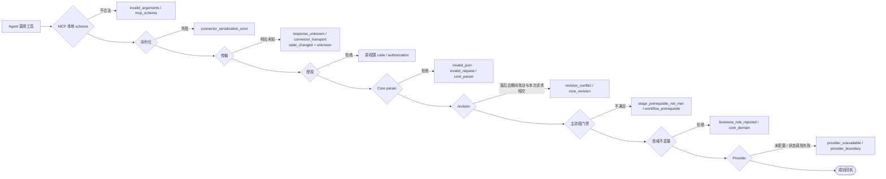

# 错误契约

StoryRail 面向 Agent 的 HTTP/MCP 错误必须同时回答四件事：**失败发生在哪一层、业务状态是否改变、是否可恢复、下一次调用
必须保留还是更换 revision / 幂等键**。`message` 只解释事实与动作，不回显凭据、绝对路径、完整创作正文或异常堆栈。

错误信封由 `storyrail_contracts/errors.py::error_payload` 统一构造；HTTP、Server 与 MCP connector 不得各自维护另一份。

## 字段

| 字段 | 含义 |
| --- | --- |
| `code` | 稳定的机器分类；MCP 保留 Core 原始 code，不重新包装 |
| `origin` | `mcp_schema`、`connector_serialization`、`connector_transport`、`core_parser`、`core_routing`、`core_domain`、`core_revision`、`authorization`、`workflow_prerequisite`、`provider_boundary`、`response_envelope` |
| `state_changed` | `false`、`true`，或传输无法确认时的 `unknown` |
| `recoverable` | 协议上是否存在受支持的恢复路径（不代表可以绕过领域规则） |
| `retry_policy` | Agent 应采用的恢复策略；`automatic_retry_allowed` 恒为 `false` |
| `details` | 边界特有的补充，例如 revision 冲突的 `expected` / `current`、门禁的 `required_next_actions` |

## 分类

| 失败 | code / origin | 状态与下一步 |
| --- | --- | --- |
| MCP 缺字段、额外字段、错误类型、非法 action/level 组合 | `invalid_arguments` / `mcp_schema` | 未调用 Core；按公开 schema 修正参数 |
| 连接器无法生成合法 wire JSON | `connector_serialization_error` / `connector_serialization` | 未发送；修正参数 |
| HTTP/Core 顶层命令格式错误 | `invalid_json` 或 `invalid_request` / `core_parser` | 未进入领域写入；修正参数 |
| 合法命令被目标或领域不变量拒绝 | `business_rule_rejected` / `core_domain` | 未写入；先改变业务事实或用户请求，不能盲重试 |
| revision 冲突 | `revision_conflict` / `core_revision` | 返回 expected/current、`conflict_reason`（`entities_changed` / `journal_unavailable` / `exact_grant`）与 `conflicts`（`[{id, kind, locator}]`，至多 20 项）；先重读冲突对象，只有用户意图仍适用时才显式发起新写请求，禁止自动换 revision 重放 |
| 认证、scope、capability、grant 或 caller 归属不符 | 原权限 code / `authorization` | 未调用业务写入；需要正确凭据、授权或用户动作 |
| 主流程前置条件不足 | `stage_prerequisite_not_met` / `workflow_prerequisite` | 返回当前 workflow、reason 与 `required_next_actions`；按其中的人类/Agent 动作推进 |
| Provider 尚未配置或状态调用失败 | `provider_unavailable` / `provider_boundary` | 先看 `state_changed` 与当前 revision；若已变化，先读 Generation，不得直接重复提交 |
| 响应是否到达未知 | `response_unknown` / `connector_transport` | `state_changed = unknown`；只允许用完全相同的参数、revision 与 key 回放 |
| 通用读取超限 | `result_too_large` / `response_envelope` | 缩小读取或按 cursor 续读 |
| Playground run 当前阶段不允许该操作 | `run_state_conflict` / `core_domain` | 未写入；读 run 最新阶段后按 `allowed_actions` 决定 |
| Playground 同一 `idempotency_key` 对应不同请求摘要 | `idempotency_conflict` / `core_domain` | 未写入；换新 key，或原样重放原请求 |
| 删除的 Playground Asset 是未结束 run 的输入 | `asset_in_use` / `core_domain` | 整批不删除，`details.asset_ids` 列出占用项 |
| 复制到项目被项目 Core 拒绝 | `project_write_rejected` / `core_domain` | 未写入项目；message 透传项目原因 |

`response_envelope` 只约束对外读取工具的结果，不用于 proposal submit 等写事务内部的工作集校验。`project.get_request` 查询 proposal
请求时只返回紧凑恢复信息，避免把原始大型工作集再次装入读取信封。

## Generation 失败不是 HTTP 错误

Provider 侧的失败属于持久业务观察，记录在 Generation 上，不伪装成 HTTP revision 冲突：

| Generation 事实 | 含义 | 下一步 |
| --- | --- | --- |
| `phase = submission_uncertain` | Provider 是否接受提交未知 | 不自动重提；先核查，再显式 `generation.retry` 或 `generation.dismiss` 放弃；处理前计为活动任务 |
| `phase = failed` | 运行明确失败 | 输入未变化时可显式 retry，新建带 `retry_of` 的 Generation |
| `cancellation_requested = true` | 取消意图已持久化，Provider 尚未确认 | 继续等待原 Generation |
| `error_code = artifact_import_failed` | Provider 已完成但 Core 未能校验/导入产物 | 保留句柄并等待同一 Generation，不新建 Provider 任务 |

`task_discovery` 为每个 Generation 返回 `message`、`error_code`、`cancellation_requested`、`retry_of`、`output_asset_id` 与 `recovery`，
用于中断恢复和回答用户进展。
