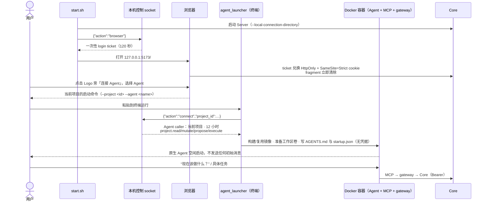
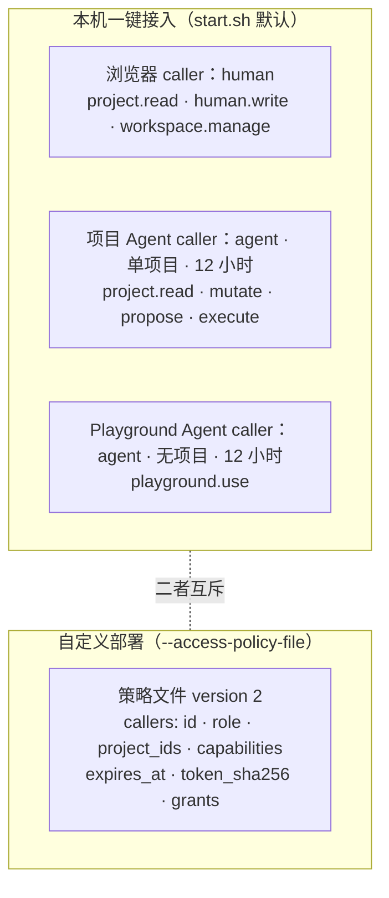
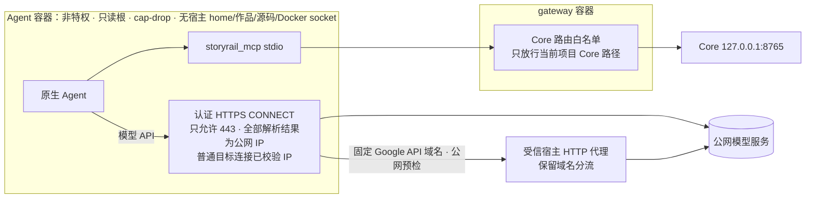

# 外部 Agent 接入

StoryRail 不内置 Agent。用户在自己的终端启动成熟的外部 Agent，Agent 通过 MCP 工具调用 Core 的正式入口，
完成专业规划与生产操作；候选采用、审核确认与 Approval 永远留给人类。

## 支持的 Agent

| 选择 | 启动参数 | 安装版本 | 原生配置卷 |
| --- | --- | --- | --- |
| Pi | `--agent pi` | `@earendil-works/pi-coding-agent@latest`（镜像构建时解析） | `storyrail-native-pi-profile`（首次导入宿主 auth/models/settings，之后由 Pi 自己维护） |
| Codex CLI | `--agent codex` | `@openai/codex@latest`（镜像构建时解析） | `storyrail-native-codex-profile`（首次只导入文件式 `auth.json`；无缓存时设备码登录） |
| Antigravity CLI | `--agent agy` | 官方安装器 latest（镜像构建时解析） | `storyrail-native-agy-profile`（容器内登录） |
| Kimi Code | `--agent kimi` | 官方安装器 latest（镜像构建时解析） | `storyrail-native-kimi-profile`（容器内登录，`--auto`） |
| DeepSeek Harness | `--agent dsh` | `@deepseek-ai/dsh@latest`（镜像构建时解析） | `storyrail-native-dsh-profile`（Web UI 交互，宿主回环随机端口） |
| Grok Build | `--agent grok` | `@xai-official/grok@latest`（镜像构建时解析） | `storyrail-native-grok-profile`（容器内登录） |

全部六种 CLI 一次安装在同一个 `storyrail-external-agents:latest-v1` 镜像内。切换 Agent 只切换启动命令、
工作区卷和原生配置卷，直接复用该镜像；跨项目构建锁避免并发重复构建。
源码摘要变化时重建公共镜像并复用依赖安装层。删除项目容器不会更新 CLI；需要更新全部 CLI 时，
在连接命令末尾加 `--update-agents`，该次构建禁用层缓存并重新获取官方 latest。

启动器从不指定 provider、model 或 thinking 参数，也不导出、截取或保存模型凭据；模型选择、切换与登录刷新全部由
Agent 原生处理。每个 Agent 都在启动时把固定的 `storyrail` stdio MCP 写入隔离配置，不导入宿主的其它 MCP、插件或会话。
Mac 上可在启动器终端用 Ctrl+V 粘贴图片（≤16 MiB，经容器回执校验字节数与 SHA-256 后才转发按键）。

## 一键接入流程

- 启动**不创建任何业务任务**，也不调用 MCP；页面提示“你可以询问当前应该做什么”。Agent 等用户在终端里给出具体指令后才行动。
- 同一项目的启动租约在不同 Agent 之间共用，防止并发覆盖连接；重复运行同一命令会保留 caller 并续期。
- 入口在项目任意阶段都可用；切换项目后面板按新项目重建。

## 授权模型

**本机一键接入**：`server/local_connection.py` 在 `--local-connection-directory` 下只通过当前用户独占的 Unix socket
（0600）签发身份；HTTP 不提供此管理动作。服务从启动起就需要身份，没有匿名 human fallback。所有写 cookie 的请求校验固定
本机 Web Origin；Agent Bearer 与 cookie 人类身份分别验证。它只防御非宿主权限的进程，不防御宿主管理员。

**项目执行委托**（`project.execute`）：替代逐命令 grant，覆盖整个 Agent 操作白名单，但不绕过有效期、项目范围、Core schema、
状态、revision 与 proposal 归属校验。选择、Approval、repair 与旧写路由仍拒绝。Core 不读取外部对话，也不声称能验证指令来源。

**自定义部署**：策略根严格为 `{version: 2, external_mutations: false|true, callers: [...]}`；策略文件由服务用户持有，必须是普通文件、
0600、无 symlink 祖先，**每次请求重读**——失效、撤销、损坏都直接拒绝。Bearer 只经受保护渠道交付，不进入 URL、日志或业务 JSON。
没有 `project.execute` 时，每条写命令都需要一条精确 grant：`{id, project_id, command_digest, expires_at}`，摘要绑定命令名、全部参数与
原 revision。

**未配置任何策略的开发服务**是匿名模式，**不得交给外部 Agent**。

## 隔离拓扑

- 内部网络只有两类出口：当前项目的 Core application/Asset 路径，与公网 HTTPS 隧道（TLS 端到端透传，gateway 不解析模型协议、不读凭据）。
- 系统 DNS 返回非公网地址（本机代理的 Fake-IP）时，gateway 用固定的 `https://1.1.1.1/dns-query` 重新解析 A 记录；仍非公网则拒绝。
- 启动器优先从宿主 `HTTPS_PROXY`（兼容小写与 `HTTP_PROXY`）读取代理；变量未设置时，macOS 从当前系统
  HTTPS/HTTP 代理读取。只接受无认证的本机 HTTP 代理，只向 gateway 传入端口。
  gateway 的 `HOST_PROXY_TARGETS` 固定 Google API 域名通过公网预检后，保留原域名经受信宿主代理 CONNECT，
  继承宿主的域名分流；此分支由宿主代理再次解析厂商域名。其它目标仍连接已校验 IP，拒绝 DNS 重绑定。
  宿主代理失败返回 502，不回退直连；Agent 不获得宿主代理地址或直接宿主网络权限。
- 工作区是每项目一个 Docker 卷 `storyrail-<agent>-<project_id>`；Agent 的会话与文件不是项目事实，Core 不读取。
- npm 缓存使用可写的 `/tmp/npm-cache`；Pi 扩展持久化在 profile 卷。
- 这一边界缩小绕过面，但应用层校验仍然完整保留，部署隔离不复制领域规则。

## MCP 工具

项目 scope 的 `tools/list` 发布 26 个工具（逐字节基线：`tests/fixtures/mcp_project_tools.json`）。没有任意 command、shell、文件、
路径、URL、模型目录、候选采用或 Approval 工具。所有工具顶层与嵌套参数都拒绝未知字段，条件参数用公开 `oneOf` 表达，MCP runtime
与 schema 共用同一参数矩阵。

| 分组 | 工具 | 翻译为 |
| --- | --- | --- |
| 读取 | `read_story` | `project.get_projection`（outline 用项目 scope；scene/shot/segment 必须给 `scene_ids`；`parent_id` 只用于 segment 且是 Scene ID；Shot 与 Segment 都直接属于 Scene，shot 层给出 `segment_ids`、segment 层给出 `shot_ids`；Segment 的 `dialogue_lines` 给出稳定 `id` 与完整写回字段，脚本编辑前应带 `text` 扩展读取完整正文；`video_prompt` / `keyframe` 扩展只用于 segment；Segment 的 `selection` / `keyframe` / `video_prompt` 扩展同时给出 `video_inputs`，含其他图片规划与实际绑定） |
| | `locate_story` | `project.locate_story` |
| | `read_professional_contract` / `read_professional_workset` | `project.get_contract` / `get_workset`（支持 `if_hash` 内容协商与分块续读） |
| | `read_workflow` | 主流程 + handoff + contract hashes |
| | `read_media_input` | 受控 Asset 内容（见下文） |
| | `list_candidates` / `read_run` / `read_request` | 对应读取命令 |
| 规划 | `submit_proposal` | 统一入口：`capability` + `payload`；schema 按 capability 与 `payload.action` 公开完整字段：request（`raw_user_instruction`；keyframe 另需 `scene_ids` 与 Segment `target_ids`）/ get、cancel（`request_id`）/ submit（`request_id` 加内联 `proposal` 或受限 `proposal_source`）/ reject（`request_id`、`reason`） |
| 编辑 | `edit_script` / `edit_narration` / `edit_locations` / `edit_keyframes` / `edit_looks` | 各自的 `*.apply_operations` / `narration.update_cue` / `reference.apply_look_operations`（`add_look` / `update_look`，字段形状随 `reference_library` 契约下发）；`edit_narration.fields.clear_selected_audio = "zh"\|"en"` 独占一次调用并翻译为 `narration.clear_selection`；`edit_locations` 的 scope 是 `location_ids` / `scene_ids`，可编辑地点、状态、陈设、独立图片和 Scene 绑定，字段形状随 `location` 契约下发；`edit_script` 的 `insert_shot` 必须给出 `attach_to_segment_id` 或 `new_segment`，Segment 操作以 `scene_id` 为容器 |
| | `save_video_prompt` / `save_keyframe_prompt` | 不带 `recipe_inputs` 时 `video.set_prompt`；带 `recipe_inputs: {bindings, params}` 时 `video.update_recipe_inputs`（正文、当前 recipe 绑定与参数整体替换）/ 单项 `update_frame_fields` |
| | `save_reference_image_plan` | `video.save_reference_image_plan`（Scene scope、Segment ID、0–3 槽位与完整画面计划；可规划任意图片内容，不生成、不选择） |
| | `set_video_recipe` | `video.set_recipe` |
| | `unlock_production` | `visual_production.unlock` |
| 生产 | `generate_media` | 单目标 `narration.generate`（必须给 `language`）/ `location.generate_image`（`location_image`）/ `location.capture_panorama`（`panorama_capture`，创建带说明的普通子图）/ `keyframe.generate` / `video.generate_reference_image`（`reference_image`：`target_id` 为图片规划 ID）/ `video.generate` / `video.upscale` / `reference.generate_look_sheet`（`look_sheet`：`target_id` 为造型 ID，必须给 0–4 张 `identity_asset_ids` 身份参考） |
| | `media_batch` | 必填 `kind`：`keyframe` 的 `start` / `continue` 翻译为 `keyframe.generate_batch` / `keyframe.continue_batch`；`location` 的两种 action 都翻译为 `location.generate_set`（`target_ids` 启动、`run_id` 继续） |
| | `assemble_media` | `animatic.generate_scene` / `final.assemble_scene` / `final.assemble` |
| | `manage_generation` | `generation.wait`（只观察，可省略 `expected_revision` 与 `idempotency_key`）/ `cancel` / `retry` / `dismiss` |
| | `cancel_run` | `run.cancel` |

另有 6 个**可调用但不在 `tools/list` 中下发 schema** 的旧名：`read_human_handoff`、`read_workflow_state`、`script_proposal`、
`reference_proposal`、`location_proposal`、`keyframe_proposal`，供尚未更新的客户端使用。

MCP 约定：

- 读工具的幂等键由 MCP 生成，不暴露给模型；写工具的 `idempotency_key` 必须由模型提供，不同动作不得复用。
- 为兼容会把可选字段补成 null 的原生连接器，MCP 把非当前 action 的 null 归一为省略；任何非 null 越界值仍拒绝。
- 大型 submit 可将完整 object JSON 写入 Agent 自己的固定 `/workspace/proposals/<request_id>.json`，调用时只传
  `proposal_source={kind:"workspace_json", byte_count, sha256}`。MCP 不接受任意路径，只读取 request ID 决定的普通文件并拒绝
  symlink、非 UTF-8、非 object、超过 1 MiB 或校验变化；文件只是不受信的传输缓冲。解析后仍由 Core 在当前 request/revision 下
  对完整 proposal 做同一套 schema 与领域校验，成功时一次原子写入，半成品不成为项目 authority。
- 每个结果的 text content 都是完整 JSON，`structured_content` 携带同一份数据；只读 text 的客户端（如 AGY）与只读
  `structured_content` 的客户端都能直接拿到结果，不需要经 shell 转调 Core。
- 项目写入被进行中的 Agent 请求锁定时，`action_not_allowed` 错误带出 `active_task`（proposal 请求 ID、类型与可用的
  submit/cancel 动作），调用方据此提交或取消，不必另行排查。
- 错误信封保留 Core 原始 `code`，并区分 MCP schema、连接器与 Core 各层（见 [错误契约](error-contract.md)）。

## 专业能力

六项专业能力以固定 Skill 包形式保存在 `core/director_proposals/skills/`，通过 `read_professional_contract` 交付（正文 + SHA-256）。
Skill 是 Agent 的唯一规则来源，不依赖任何 Agent 品牌。

| capability | Skill | 工作集 scope | 产出 |
| --- | --- | --- | --- |
| `reference_library` | `storyrail-reference-library` | 项目 | 角色卡与旁白身份 proposal |
| `script` | `storyrail-structured-director-script` | 项目 | 结构化脚本 proposal：先设计 Shot 列表再打包 Segment；含模型无关的 cinematic director intent 契约 |
| `narration` | `storyrail-narration-review` | `scene_ids`，可指定 Cue | 中英旁白正文、seed 与 recipe_params（经 `edit_narration` 保存） |
| `location` | `storyrail-location-planner`（参考 `location-bible.md`、`view-coverage.md`） | 项目（要求已有脚本） | 地点、陈设、主光、状态、可选独立图片与 Scene 绑定的增补 proposal |
| `keyframe` | `storyrail-keyframe-planner` | `scene_ids` + 可写 Segment `target_ids` | Keyframe 计划 proposal：`segments[]` 首尾计划、角色造型与承接关系；地点只作语义上下文 |
| `video_prompt` | `storyrail-video-prompt` + 当前插件的专业 Skill | 恰好一个 Segment | 视频正文，以及用户要求时的 recipe 参考素材与机制参数（经 `save_video_prompt` 保存） |

- 六个契约共同附带 `storyrail-consistency-review`：修改前预检授权范围内的上下层联动，提交后重读核对；只读校对不修改；
  需要越出授权范围时先说明。它是共享工作原则，不是第七个生产阶段。
- 工作集返回当前 revision 的事实、输出 schema 与 provenance：
  - 图片写作统一遵守 `storyrail-image-prompt-writing`。地点与 Keyframe 契约默认附带 `global/` 下的该 Skill，
    图片工作集的 `image_prompt.global_skills` 同样交付正文与哈希，`recipes`、`plugin_skills` 补充当前模型标签与写法。
    有输入图时在 `prompt_text` 顶部逐图写“真实标签: 用途与保留边界”，空行后正文逐图引用，不写文件名；无图时只写正文。
    默认标签为 `<PictureN>`，Qwen 多图为 `<imageN>`、单图为“图片”。
  - Keyframe 工作集读取目标 Segment 所属完整 Scene 作上下文，并明确 `context_segment_ids` / `writable_segment_ids`
    （`target_segment_ids` 与后者相同）、锁定节点、辅助图映射，以及按 Scene 裁剪的 `saved_keyframe_plan`（未建立时为
    `not_established`）。`scenes[].segments[]` 按顺序给出覆盖的 `shots[]`、派生可见角色与 `continues_from_previous`；
    Scene 给出可选 `location_id` / `state_id`，proposal 写 `segments[]`，每个 Segment 给 `frame_strategy=none|start|end|both`、启用端点计划与可选 `reference_images` 规划，以及
    `continues_from_previous`。每个可见角色的造型条目给出 `look_id`、名称、使用场合、已选造型图 `selected_asset_id` 和派生的
    `has_image`，Agent 可将该 Asset ID 直接交给 `read_media_input` 查看受控原图。
    已建立关键帧的实际 `image_inputs` 给出 `asset_id`、`label`、`roles`；这些只表示实际输入，不代表图片内容或使用意图，输入变更后重新读取映射。
  - 地点工作集给出完整导演方案、画幅、每个 Scene 的标题/梗概/设定与当前地点/状态，全部 Shot 的构图、运镜、动作与可见角色，
    以及完整地点库（每张独立图片带 kind、强制说明、生成计划、参考图与选图状态）和图片插件的
    `image_prompt` 约定。request 回执内嵌的冻结工作集不带 `image_prompt`，以 `read_professional_workset` 为准。
  - Keyframe 与视频工作集的 `video_inputs[]` 给出每个 Segment 的当前 recipe、合法 `frame_strategies`、媒体槽位与
    `require_any`、已绑定独立参考与已保存 `reference_image_plans`。没有时间约束时可按 recipe 选择 `none`；
    关闭端点无需编造正文，Core 保留其历史计划。可选 `segments[].reference_images[]` 按 0–3 的 `slot_index`
    增补无时间位置参考图规划，不生成、不选择、不改变已有视频绑定；已有成功候选和选图受到规划保护。
    其他图片可为任意内容，不限角色、地点或关键帧。`save_reference_image_plan` 可单独新建或编辑其中一张；
    `generate_media(kind="reference_image", target_id=<规划ID>)` 单独生成候选，人类在对应卡片选择后才进入视频输入。
    `reference_image_plans` 给出稳定 ID、正文与选图状态；没有生成计划的已绑定图片也会出现在 `reference_inputs`，
    每张已保存规划还给出其生图用 `image_inputs`（含角色造型参考），无法解析时给出 `image_inputs_error`；
    其中 `slot_index` 是当前媒体槽位中的位置，`asset_id` 可直接交给 `read_media_input` 查看真实图片。
  - Keyframe 工作集另给出当前 Scene 使用的 `location_library` 语义与扁平 `location_images`（图片 ID、名称、kind、强制说明、
    所属地点和已选图）；这些只帮助 Agent 理解空间，不会自动成为 Provider 图片输入。
  - 视频工作集给出当前 `video_recipe`（槽位与参数声明、`editable_params`）、`context`（含 `scene.driver`，决定无对白时是否声明预留旁白通道；
    `context.shots` 按覆盖顺序列出 Segment 的每个 Shot（构图、运镜、动作、声音、可见角色名与视图建议名）；
    `segment.continues_from_previous_segment` / `continues_into_next_segment` 表示相邻 Segment 共享边界 Shot 的延续关系；
    `segment.dialogue[]` 的 `on_screen` 为 null 表示引用库外的临时说话者）、`dialogue_timing`（已选 WAV 的真实起点、时长与最晚结束时间；未完成 TTS 时明确标记未就绪）、`required_dialogue_prompt`（H3 必须原样置于正文开头的 Audio 标签与原台词映射）、`asset_inputs`、`plugin_skills`（随插件发布的
    Skill 与参考正文），以及 `recipe_inputs`（已保存的 `{bindings, params}`，即 `save_video_prompt.recipe_inputs` 的整体替换形状）与
    `bindable_assets`（当前 recipe 显式槽位可接受的项目 Asset：`asset_id`、`name`、`media_type`、`duration_seconds`、`slots`；
    只列导入素材、引用库与地点库已选资源、本 Scene 已选的关键帧/旁白/视频与显式媒体参考）。标签按 manifest namespace 由 Core 计算，绑定变化后重读
    工作集取新标签；插件只转换自己的专业格式。软时长提示来自插件 hints；H3 声明 15 秒，超过可能 OOM但不拒绝；缺帧直接拒绝。
- 用户的修改要求与语言偏好由 Agent 作为用户输入单独处理，不当作 Core 事实。

## 主流程读取

`read_workflow`（`project.get_workflow_state` + `get_handoff`）返回：

| 字段 | 含义 |
| --- | --- |
| `current_stage` / `stage_status` | 主流程焦点（见 [生产工作流](production-workflow.md#全景)），不是能力锁 |
| `required_next_actions` | 主流程下一步，结构化对象：`action`、`tool`、`target_ids`、`human_only`、`requires_explicit_user_request`，以及精确 `generation_ids`、`batch_id`、候选类型与当前真实候选数、Web 入口 |
| `recommended_next_actions` | 不阻塞主流程的可选建议，结构同 required；当前只有地点：规划（`location.request_proposal`，只带缺口数量）、成套生成（`location.generate_set`）、继续在途地点批次（`location.continue_set`） |
| `blocked_actions` / `blocking_prerequisites` | 以动作命名空间为 key 的已知写入阻塞及原因 |
| `active_task` | 只表示占据主流程的 proposal / run / 批次 |
| `activity_summary` | 全项目非终态 Generation 数量；并行任务看 `task_discovery` |
| `workspace_capabilities.unlocked` | 累计解锁层 |
| `allowed_actions` | 人类 UI 能力，**不是**主流程下一步 |
| `task_discovery`（handoff） | 从 run、ApplicationRequest、Generation 派生的分页活动/最近任务；cursor 绑定 observation revision |

关键约束：

- 候选数只统计当前可审核的候选：成功、未隐藏、产物仍存在且类型正确、目标仍在当前计划中并满足选择约束。
  Agent 必须在同一 revision 用 `list_candidates` 复核，不能根据卡片存在、历史成功或 `allowed_actions` 推断。
- Narration Scene 选齐 TTS 但仍无 Shot 与 Segment 时，主流程返回 `script.apply_operations`（`reason = narration_shot_plan_required`，目标为缺
  Shot/Segment 的 Scene）。规划 Shot 与 Segment 的那次写入由 Core 自动校准时序并建立生产基线，没有人工确认时序步骤；无法校准时返回
  `reason = narration_timing_conflict` 的 `script.apply_operations`，`message` 给出具体原因。
- `active_task = null` 不代表项目没有任务；并行 Generation 与 run 由 `task_discovery` 单独列出。
- 专业工作集在非当前阶段仍可读，附 `not_current_stage`（只表示相关性）与 `mutation_blocked`（已知写入阻塞）。
- **推荐动作语义**：`recommended_next_actions` 永不进入 `required_next_actions`、不改变 `allowed_actions` 与门禁。Agent 读到后向用户说明
  收益与可选性并提议，收到用户明确指令才执行；用户只说“推进”“下一步”时不执行推荐动作。推荐只在引用库已确认、生产基线已建立且无
  活动 run 时出现；视觉生产解锁后只保留在途地点批次的继续提示。

## 媒体读取

`read_media_input` 先取 `project.get_asset_manifest`，再从固定可信 Core 的受控 Asset content API 获取字节。只支持 PNG、JPEG、WebP、
WAV、MP3，单项 ≤ 8 MiB，逐项核对 MIME、长度与 SHA-256；拒绝任意路径、URL、跨项目 Asset、过期 revision，不跟随重定向、不沿用环境代理。
返回 MCP image/audio 内容与 manifest。

## Agent 行为准则

1. 先 `read_workflow`，再按 `required_next_actions` 与用户指令行动；用户以自然语言或 `@功能名` 请求某功能时，直接映射为对应类型化动作，
   不要求用户再输入功能标签。功能提示本身不授予权限、不自动执行。
2. 写入始终携带当前 revision 与新的幂等键；冲突时重读，只有用户意图仍适用才发起新的写请求。
3. 断连后先 `read_workflow` / `task_discovery` 发现任务，再 `read_request` / `read_run` 细查；丢响应只用原参数、原 revision、原 key 重放。
4. 不对 `submission_uncertain` 自动重试；不靠新生成绕过未确认的取消。
5. 生成、选择、批准是三件事：Agent 只做生成与观察，提醒用户在 Web 中采用与批准；地点图片同样只能由人类选择。
6. Segment 视频的参考素材与机制参数只在用户明确要求时增删或替换；未改动的已有绑定原样回传。
7. 查看项目图片只用 `read_media_input`，直接以 Agent 原生多模态视觉能力判读；不调用 ffmpeg、ImageMagick、Python/PIL 等命令行工具
   抽取、转码或分析图片。读取被拒绝时如实报告原因，不自行绕道。当前模型没有多模态视觉能力或看不到图片时，
   告知用户并请其提供各图的内容、参考用途和保留/修改要求；已有充分说明时可据此编写并说明信息来源，缺必要说明则暂停相关提示词编写与生成。
   不用命令行工具、文件名、元数据、提示词或计划文字推测画面来冒充看图。

## Playground Agent

从 Playground 页面复制的命令使用 `--playground`（与 `--project` 互斥）。它获得只有 `playground.use`、`project_ids = []` 的 12 小时 caller，
独立的 `storyrail-<agent>-playground` 卷与 `playground.launch.lock`（同一时刻只允许一个），工作区提示词为 `PLAYGROUND_PROMPT.md`，
MCP 以 `--scope playground` 启动、只发布 5 个工具。项目 Agent 拿不到 Playground，Playground Agent 拿不到任何项目，双方都不能跨域复制
资产。详见 [Playground](playground.md#agent)。
