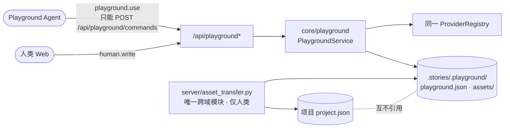
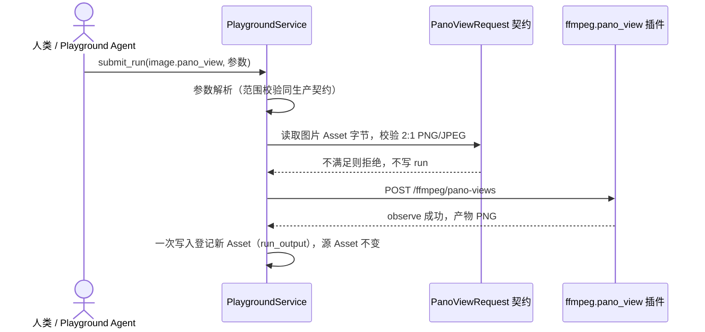
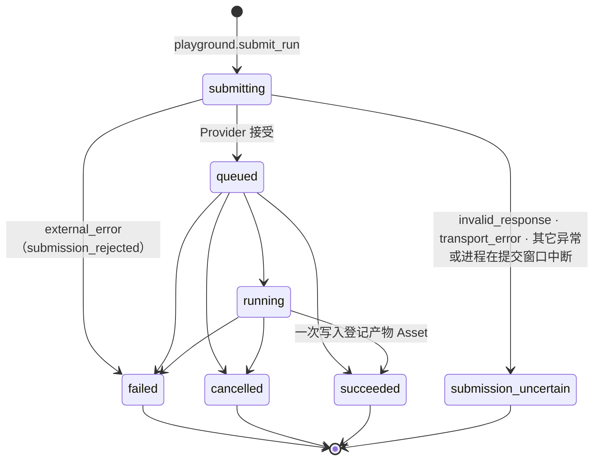
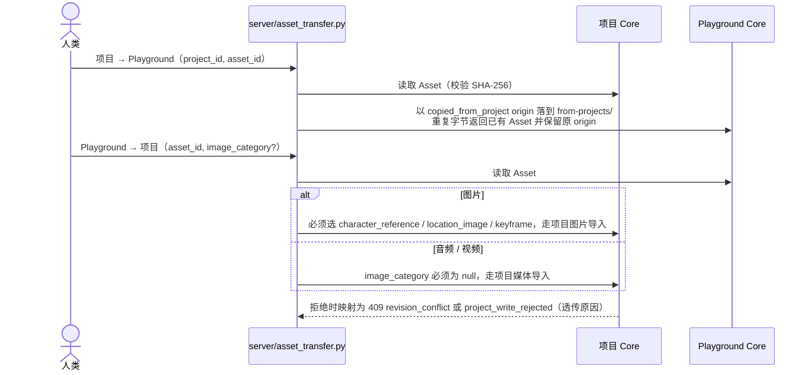

# Playground

Playground 是一个**与项目平行、全局唯一的媒体实验台**。它不含任何故事上下文，不读取也不修改任何项目；人和从 Playground 页面
启动的外部 Agent 用它调试生产中同一批媒体 Provider。产物进入 Playground 自己的资产库，需要时由人类复制到某个项目。

入口：项目列表页顶部「Playground」按钮（`/?playground=1`）。

模型能力目录来自当前可用的能力绑定；`recipe` 与 `parameters_schema` 由插件声明生成。
Playground 顶栏同样暴露「Provider 设置」（绑定与插件设置全局共用），修改后能力列表立即刷新。
Web 用通用 RecipeForm 渲染全部模型槽位与参数；五项确定性工具有固定入口。

## 定位与边界

- 全局唯一，不做多实验管理；运行流按时间排列，可以加备注、隐藏。Web 运行流的「全部隐藏」按当前能力/状态过滤，
  逐条对列出的、`allowed_actions` 含 `dismiss` 的 run 发 `dismiss_run`，没有批量隐藏命令。
- **不突破生产约束**：只使用生产已经在用的 Provider 请求形状与参数范围；全局 Provider 设置与插件内部固定参数与生产一致；模型约束与软提示由 manifest 声明。
  当前 H3 不设时长上限，以 15 秒提示本地部署可能 OOM。
- 没有候选、选择和 Approval；同步能力（ASR、音频后处理、截取）也记成 run。
- 跨域复制只允许人类操作，且只做复制：产生一个全新的对侧 Asset，不共享引用；项目 schema 不记录来源。
- 权限隔离：Playground Agent 只获得 `playground.use`，拿不到任何项目；项目 Agent 也不获得 Playground。
- 不包含：节点图与工作流编排、批量提交与参数网格、故事形状能力（旁白 TTS、Scene 成片、Animatic、全片装配）、硬链接去重、
  资产标签/文件夹/搜索、多用户多 Playground、删除或重置整个 Playground 的 API。需要清空时，在 Core 停止后手工移走 `.stories/.playground/`。



## 存储与 authority

```text
.stories/.playground/
├── playground.json          唯一权威结构化状态，schema v2
└── assets/
    ├── images/{imported,runs,from-projects}/<可读名>-<sha256前10位>.<png|jpg|webp>
    ├── audio/{imported,runs,from-projects}/<可读名>-<sha256前10位>.wav
    └── videos/{imported,runs,from-projects}/<可读名>-<sha256前10位>.mp4
```

- `playground.json` 由 Core 串行化写入：校验 `revision + 1` 后原子替换；不引入数据库或双写。
- Asset 以 SHA-256、媒体类型和字节数校验，内容不可变；重复字节直接返回已有 Asset，不重写文件、不改 origin。
- 三个来源目录分别是用户上传、run 产物（含同步处理的副本）和从项目复制来的素材。
- 依赖规则由 `tests/test_playground_boundaries.py` 守卫：`core/playground/**` 不 import 项目领域包，项目包也不 import Playground。

## 能力

模型入口直接使用当前绑定插件的 recipe ID。Core 从 manifest 生成目录、分组、槽位、参数 schema 和执行方式；
Web 的 `RecipeForm` 按目录渲染，新增 recipe 不需要增加表单组件。目录包含当前可用的插件 recipe 与五项确定性工具。
已提交 run 保存 `capability = recipe ID`、完整 `recipe` 声明与 `provider_snapshot`，历史参数、输入顺序与标签按提交时声明校验。

| 当前插件 recipe / Core 工具 | 中文用途 | 执行 | 产物 |
| --- | --- | --- | --- |
| `codex_image.generate` / `agy_image.generate` / `qwen_image.generate` | 生图 | 异步 | 图片 |
| `codex_image.edit` / `agy_image.edit` / `qwen_image.edit` | 改图 | 异步 | 图片 |
| `breeze_tts2.voice_design` | 音色设计 | 异步 | WAV |
| `breeze_tts2.clone` / `indextts2.synthesize` | 声音克隆（按当前绑定） | 异步 | WAV |
| `whisper_asr.transcribe` | 语音转写 | 同步 | 文本（`result`） |
| `minimax_h3.fl2va` / `minimax_h3.ref2va` | 首尾帧 / 参考视频 | 异步 | MP4 |
| `seedvr2_7b_sharp_fp8.upscale` | 视频超分 | 异步 | MP4 |
| `demucs_audio.separate` | 人声 / 背景分离 | 异步 | WAV |
| `stable_audio_3.generate` | 文生音频 | 异步 | WAV |
| `video.extract_frame` | 按帧号抽帧 | 异步 | PNG |
| `image.pano_view` | 全景裁切 | 异步 | PNG |
| `audio.remix` | 音轨重新混音 | 异步 | MP4 |
| `audio.effect` | 音频后处理 | 同步（Core 本地） | WAV + `result` |
| `audio.trim` | 音频截取 | 同步（Core 本地） | WAV + `result` |

项目与 Playground 共用能力绑定、插件设置、请求构造和 manifest 约束。H3 画布与步数由插件设置换算，
CFG 与音轨开关由插件固定；SeedVR2 在插件内固定生产默认尺寸（短边 720、长边 1280）；图片模型由图片插件固定。
`audio.effect` 固定 `effect = "radio"`，不开放高级参数覆盖。

`image.pano_view` 把 2:1 等距柱状全景裁成一个透视视图，参数是 `image_asset_id`、`yaw_deg`、`pitch_deg`、`hfov_deg`、
`aspect_ratio`。范围与生产全景裁切契约（`core/model_providers/contracts.py`）是同一份校验：yaw ∈ [0, 360)，
全景正中为 0、顺时针为正；pitch ∈ [−60, 60]，抬头为正；hfov ∈ [20, 120]；画幅为 `16:9` / `9:16` / `2:1`。
输入必须是 PNG/JPEG、2:1（±1 像素）、宽 1024–16384、≤64 MiB；Core 从 PNG IHDR / JPEG SOF 头读出宽高（不依赖图片解码库），判定结果按 SHA-256 缓存。
满足条件的 Asset 在 `allowed_actions` 里带 `pano_view`，Web 的素材选择器和“作为输入”菜单只列出这些 Asset。
一次只裁一个视图，产物命名为 `<源名>-全景裁切-yaw<值>`；Web 的“四个方向依次裁切”按 yaw 0/90/180/270
逐条调用 `submit_run`，Core 没有批量接口。



参数对象拒绝未知字段；声明的全部键都必须出现，可空的键显式传 `null`。素材选择器按 slot 的媒体类型、时长与数量约束过滤；
机制参数使用共享字段组件，包括定长数值向量和高级参数折叠。素材“作为输入”的目标列表来自当前 recipe slots。
表单经只读 `recipe-inputs-preview` 获取 Core 计算的输入标签与有效性；Web 不维护模型专用编号器。
Core 不自动递增 seed；值由声明了 `seed` 语义角色的字段提供，字段 key 可以由插件定义。

## run 生命周期



- 同步能力不存在“远端任务是否已建立”的问题，因此不会进入 `submission_uncertain`。
- 观察：终态直接返回；`cancellation_requested = true` 时调用 `cancel`，否则调用 `observe`。`transport_error` 只标记
  `provider_unreachable`，阶段不变。中间 progress 只进内存观察缓存，不写文档。
- 取消：先持久化取消意图，再调用 Provider 并应用观察结果；失败时报告“取消意图已保存”。
- 重试：只接受未隐藏的 `failed` / `cancelled` / `submission_uncertain` run，用原样参数（含 seed）重新提交并保留 `retry_of`。
  Web 的“用这组参数”只是预填表单，不是 Core 动作。
- 启动恢复：`submitting` 的 run 迁移为 `submission_uncertain`，不自动重试。
- 只有未结束 run 的输入 Asset 不能被删除；已结束 run 的产物可以删除，run 记录保留原 Asset ID，UI 显示“产物已删除”。

## HTTP 路由

| 方法 | 路径 | 调用方 |
| --- | --- | --- |
| GET | `/api/playground` | 人类 |
| POST | `/api/playground/commands` | 人类、Agent（`playground.use`） |
| POST | `/api/playground/runs/refresh` | 人类 |
| POST | `/api/playground/recipe-inputs-preview` | 人类（只读） |
| POST | `/api/playground/assets/media?filename=<名>` | 人类 |
| GET | `/api/playground/assets/{id}/content` | 人类 |
| GET | `/api/playground/assets/{id}/video-frame-info` | 人类 |
| DELETE | `/api/playground/assets` | 人类 |
| POST | `/api/playground/assets/copy-from-project` | 人类（还需项目在其 scope 内） |
| POST | `/api/projects/{pid}/structured-director/assets/copy-from-playground` | 人类 |

命令信封是 `{"name", "idempotency_key", "arguments"}`，**没有** `expected_revision`：run 记录只追加，没有可以互相覆盖的编辑态，
并发安全由 Core 锁与幂等键保证。请求记录与业务变更在同一次写入里落盘，最多保留 1,000 条；重放返回首次保存的完整回执。

命令：`playground.list_capabilities`、`list_runs`、`get_runs`、`list_assets`、`wait_runs`、`submit_run`、`cancel_run`、`retry_run`、
`dismiss_run`、`set_note`。读命令不写记录。

错误码：400 `invalid_json` / `invalid_request`；404 `run_not_found` / `asset_not_found` / `not_found`；409 `provider_unavailable`、
`run_state_conflict`、`asset_in_use`、`idempotency_conflict`、`project_write_rejected`；503 `provider_unavailable`（观察或取消时
Provider 暂不可读）。分类见 [错误契约](error-contract.md)。

## 授权

| 调用方 | 规则 |
| --- | --- |
| 人类 | 需要 `human.write`；`copy-from-project` 还要求 `project_id` 在自己的项目范围内 |
| Playground Agent | 需要 `playground.use`，只能访问 `POST /api/playground/commands`，命令名必须在白名单内；快照、素材内容、上传、refresh 一律拒绝 |
| 项目 Agent | 没有 Playground 权限，任何 `/api/playground*` 都被拒绝 |
| `copy-from-playground` | 走项目路由：Agent 被 `external_mutation_disabled` 拒绝；人类需要 `human.write` 且项目在其 scope 内 |

## 跨域复制



Web 复制到项目前先读目标项目 revision；遇到 `revision_conflict` 自动重读并重试一次。

## Agent

`integrations/agent_launcher` 的 `--playground`（与 `--project` 互斥）启动只连 Playground 的 Agent：

- 本机控制请求 `{"action": "connect_playground"}`，凭据只有 `playground.use`、`project_ids = []`，有效期 30 天；
- 锁文件 `<socket 目录>/playground.launch.lock`，同一时刻只允许一个 Playground Agent；卷 `storyrail-<agent>-playground`；
- gateway 只设置 `STORYRAIL_SCOPE=playground`，只放行 `POST /api/playground/commands`；
- 工作区写入 `startup.json = {"scope": "playground"}` 与来自 `PLAYGROUND_PROMPT.md` 的 `AGENTS.md`；
- MCP 以 `--scope playground` 启动，只发布 6 个工具：

| 工具 | 输入 | 翻译为 |
| --- | --- | --- |
| `playground_capabilities` | `{}` | `playground.list_capabilities`（含全部能力的参数 schema 与 `image_prompt` 写作指南） |
| `playground_submit` | `capability`、`parameters`、`note?`、`idempotency_key` | `playground.submit_run` |
| `playground_runs` | 按 `action` 严格 oneOf 的 `list` / `get` / `wait` | `list_runs` / `get_runs` / `wait_runs` |
| `playground_manage_run` | `action` ∈ `cancel` / `retry` / `dismiss` / `set_note`，`run_id`，`note?`，`idempotency_key` | 对应写命令 |
| `playground_assets` | `limit?`、`cursor?`、`media_kind?` | `playground.list_assets` |
| `ring_alarm` | `message`（1–200 字） | `playground.ring_alarm`（[主机闹钟](external-agents.md#主机闹钟)，不读写 Playground） |

- `capability` 不在 MCP 侧枚举，由 Core 校验，新增能力不需要改 MCP。
- 没有读取 Playground 媒体字节的工具：元数据只用于绑定素材，不能代替看图。带图提示词统一遵守全局生图 Skill；
  Agent 无法看到实际图片时，请用户提供各图内容与参考用途，必要信息不足时暂停相关编写与生成，不能凭文件名猜图。
- `PLAYGROUND_PROMPT.md` 要求：提交多个视频 run 之前先说明排队情况，并在当轮取得用户明确同意；“一次做完”“不用问我”不构成同意。

## 调度

媒体服务的 lane 分组、Mac 三 lane 与“排队中：前面还有 N 个任务”提示都在私有部署 `default_model_providers_implement/` 内实现，
Core 与 Playground 都不感知分组。Playground 与项目生产的任务在同一条 lane 上按提交顺序排队。
