# 产品概览

## 定位

StoryRail（镜序）把一份**已经写完的 Markdown 导演方案**变成可审核、可追溯、可恢复的视频生产项目。
它面向个人创作者与小型制作团队，输出是一组经过人工审核、带完整输入血缘的媒体资产，以及用户明确批准的
按所选旁白语言输出最终成片。

StoryRail 不承担前期创意。导入页提供两段可复制的提示词，用户交给自己常用的外部 AI：还没有方案时用
「创作搭档提示词」从想法聊到定稿；已有分镜表或其它格式的方案时用「方案整理提示词」，把按镜号、时间码
切好的镜头表改写成按段落组织的连续内容，只保留明确的剪辑决定。两者共用同一份最终交付格式（含每段的段落
意图：作用、观众认知变化、必须揭示与必须保留、情绪功能）。提示词只是引导，不是导入门禁。

```mermaid
flowchart LR
    plan[完整导演方案<br/>Markdown] --> project[创建项目<br/>固化标题·画幅·旁白语言]
    project --> refs[引用库<br/>角色·非出镜声音·旁白身份]
    refs --> script[结构化脚本<br/>Scene / Shot / Segment]
    script --> narration[项目所选语言旁白<br/>TTS · 选择 · 校时]
    narration -.可选.-> loc[地点库<br/>语义 · 状态 · 独立图片]
    loc -.语义上下文.-> kf[Keyframe<br/>首尾帧 · 自行考虑地点]
    narration --> kf
    kf --> video[Segment 视频<br/>FL2VA / Ref2VA · 超分]
    video --> scenefinal[Scene 成片<br/>所选语言版本]
    scenefinal --> final[最终成片<br/>所选语言版本]
    final --> approval([Approval])
```

脚本生成后，所有后续内容层都嵌在**同一个结构化导演台**里累加显示，不切换到专用页面。左侧导航是 Scene → Segment，
Scene 页另有镜头设计列表；Segment 标签显示覆盖的 Shot 区间与是否承接上一段。上游修改只精确失效依赖它的当前选择与装配，历史媒体全部保留，已开放的内容层不会重新上锁。

## 两类使用者

| 使用者 | 做什么 | 不能做什么 |
| --- | --- | --- |
| 人类（浏览器） | 创建项目、手工编辑全部计划、生成媒体、**采用候选**、**审核确认**、**Approval**、复制资产 | — |
| 外部 Agent（终端里由用户启动） | 读取 Core 投影与专业 Skill；提交 proposal；编辑计划；按用户指令生成媒体、观察任务、装配 | 采用候选、审核确认、Approval、重新开放生产、直接写项目文件、调用 Provider |

外部 Agent 是用户自己选择的成熟工具（Pi、Codex CLI、Antigravity CLI、Kimi Code、DeepSeek Harness、Grok Build）。
StoryRail 不内置 Agent、不持有模型会话，也没有隐藏 fallback。详见 [外部 Agent 接入](external-agents.md)。

## 核心概念

| 概念 | 说明 |
| --- | --- |
| Project | 生产容器；创建时固化 `title`、`aspect_ratio`（`16:9` / `9:16` / `2:1`）和旁白语言；人类可在导演台手工修改 `director_plan_markdown`，Agent 不可修改 |
| Reference Library | 角色卡（可见角色或非出镜声音）与独立旁白身份；Core 分配 ID |
| Scene | 叙事块；声明 `driver` 为 `narration`（旁白驱动：恰好一条旁白 Cue，无对白）或 `drama`（表演驱动：无旁白，对白可有可无）；可绑定一个地点及其状态 |
| Shot | 创作层的连续镜头：构图、运镜、动作、声音、可见角色与转场意图；不持有地点绑定或生产状态 |
| Segment | 生产原子与一次视频生成单位（不短于 0.2 秒，默认 15 秒软约束），承载对白（仅 Drama Scene）；每个 Segment 一张视频卡，可覆盖一个或多个连续 Shot，一个 Shot 也可跨多个相邻 Segment |
| Narration Cue | Scene 旁白，按创建时所选语言建立 `zh` / `en` 轨道，未选语言为 null，各自正文、seed、表演指示、已选音频 |
| Location | 跨 Scene 共享的固定空间：描述、固定陈设、主光、状态变体和可选独立图片；图片不绑定 Shot/Keyframe |
| Location Image | 普通图或 2:1 全景图；每张图必须有实际内容说明。全景图可在 3D 查看器中手动取景生成独立普通子图 |
| Keyframe | Segment 的首帧或尾帧；相邻 Segment 可显式共享边界 Keyframe；Planner 根据 Scene 地点语义和镜头上下文自行建立空间 |
| Asset | 不可变媒体字节，按 SHA-256、媒体类型、字节数校验 |
| Generation | 一次 Provider 尝试或本地处理：输入、参数、seed、状态、产物、`retry_of` |
| Candidate Selection | 从属于目标的成功、未隐藏 Generation 中显式采用一个 Asset |
| Approval | 一次同时批准所选语言版本最终成片的精确 Asset、Generation 与 revision |

完整字段与约束见 [数据模型](data-model.md)。

## 当前能力

- 项目创建、列表、打开与移入 `.stories/.trash/`；
- 引用库：外部 Agent proposal（含每个角色的多套造型与使用场合）、人工编辑；造型是角色图的唯一单位，
  每套造型一张造型图（生成柔和浅灰底多视图设定图：单一版式、不预设人形，完整提示词可编辑，2:1；或从资产库选定）、音色设计（Voice Design）或上传参考音色，
  参考文字稿可用本机 Whisper 转写后人工校对；
- 结构化脚本：外部 Agent 先生成 Shot 列表、再打包成 Segment；人工或 Agent 以原子操作局部修改（增删 Scene/Shot/Segment、拆分与合并 Segment），覆盖关系由 Core 校验；
- 项目所选语言旁白：旁白身份按所选语言各一套参考音色，分别 TTS、审核、选择；单语按真实时长校准，双语按较长音频校准；
- 地点库：外部 Agent 从完整脚本规划地点、状态和可选独立图片并绑定 Scene，人工编辑与改绑；普通图/全景图可单项或成套生成，
  全景图点击进入 3D 查看器并由用户手动取景，人类选择普通生成候选；
- Keyframe：按 Segment 建首尾槽位，激活、正文、可见角色造型、辅助图、共享/拆分边界、从上一 Segment 视频按帧号抽取；地点图片不自动提交；
- Segment 视频：FL2VA / Ref2VA；导演台把 Ref2VA 其他图片与首尾帧并列展示，可从已选关键帧或资产库参考图添加（当前已启用的首尾帧不重复列入），底层显式保存为
  `additional_images`（≤4，逐图必填说明），另有参考音频（≤8）与参考视频（≤3），人工或外部 Agent 均可保存；SeedVR2 超分；
  FL2VA 至少需要首帧或尾帧之一；Ref2VA 不要求图片，但图片、音频与视频参考合计至少有一个输入资产；
  从资产库挂接任意 MP4 为候选；
- Scene Animatic 预览、Scene 成片（所选语言版本）、最终成片（所选语言版本）、Approval 与重新开放生产；
- 资产中心：导入图片/WAV/MP4、通用音频生成、WAV 截取与后处理、视频音轨分离与重新混音、按帧号抽帧、
  永久删除未使用资产；
- 全局 Provider 设置：每个媒体能力绑定哪个插件（如生图用 Codex 或 AGY），以及插件自身设置（如 H3 的基础模型预设、分辨率、SageAttention、SelfLift）；候选卡显示提交时的设置摘要；
- [Playground](playground.md)：与项目平行的媒体实验台。

## 人工控制边界

生成、选择与批准是三个独立权限：

- **generate** 只创建新的 Generation，从不替换当前选择；
- **select** 只接受属于目标、成功、未隐藏且产物类型正确的候选；
- **approve** 只在用户本轮明确批准精确成片时成立。普通正面评价、“看起来不错”、推荐采用都不构成 Approval。

进入 Keyframe 或视频阶段只建立空卡，不自动生成。单图按钮只提交该 Keyframe；批量动作只提交授权范围内
当前依赖已满足的目标，前置完成后需要新的显式“继续”。

## 非目标

- 前期创意聊天、剧情发展、导演方案撰写或完整度审核；
- 内置 Agent runtime、通用 Agent 框架、模型侧 shell 或任意文件访问；
- 任意 URL 下载、任意 Provider 控制接口，或让外部服务持有项目语义；
- 数据库、ORM、双写、旧 schema 迁移（开发期 schema 变化后新建项目）；
- 发布渠道、多人实时协作、组织权限系统、完整非线性剪辑器、三维空间求解。

## 产品完成标准

- 服务重启后可以从 `project.json` 恢复全部项目事实、Generation、DirectorRun 与幂等回执；
- 模型无法绕过 Core 的 ID、scope、revision、授权、失效与血缘校验；
- 每个媒体产物可追溯到目标、输入 Asset、提示词、参数、Provider 与 Generation；
- 用户能区分当前选择与历史候选，并看到失败、等待与恢复状态；
- 同一个导演台持续承载所有已解锁的生产层。
