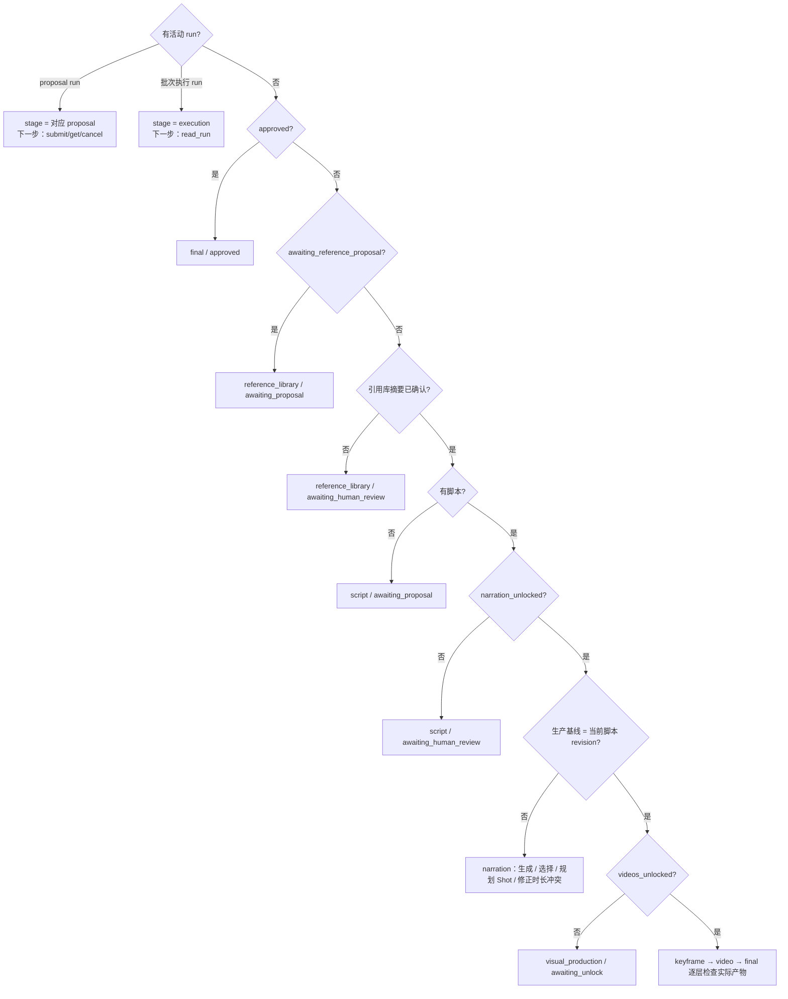
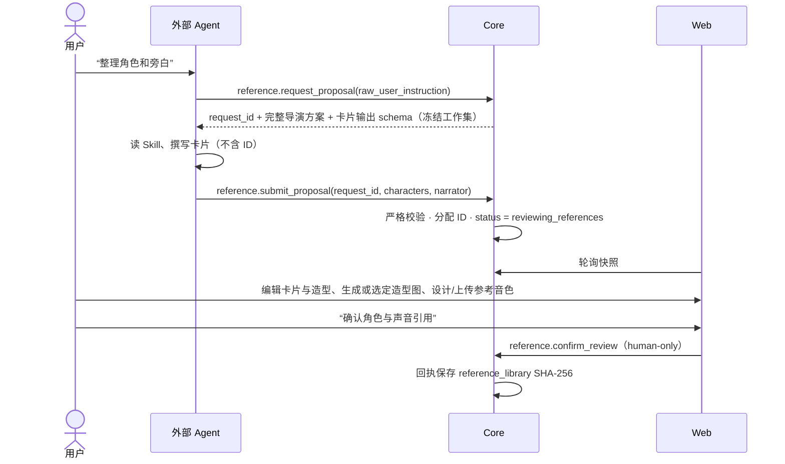
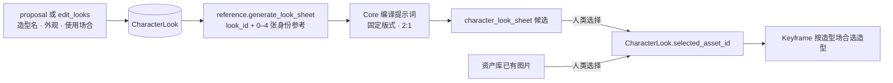
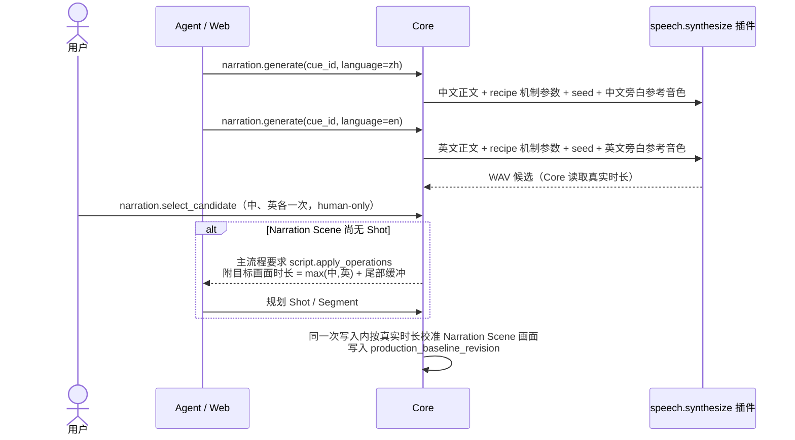
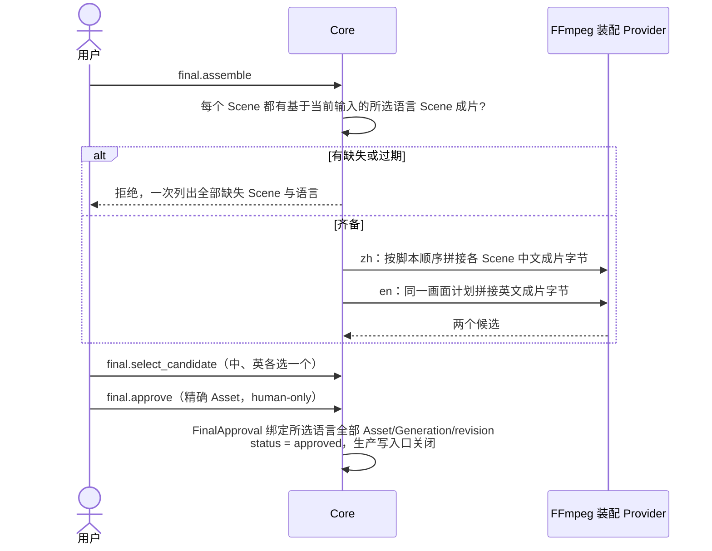

# 生产工作流

本文按阶段描述一个项目从导演方案到批准成片的完整业务流程：每一步由谁触发、读什么、写什么、被什么门禁。
命令的精确参数见 [命令目录](commands.md)，请求如何穿过系统见 [控制流](control-flow.md)，时序与输入编译算法见
[数据流](data-flow.md)。

## 全景


**主流程投影**：Core 的 `reads/workflow_state.py` 从当前 document 派生“主流程现在停在哪、下一步必须做什么”，
不持久化第二份状态。外部 Agent 通过 `read_workflow` 读取，Web 与 Agent 看到的是同一份事实。投影的判定顺序就是
上图的门禁顺序：



## 1. 创建项目

- **触发**：人类在首页提交项目名、画幅（`16:9` / `9:16` / `2:1`）、完整 Markdown 导演方案（≤ 50,000 字符）和旁白语言。`narration_languages` 必填，仅允许 `zh`、`en`，至少一种、不重复；未选择时页面禁用创建，Core 拒绝请求。
- **写入**：`POST /api/projects` 建立 `<项目名>-<project_id>/project.json`，`status = awaiting_reference_proposal`，
  标题、画幅、原方案和旁白语言四个创建字段永久固化。该接口只持久化项目、立即返回，**不等待任何 Agent**。
- 单选中文或英文时，只建立该语言的音色、旁白、Scene 成片和最终成片；两种都选时才走双语流程，按较长音频校准共用画面。未选语言的字段为 null，不能提交对应语言的合成、装配或批准。
- **之后**：页面直接进入导演台并显示“引用库尚未建立”，等待外部 Agent 通过正式入口提交引用库 proposal。

## 2. 引用库



- Agent 只读取完整 `director_plan_markdown`，提出需要跨镜头一致的角色卡（可见角色或非出镜声音）以及存在旁白时的独立旁白身份。
  每个可见角色带 1–8 套造型（look）：造型名、外观（服装、发型、配饰、身体状态）与使用场合（自由文本，如“第一幕童年时期”；
  此时还没有 Scene ID）。Core 分配卡片与造型 ID。
- 造型图、参考音色的生成只新增候选；用户显式采用后才成为当前参考。隐藏候选不删除历史。

### 造型与设定图



- **造型是角色图的唯一单位**：角色卡上的图只能是某套造型的造型图，每套至多一张。造型图有两种来源，都只由人类选定：
  选择设定图候选，或把资产库里已有图片（导入的照片、外部设定图）设为造型图。
- 每套造型可生成一张**设定图**（柔和浅灰底，固定 2:1）：左侧约四分之三为同一主体的正面、正侧、背面与最能展示形态的第四个角度
  （直立人形取四分之三侧，伏地、爬行或多足生物取俯视），右侧约四分之一为头部正面特写。只有一套版式、没有形体标记：
  提示词先写主体（角色视觉描述与本次造型外观），再写版式；版式不含站姿、双臂、头肩、五官、妆容、服装等只属于人的措辞，
  并明确要求非人生物按真实生物绘制、不得人形化或拟人化、只画主体本身而不画巢穴、蛛网等所处环境。
  身份参考图（≤ 4 张项目图片）显式传入，只保持身份识别特征、体型与比例，映射写在提示词顶部。
- 人类在造型图弹窗里看到按当前图片插件约定编译的完整提示词（`sheet-preview`，只读不写），可直接编辑后生成；
  编辑过的提示词原样提交并记入 Generation，重试沿用当时提交的提示词与身份参考。Agent 只能用 Core 编译的提示词。
- 分辨率按插件上限：画幅由画布保证的插件（Qwen）沿用全局分辨率档位，不写画幅句；画幅写进提示词的插件（Codex / AGY）
  由 Core 在提示词里写“2:1 横构图、4K（4096×2048）”。
- 生成只新增候选，人类在角色卡的造型图弹窗中选择。Keyframe 引用造型而不是图片，改选造型图不需要改写 Keyframe，
  也不失效已有 Keyframe 候选。
- 人类在角色卡上增删改造型（新造型 id 为 null，由 Core 分配；整卡保存只改造型文字）；删除造型时 Core 剪除 Keyframe 对它的选择，
  该角色回到默认规则。Agent 用 `edit_looks`（`reference.apply_look_operations`）新增或修改造型，用 `generate_media` 的
  `look_sheet`（`reference.generate_look_sheet`）在用户明确要求时生成设定图；Agent 不能删除造型或选定造型图。
  改造型文字不失效已选造型图。
- 旁白身份按已选语言各有一套独立音色（各自的音色描述、参考 WAV 与完整文字稿）。Agent proposal 分别给出
  `zh_voice_description` / `en_voice_description`（未选语言为 null）；设计、上传与采用都按语言进行，只替换同语言的那一套。
- Clone/Direction 音色需要完整参考文字稿：用户填写，或点击按钮调用本机 Whisper 转写后校对回填。ASR 不对 Agent 开放。
- **确认是摘要绑定的**：之后任何引用内容变化都会让摘要不匹配，主流程回到“等待人类确认”。已进入生产的项目不会因此回退内容层。
- 未确认引用时，脚本请求返回 409 `stage_prerequisite_not_met`，不创建 run、Generation 或回执。

## 3. 结构化脚本

- **触发**：用户审核引用后，明确要求 Agent 生成脚本。系统不会因项目创建或引用确认而自动开始。
- **读取**：脚本 Skill 只读原始导演方案、当前引用卡和必要的当前脚本。
- **写入**：`script.submit_proposal` 提交不含 ID、资产或候选字段的严格草稿；Core 分配全部 Scene/Shot/Segment/Cue ID，
  `status = reviewing_script`。
- **初稿规则**：
  - `narration` Scene 只有一个语义原子的 Cue（不按标点数量判断），所选语言的轨道，**不规划 Shot**；之后规划的
    Segment 不含对白；
  - `drama` Scene 先设计 Shot，不预设 Scene 总时长；不含旁白，对白可有可无；
  - 同一内容既需要旁白又需要对白时拆成相邻的 narration 与 drama Scene，Core 拒绝在同一 Scene 混用；
  - 初次规划时每个 Shot 只有一个 Segment，预计时长按真实节奏填写（不短于 0.2 秒），超过 15 秒软约束也不预先拆分；
    已有 Segment 只在用户明确要求时拆分或合并（Skill 约束，Core 不校验 Shot 的 Segment 数量）；
  - 脚本必须先确定镜头功能、视觉重心、空间调度、揭示路径、起止状态与连续性锚点，Keyframe 与 H3 只具体化这些既定意图；
  - 先调度、后切镜，默认不切：动作阶段、说话人、连续运镜中的景别变化或模型时长都不单独构成新 Shot；导演方案用文字
    明确写出的剪辑决定照做，分镜表的镜号与时间码只是内容顺序和节奏意图，连续的相邻镜号默认合并；
  - 合并只合并摄影、不删内容：方案的节拍、台词（含引用库外说话者）、可见文字、伏笔与回收、声音与配乐入点逐项落到
    Segment 或 Shot；方案给出时间码时每个 Scene 合计时长与方案同一量级，偏差超过约 30% 或有意删减时在
    `reply_markdown` 逐条说明（Skill 约束，Core 不校验）；
  - 用户要求拆分时，分段边界落在可从上一段实际视频截帧续拍的稳定状态，后一段从同一时刻、同一运镜继续；
  - 初稿与多 Scene 回改先成稿、再逐 Scene 复查后提交，复查过程不进入 proposal。
- **修改**：人工表单与 `script.apply_operations` 都走同一组原子操作（见 [命令目录](commands.md#脚本)）。
  讨论不等于授权修改；Agent 返回空操作时 Core 不改变 revision。
- **确认**：人类 `script.confirm` → `narration_unlocked = true`、`status = reviewing_narration`，并由 Core 立即尝试
  建立生产基线；没有旁白的脚本由此直接进入视觉生产解锁。旁白层已解锁时重复确认不写入。

## 4. 旁白审核与校时



- 每条 Cue 的所选语言的轨道各自保存正文、seed、`recipe_params` 与已选音频，**分别合成、分别选择**。英文是适合朗读的意译；对白不做双语。
  机制参数以 `recipe_params[recipe_id]` 保存。快照 `provider_recipes` 与专业工作集 `speech_recipe` 给出当前绑定的
  `editable_params`，Web 按声明渲染，Agent 按同一声明调整。正文、语言、seed 与同语言的参考音色由 Core 填充。
- 修改某语言正文或合成参数只清除该语言的音频选择，并使时序与装配失效；既有视觉 Shot 保留。纯结构锚点重建不重做 TTS。
- 用户明确要求时，Agent 可用 `narration.clear_selection` 解除某语言当前音频引用；这不授予采用其它候选的能力。
- 旁白层解锁后，每次脚本或旁白写入（含选择音频、规划 Shot）都由 Core 在同一次写入里自动校准时序，没有人工确认步骤。
  校准要求每条 Cue 已选语言的音频都已选择、存在旁白身份、所有 Scene 已有可校准的 Shot；成功时按真实音频校准 Narration Scene
  的画面覆盖，并把校准后的脚本写为**生产基线**。已对齐的时长逐位保留，重算不会让无关 Segment 的视频选择失效。
- 无法校准（缺音频或 Shot、缩放后 Segment 短于 0.2 秒）时生产基线保持失效，主流程返回
  `script.apply_operations`（`reason = narration_timing_conflict`，`message` 为 Core 的具体原因，`target_ids` 为无法校准的 Scene），
  Web 在项目概览显示该原因；修正脚本的那次写入即重新建立基线。
- Drama Scene 没有旁白，不参与校准，表演时长保持脚本设计。
- 时序算法见 [数据流 · 旁白时序](data-flow.md#旁白时序)。

## 5. 地点（可选）

地点库把跨 Scene 共享的固定空间建成结构化事实：每个地点有一张主图、若干固定陈设与主光、可选状态变体，以及供 Keyframe
参考的机位视图。Shot 的 `view_id` 只是给 Keyframe Planner 的空间参考建议，不强制、也不是底图；Keyframe 建帧默认以它为
`reference`，Planner 可改选本 Scene 地点的其它视图或不用，使室内正反打、同机位多镜头的背景保持一致；
只有用户明确要求画面严格贴合视图时才用编辑底图。
数据结构与失效规则见 [数据模型 · 地点库](data-model.md#地点库)。

```mermaid
flowchart TB
    S[生产基线已建立] -. 推荐 location.request_proposal .-> P[Agent 规划地点<br/>location proposal]
    P --> B[地点库 + Scene 地点/状态 + Shot 视图]
    B -. 推荐 location.generate_set .-> G[成套生成批次]
    G --> M[主图候选]
    M --> SM[人类选择主图]
    SM --> V{kind}
    V -- interior --> C[全景裁切<br/>Core 直接写入 crop_asset_id]
    C --> R[细化 edit]
    V -- exterior --> T[主图转向 edit]
    R --> SV[人类选择视图图片]
    T --> SV
    SV --> U[解锁视觉生产<br/>Keyframe 继承 Shot 视图]
    S --> U
```

**规划**：用户明确要求后，Agent 通过 `location` 专业能力规划（`location.request_proposal` 要求已有结构化脚本，
否则 409）。工作集给出完整导演方案、每个 Scene 的标题/梗概/设定与全部 Shot 的构图、运镜、动作与可见角色，以及当前地点库。
proposal 一次提出地点（含陈设、主光、主图正文、状态与视图）与 Scene/Shot 绑定，Core 编译为与
`location.apply_operations` 相同的操作并在一次提交内落库：

- 同一物理空间只建一个地点；彼此看不见的空间不硬合并；同一空间的昼夜、天气、布置或破坏变化建为状态，Scene 绑定 `state_id`；
- 室内地点按方位列出固定陈设（只放固定陈设，不放人物、群众或临时道具）；视图用 `azimuth_deg` 定义，正反打视图方位相差约 180°；
- 视图按 Shot 的空间需求规划，不要求每个 Shot 一张；机位与朝向相同的多个 Shot 共用同一视图并把参考建议指向它，
  hfov 按景别取值（大全约 90–110°，全/中约 60–75°，近/特约 30–45°）；`shot_bindings` 只是给 Keyframe Planner 的建议；
- proposal 是增补：未列出的项不删除，列出的已有项整体替换；已选主图的地点不能再改陈设或主光方位，只能经 `calibrate` 修改；
- 规划期间持有 `location_plan` run，其它业务写入被锁。

人工可在导演台的地点库浮层逐项创建、编辑、删除地点、陈设、状态与视图，并在 Scene/Shot 上改绑；每次修改前展示服务端影响预览。
删除视图时，只被 Shot 软引用的允许删除，同一操作清空这些 Shot 的参考建议并在预览中列出；被 Keyframe 或其它视图引用时拒绝并列出引用者。
删除地点时其全部视图按同一规则处理，Scene 仍绑定该地点时拒绝。软引用清空不会作废已规划 Keyframe。
室内地点已选择 2:1 主图后，视图编辑器把主图显示为可拖拽的透视相机：拖动直接修改绝对方位（或相对已标定陈设的偏转）与俯仰，
滚轮或触控板修改水平视场角，预览画幅恒等于项目画幅，数值字段与画面双向同步。该预览只修改尚未提交的 Web 草稿；保存仍先调用
Core 影响预览，再按 revision 写入。室外主图不是全景，不提供伪造的可旋转预览。地点库从项目创建起即可编辑，不受阶段门禁；
Approval 后或有活动 run 时关闭。

**生成**：

| 目标 | 命令 | 室内 | 室外 |
| --- | --- | --- | --- |
| 主图 | `location.generate_master` | `image.generate`，固定 2:1 等距柱状全景、无人物、左右无缝 | `image.generate`，项目画幅 |
| 视图 | `location.generate_view` | 无有效裁切时**只**提交全景裁切（`PANO_VIEW`）；裁切完成后再次显式调用才提交细化 edit | 以主图已选图为底图的转向 edit，一步完成 |

- 主图需先填写主图正文；视图要求主图已选、参考视图已选；朝向陈设的视图在陈设未在当前主图上标定方位时拒绝。
- 全景裁切是 Core 的确定性工具：同输入必得同字节，产物由 Core 直接写入视图 `crop_asset_id`，不是候选、不需要人选。
  回调只在裁切快照仍等于当前主图与几何时写入，否则只保留历史；回调不自动续提交细化。
- 细化以裁切图为底图（另加显式参考视图），不提交 2:1 全景主图；提示词保持取景中心、镜头朝向、景别与物体关系，明确修复
  全景转透视造成的直线弯曲、边缘拉伸、比例失衡和不自然透视，允许为恢复可信单一透视调整局部轮廓、尺度和边缘位置，但不
  改变空间布局、增删物体或改换机位；同时去除模糊并补足细节，视图有状态时叠加状态差量，不附空间描述或正文；
  室外转向写明相对主图的水平转向角、俯仰与景别。提示词编译见 [数据流 · 地点图片输入编译](data-flow.md#地点图片输入编译)。
- 主图与视图只有人类可以选择（`location.select_master` / `location.select_view`）：只接受该目标自己的成功、未隐藏图片候选，
  室内主图还必须是 2:1 PNG/JPEG、宽 1024–16384。Agent 只能清除选择。

**成套生成**：`location.generate_set` 以 `target_ids`（地点 ID）启动一个范围固定的批次，每轮按依赖提交当前可提交的单元：
未选主图 → 主图；主图已选 → 各视图的裁切或细化/转向。已有成功未选候选的项报告“等待选择”，不重复提交。
每轮结束自己的 run；本轮无可提交项时停下并说明原因（等待选择主图/视图、等待标定、等待参考视图）。选择或回调都不自动推进，
继续需要再次显式调用 `location.generate_set(run_id)`。地点被删除时该项报告“已不存在”，范围不扩大。

**推荐与跳过**：生产基线建立、引用库已确认且无活动 run 时，`read_workflow` 在 `recommended_next_actions` 里给出可选建议：
有 Scene 未绑定地点或 Shot 未绑定视图时推荐规划（只带缺口数量）；地点主图或视图未选齐且没有在途批次时推荐成套生成；
在途地点批次等待显式继续时只推荐继续。推荐永不进入 `required_next_actions`、不改变 `allowed_actions`，Agent 读到后只向用户提议。
解锁视觉生产本身就是跳过地点：解锁后不再推荐规划与成套生成；解锁的影响预览与回执附 `location_advisory`，列出未绑定地点的
Scene 与未绑定视图的 Shot。

## 6. 解锁视觉生产与 Keyframe

**解锁**（`unlock_visual_production`）要求生产基线 = 当前脚本 revision。它一次性：

1. 为每个 Segment 建立独立的首帧与尾帧 Keyframe（尾帧以首帧为前置），两个槽位默认都不启用；环境字段按 Segment 首个/末个覆盖 Shot 的视图写成显式值；
2. 为每个 Segment 建立视频卡（无对白默认 FL2VA，有对白默认 Ref2VA）；
3. 置 `keyframes_unlocked` 与 `videos_unlocked`，`status = reviewing_videos`。

只建空卡，**不自动生成**。

**规划**（Keyframe Planner Skill 或手工弹窗，读写同一份计划）：

- 先确定整段连续关系与视觉信息需求，再选择最少必要帧。单帧只在它已覆盖必要的角色、环境和道具信息时使用；
  局部拉远揭示通常需要首尾双帧；精确结束状态需要尾帧。
- 相邻 Segment 的边界默认是两个独立 Keyframe；用户或 Planner 可显式 `share_boundary` 共享为同一 Keyframe。
- 角色唯一、造型可多套：每套造型对应不同时期、服装或状态，带使用场合。每个 Keyframe 为可见角色选择本帧使用的造型
  （`character_references`），Planner 与手工弹窗读写同一字段；多套造型未选择时该帧不能生成，所选造型没有造型图时也不能生成
  （批次中作为等待依赖）。删除造型时 Core 同步剪除各 Keyframe 对它的选择，已生成候选与选择保留。
- 默认只规划用户指定范围；Planner 可读目标 Segment 所属完整 Scene 作上下文，但 Core 只合并目标 Segment 的 Keyframe 子图。
  只有用户明确要求全部规划时才遍历整个项目；局部规划恢复时目标范围丢失，必须无修改结束并要求重试，绝不扩大成全量。
- **规划锁定节点**：已有未隐藏成功候选或已选候选的 Segment，重新规划时保留其首尾绑定、正文、候选与辅助图。

### Keyframe 使用地点视图

每个 Keyframe 保存显式的 `environment_mode`、`environment_view_id` 与 `environment_none_reason`：

| 模式 | 提交 | 编译语义 |
| --- | --- | --- |
| `edit` | 视图已选图作为编辑底图 | 同一地点该机位的空环境；保持陈设、材质与光线，只加入本帧的人物与动作；只在用户明确要求画面严格贴合视图时使用 |
| `reference` | 视图已选图作为参考（默认） | 同一地点的空间参考；只参考固定陈设的方位关系、空间布局、材质与主光方向，不照搬该图的机位、视角与构图，按本帧画面目标重新构图，人物与环境须融为同一光照与透视 |
| `none` | 不提交视图，视图为 null | 理由可选（最多 500 字，空白存为 null），不进入提交 |

- **继承**只在建帧时发生（解锁视觉生产、脚本回改给新 Segment 建帧）：首帧取首个覆盖 Shot 的视图、尾帧取最后一个覆盖 Shot 的视图，有视图 → `reference` + 该视图；无视图 → `none`
  （无理由）。之后 Scene/Shot 改绑不改写已建立的帧，规划锁定节点也不被继承改写。
- 视图是软参考：Segment 首/末覆盖 Shot 的视图只是建议。Keyframe Planner 的三个环境字段都写 null 表示继承，由 Core 按同一规则填值；
  也可以按本帧机位朝向在本 Scene 地点的全部视图中自由改选（`reference`），没有合适视图或画面没有环境信息时用 `none`，
  改写不需要说明理由。`edit` 只在用户明确要求画面严格贴合视图（背景逐像素一致、不做重新构图）时使用。Planner、手工弹窗与
  `keyframe.apply_operations` 的 `none` 理由都可选。正文不重述视图里已有的固定陈设、材质与主光，只写人物、动作、构图与需要变化的部分。
- 手工计划弹窗的视图选择器只列本 Scene 地点的视图；帧当前视图属于其它地点时作为当前值保留并标明来源。“当前实际图片输入”
  按 Core 预览逐图显示编辑底图/参考图及用途。
- **输入名额**：视图 → 可见角色参考 → 前置帧 → 辅助图，同一 Asset 只占一个名额，合计不超过 5 张（`MAX_IMAGE_INPUTS`，
  与地点生成共用）；超额时拒绝并按此顺序列出会被挤掉的输入，不静默丢弃。名额顺序不改变提交顺序中的编辑底图排第一
  （`edit` 视图；否则启用首帧时的前置帧）。
- 视图未选图时允许规划；单帧生成拒绝并提示先选视图图片或改为 `none`；批次把它当作未满足依赖。

**生成**：

- 卡片单图按钮只提交该 Keyframe，成功回调只保存结果，不触发其它任何 Keyframe。
- 批量（`keyframe.generate_batch`，MCP `media_batch` `kind=keyframe` `action=start`）固定一个显式目标集合，每轮只提交其中“当前依赖已满足”的帧
  （前置帧有成功候选、所用地点视图已选图）；其余帧留作等待项并在回复中说明原因。依赖满足（包括人类选好视图图片）后，
  需要用户再次明确“继续”（`keyframe.continue_batch`，`action=continue`），批次不会自动补齐；输入超额仍是计划错误，整轮拒绝。见 [控制流 · Keyframe 批次](control-flow.md#7-keyframe-批次)。
- 图片输入的编译顺序与映射见 [数据流 · Keyframe 输入编译](data-flow.md#keyframe-输入编译)。

**首帧“从上一 seg 抽取”**：首帧卡可按帧号（范围 `0…N-1` 由 Core 从 MP4 读出，默认最后一帧）抽取脚本顺序上一个
Segment 当前生效视频（有超分取超分）的一帧。产物只作为该首帧的候选，不自动选择；需要后期处理时，用户导入处理后
的图片再选择。上一段换版不会改写已选首帧，Core 不维护“尾帧续接”状态。共享首帧本身就是上一段尾帧，不提供此入口。

**脚本回改后的重建**：合并、拆分、增删 Segment 后，Core 立即按当前脚本重建 Keyframe 绑定：仍在的 Segment 保留原绑定
与已选帧；新 Segment 获得独立空首尾槽位；被删 Segment 的槽位随之移除；显式共享边界只在两侧仍紧邻时保留，否则复制为独立首帧。

## 7. Segment 视频

导演台的“Segment 画面输入”把三类图片并列展示：首帧、尾帧和“其他图片”。首尾帧来自 KeyframePlan，具有明确时间位置；
“其他图片”来自已选关键帧或资产库参考图；当前已启用的首尾帧不重复列入，停用的边界图仍可改作视觉参考。它没有时间位置，
只写入当前 Ref2VA recipe 的 `additional_images`。每张其他图片
必须说明它定义的角色、场景、道具或视觉关系；从关键帧加入这里只表示复用该图片 Asset，不会建立新的关键帧或中间帧语义。
上方入口与下方视频卡共享同一份受保护的 recipe 草稿并原子保存，不维护第二份绑定。

**生成前置**（Core 在提交时校验）：

- FL2VA 至少有一个**启用且已选择**的首帧或尾帧；Ref2VA 不要求首尾帧或图片，但所有媒体槽位合计至少有一个输入资产；
- 已保存的非空 H3 提示词（空提示词必须先填写或显式让 Agent 用 `h3-prompt-writing` Skill 优化）；
- Ref2VA 已添加的参考音频/视频/其他图片都合法（存在、类型正确、视频 2–15 秒、描述非空）；
- 实际使用的 Keyframe 仍然有效、时长在预算内。

**视频 recipe**：

| 模式 | 默认场景 | 输入 |
| --- | --- | --- |
| `minimax_h3.fl2va` | 无对白 | 启用且已选的首/尾帧 + H3 正文 |
| `minimax_h3.ref2va` | 有对白 | 可选首/尾帧 + 可选 ≤4 张其他图片（`additional_images`）+ 可选 ≤8 条参考音频 + 可选 ≤3 条参考视频 + H3 正文；五类媒体槽位至少有一项 |

默认规则、可用槽位和参数由当前绑定插件的 manifest 声明。视频卡按 recipe 渲染，切换前由 Core 校验；每个 recipe 的机制参数与显式输入独立保存。H3 用户可手动切换两个 recipe；切回 FL2VA 前必须先清空全部其他图片、音频与视频引用。参考音频的用途完全由用户描述决定
（音色参考、原样对白、音乐、音效……），Core 不从角色卡推导。参考视频只作视觉参考（运镜、节奏、续写），其音轨不会自动成为音频参考。

**Agent 保存 recipe 输入**：外部 Agent 与人类走同一条 `video.update_recipe_inputs`，原子保存正文、当前 recipe 的 `bindings`
与机制 `params`（MCP `save_video_prompt` 带 `recipe_inputs`）。校验完全相同：manifest 槽位、数量、媒体类型、视频时长、说明必填、
不重复、只引用本项目 Asset、进行中任务冲突与 revision。`video_prompt` 工作集给出槽位声明、已保存输入（`recipe_inputs`，
整体替换时原样回传未改部分）、可绑定 Asset（`bindable_assets`）与参数声明；Agent 只在用户明确要求时增删或替换绑定。
候选选择与清除选择仍只属于人类。

**H3 提示词**由用户手工编辑，或由 Agent 显式使用 `h3-prompt-writing` Skill 优化。用户指定语言时必须服从；未指定时不额外约束
自然语言正文，但官方字段、引用标签与时间语法保持 Provider 格式。

**视频生成是纯程序动作**：Core 校验输入后原样提交已保存的正文，不调用 Agent、不重写正文。H3 预设（基础模型与步数）、分辨率、
SageAttention、SelfLift 读自全局 Provider 设置（见 [媒体 Provider 与部署](providers-and-deployment.md#minimax-h3-设置)），并记录在
Generation 的 `provider_snapshot` 中。
seed 可指定；留空时按该目标历史实际 seed 递增。

**时长**：Core 与 Provider 不设时长上限，只要求不短于 0.2 秒的有限值。当前默认本地 H3 部署以 15 秒为单 Segment 软约束：
超过可能（但不一定）OOM。视频工作集读取 H3 hints，返回 `soft_duration_limit_seconds = 15` 与 `exceeds_soft_duration_limit`，视频卡在超过时显示提示；
Agent 在生成前对超过的 Segment 主动提醒风险并建议拆分点，用户同意后用 `split_segment` 拆分，坚持不拆则照常提交。

**对白时长**：Core 按字数估算台词念完至少需要的秒数（中文每秒 4.5 字、英文每秒 2.5 词，每句加 0.5 秒停顿，整段再加
0.5 秒），超过 Segment `duration_estimate_seconds` 时给出软提示：快照 `dialogue_timing_warnings`（Web 在脚本阅读与编辑处显示）、
`read_story` Segment 层与视频工作集的 `dialogue_timing`（`estimated_seconds`、`exceeds_duration`）。Agent 据此建议加长或拆分，
不删减、改写或加速台词；提示不阻止任何写入或生成。

**候选与超分**：

- 选择只要求候选“成功、未隐藏、属于该 Segment、有 MP4 产物”。生成时的关键帧、提示词或参考输入快照变化只作软提示
  （`inputs_outdated`），不阻止选择、超分、Scene 成片或最终装配。
- 用户可把资产库中任意真实时长 ≥ 0.2 秒的 MP4 挂接为某 Segment 的候选（`attach`），不伪装成渲染、不自动选择。
- 选择原视频后可显式提交 SeedVR2 超分；结果绑定同一 Segment，不覆盖原视频。装配时优先使用超分版本。

## 8. Scene 级输出

Scene 卡提供两个相互独立、由用户手动触发的输出：

| 输出 | 命令 | 输入 | 作用 |
| --- | --- | --- | --- |
| Scene Animatic | `animatic.generate_scene` | 已审核旁白 + 已选 Keyframe 图 | 动态分镜预览；不影响生产基线；历史保留，再点生成新版 |
| Scene 成片 | `final.assemble_scene` | 当前已选 Segment 视频 + 所选语言旁白 | 所选语言分别确定性渲染；Scene 内转场与旁白对轨在此固化 |

重新生成或删除 Scene 成片会作废已建立的最终装配计划。

## 9. 最终装配与 Approval



- 最终装配只拼接 Scene 成片字节，不再读取原始 Segment 或重新混入旁白。跨 Scene 边界沿用同一接缝规则（见数据流）。
- 装配结果仍是候选；用户先分别选择所选语言版本，再以精确 Asset 一次批准所选语言的全部版本。
- 批准后生产写入口关闭；`final.reopen_production` 清除当前装配与 Approval、回到视频审核位置，保留全部历史与已开放内容层。

## 上游回改的影响

上游修改随时允许发生。Core 按依赖图精确失效当前选择与派生计划，**不删除** Asset/Generation 历史、**不回退**内容层、
**不重锁**入口。Agent 工作期间锁定冲突写入；相关任务进行中或提交结果未知时，冲突修改被拒绝。完整传播规则见
[数据流 · 失效传播](data-flow.md#失效传播)。

## 资产中心

资产中心与生产层并列，不改变主流程：

- 导入图片（先选分类：角色参考 / 地点主图 / 地点视图 / Keyframe）、WAV、MP4；Core 校验签名、读取真实时长，只登记未绑定 Asset；
- 通用音频生成（当前绑定的 voice.design 或 speech.synthesize recipe），产物进入 `assets/audio/generated/`，不绑定任何节点；
- WAV 截取与后处理（`radio` 效果，可限定时间区间），生成保留原文件的新副本；
- 视频音轨编辑：分离人声/背景 → 可对任一轨后处理 → 选择原始或处理后副本 → 各自增益与时间区间 → 重新混音为新 MP4；
- 任意 MP4 按帧号抽帧，产物进入“抽帧图”页签，被 Keyframe 选择前保持未使用；
- 永久删除没有项目引用、可见候选或未结束任务的 Asset（规则见 [数据流 · 资产使用与删除](data-flow.md#资产使用与删除)）；
- 与 Playground 互相复制资产（只能由人类发起，复制产生新 Asset）。
