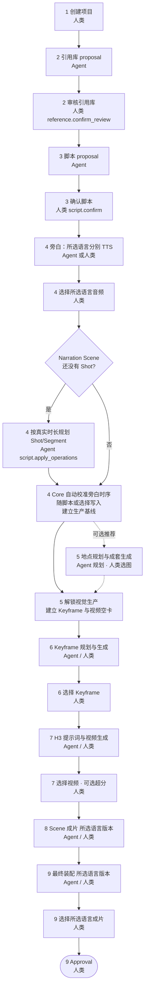
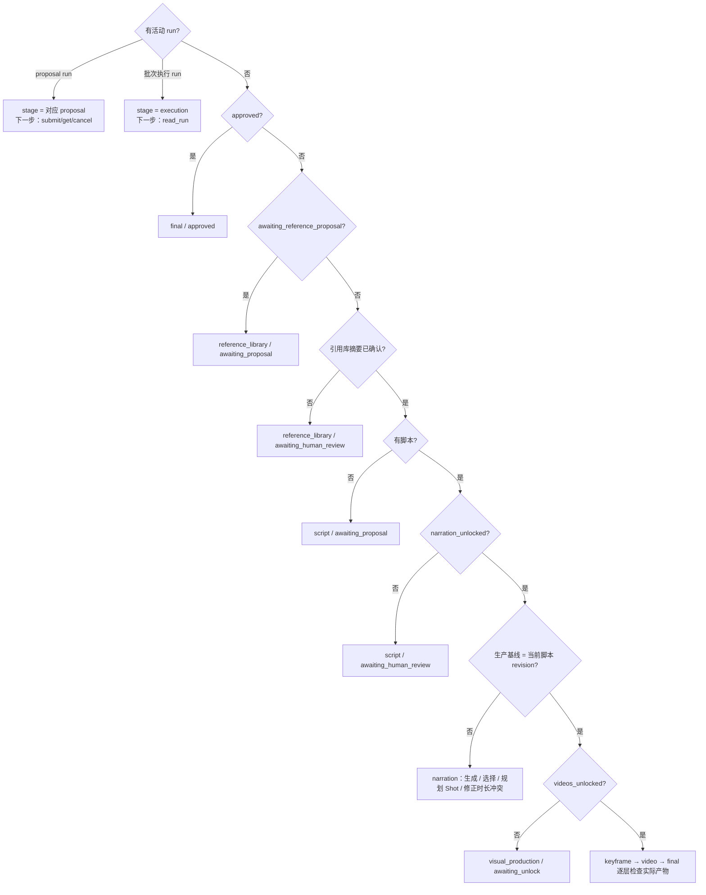
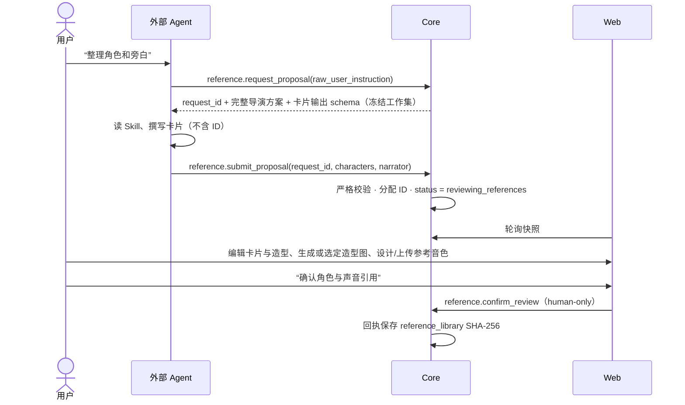
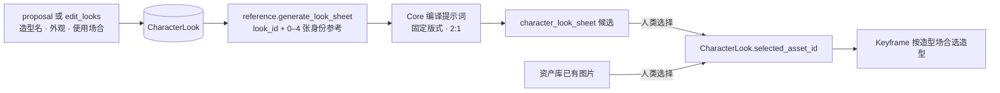
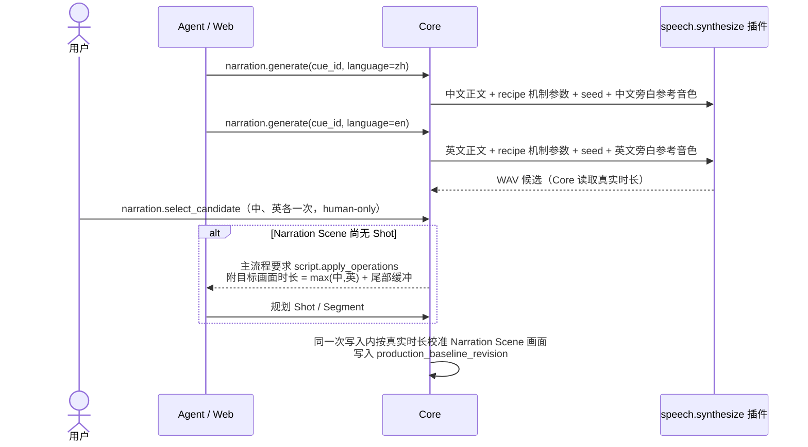
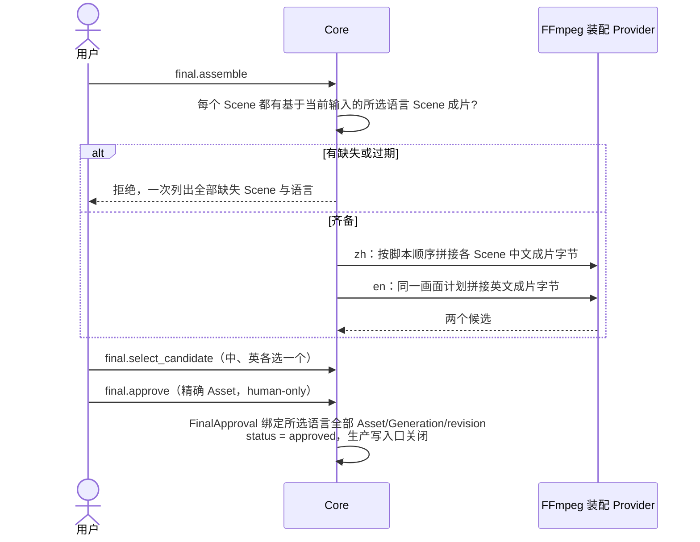

# 生产工作流

本文按阶段描述一个项目从导演方案到批准成片的完整业务流程：每一步由谁触发、读什么、写什么、被什么门禁。
命令的精确参数见 [命令目录](commands.md)，请求如何穿过系统见 [控制流](control-flow.md)，时序与输入编译算法见
[数据流](data-flow.md)。

## 全景



**主流程投影**：Core 的 `reads/workflow_state.py` 从当前 document 派生“主流程现在停在哪、下一步必须做什么”，
不持久化第二份状态。外部 Agent 通过 `read_workflow` 读取，Web 与 Agent 看到的是同一份事实。投影的判定顺序就是
上图的门禁顺序：



## 1. 创建项目

- **触发**：人类在首页提交项目名、画幅（`16:9` / `9:16` / `2:1`）、完整 Markdown 导演方案（≤ 50,000 字符）和旁白语言。`narration_languages` 必填，仅允许 `zh`、`en`，至少一种、不重复；未选择时页面禁用创建，Core 拒绝请求。
- **写入**：`POST /api/projects` 建立 `<项目名>-<project_id>/project.json`，`status = awaiting_reference_proposal`，
  标题、画幅和旁白语言永久固化。原始方案可由人类在导演台经 `PUT /structured-director/director-plan` 手工修改；Agent 无该入口。
  修改只更新原始方案和项目 revision，不自动改写或失效已有引用库、脚本与媒体。创建接口只持久化项目、立即返回，**不等待任何 Agent**。
- 单选中文或英文时，只建立该语言的音色、旁白、Scene 成片和最终成片；两种都选时才走双语流程，按较长音频校准共用画面。未选语言的字段为 null，不能提交对应语言的合成、装配或批准。
- **之后**：页面直接进入导演台并显示“引用库尚未建立”，等待外部 Agent 通过正式入口提交引用库 proposal。

## 2. 引用库



- Agent 只读取完整 `director_plan_markdown`，提出需要跨镜头一致的角色卡（可见角色或非出镜声音）以及存在旁白时的独立旁白身份。
  每个可见角色带 1–8 套造型（look）：造型名、外观（服装、发型、配饰、身体状态）与使用场合（自由文本，如“第一幕童年时期”；
  此时还没有 Scene ID）。Core 分配卡片与造型 ID。
- 造型图、参考音色的生成只新增候选；用户显式采用后才成为当前参考。隐藏候选不删除历史。

### 造型与设定图



- **造型是角色图的唯一单位**：角色卡上的图只能是某套造型的造型图，每套至多一张。造型图有两种来源，都只由人类选定：
  选择设定图候选，或把资产库里已有图片（导入的照片、外部设定图）设为造型图。
- 每套造型可生成一张**设定图**（柔和浅灰底，固定 2:1）：左侧约四分之三为同一主体的正面、正侧、背面与最能展示形态的第四个角度
  （直立人形取四分之三侧，伏地、爬行或多足生物取俯视），右侧约四分之一为头部正面特写。只有一套版式、没有形体标记：
  提示词先写主体（角色视觉描述与本次造型外观），再写版式；版式不含站姿、双臂、头肩、五官、妆容、服装等只属于人的措辞，
  并明确要求非人生物按真实生物绘制、不得人形化或拟人化、只画主体本身而不画巢穴、蛛网等所处环境。
  身份参考图（≤ 4 张项目图片）显式传入，只保持身份识别特征、体型与比例，映射写在提示词顶部。
- 人类在造型图弹窗里看到按当前图片插件约定编译的完整提示词（`sheet-preview`，只读不写），可直接编辑后生成；
  编辑过的提示词原样提交并记入 Generation，重试沿用当时提交的提示词与身份参考。Agent 只能用 Core 编译的提示词。
- 分辨率按插件上限：画幅由画布保证的插件（Qwen）沿用全局分辨率档位，不写画幅句；画幅写进提示词的插件（Codex / AGY）
  由 Core 在提示词里写“2:1 横构图、4K（4096×2048）”。
- 生成只新增候选，人类在角色卡的造型图弹窗中选择。Keyframe 引用造型而不是图片，改选造型图不需要改写 Keyframe，
  也不失效已有 Keyframe 候选。
- 人类在角色卡上增删改造型（新造型 id 为 null，由 Core 分配；整卡保存只改造型文字）；删除造型时 Core 剪除 Keyframe 对它的选择，
  该角色回到默认规则。Agent 用 `edit_looks`（`reference.apply_look_operations`）新增或修改造型，用 `generate_media` 的
  `look_sheet`（`reference.generate_look_sheet`）在用户明确要求时生成设定图；Agent 不能删除造型或选定造型图。
  改造型文字不失效已选造型图。
- 旁白身份按已选语言各有一套独立音色（各自的音色描述、参考 WAV 与完整文字稿）。Agent proposal 分别给出
  `zh_voice_description` / `en_voice_description`（未选语言为 null）；设计、上传与采用都按语言进行，只替换同语言的那一套。
- Clone/Direction 音色需要完整参考文字稿：用户填写，或点击按钮调用本机 Whisper 转写后校对回填。ASR 不对 Agent 开放。
- **确认是摘要绑定的**：之后任何引用内容变化都会让摘要不匹配，主流程回到“等待人类确认”。已进入生产的项目不会因此回退内容层。
- 未确认引用时，脚本请求返回 409 `stage_prerequisite_not_met`，不创建 run、Generation 或回执。

## 3. 结构化脚本

- **触发**：用户审核引用后，明确要求 Agent 生成脚本。系统不会因项目创建或引用确认而自动开始。
- **读取**：脚本 Skill 读取当前原始导演方案、当前引用卡和必要的当前脚本。地点规划也读取当前原始方案；Keyframe 与视频提示词工作集以结构化脚本、引用库、地点与生产输入为准，不直接携带原始方案。
- **写入**：`script.submit_proposal` 提交不含 ID、资产或候选字段的严格草稿；Core 分配全部 Scene/Shot/Segment/Cue ID，
  `status = reviewing_script`。
- **初稿规则**：
  - `narration` Scene 只有一个语义原子的 Cue（不按标点数量判断），所选语言的轨道，**不规划 Shot**；之后规划的
    Segment 不含对白；
  - `drama` Scene 先设计 Shot，不预设 Scene 总时长；不含旁白，对白可有可无；
  - 同一内容既需要旁白又需要对白时拆成相邻的 narration 与 drama Scene，Core 拒绝在同一 Scene 混用；
  - 脚本 Skill 分两步：先设计 Shot 列表（镜头功能、构图、运镜、动作、声音与剪辑决定），再按打包规则把 Shot 装进
    Segment。Shot 列表来自剪辑决定；一个 Segment 可覆盖多个相邻 Shot（段内切镜，只用于同空间、同节拍的紧密镜头组，
    当前不超过 3 个），一个 Shot 可跨多个相邻 Segment（长镜头拆段，边界落在可截帧续拍的稳定状态）；相邻 Segment
    共享边界 Shot 即延续同一镜头并填写 `boundary_from_previous`，不共享即剪辑；
  - 每个 Segment 预计不超过 15 秒；需要精确构图控制的镜头（建立镜头、关键揭示、全场最重的镜头、严格首尾状态）
    独占 Segment；仍超过软约束的 Segment 留给生成视频前提醒，不压缩动作或台词凑时长；
  - 每条 DialogueLine 另有独立的 15 秒脚本约束：按自然语速、表演要求和停顿预计超过 15 秒时，脚本 Agent 必须
    在自然语义或表演停顿处拆成连续多条，保持原文、说话者和顺序；拆 Segment 不能代替拆长对白；
  - 已有 Segment 只在用户明确要求时拆分或合并，拆分、合并或插入后覆盖仍完整连续（打包偏好与段内切镜上限是
    Skill 约束，Core 校验完整连续覆盖但不校验 Shot 的 Segment 数量）；
  - 初稿与回改在 `reply_markdown` 简述打包理由：哪些镜头组合并进一个 Segment、为什么；
  - 脚本必须先确定镜头功能、视觉重心、空间调度、揭示路径、起止状态与连续性锚点，Keyframe 与 H3 只具体化这些既定意图；
  - 先调度、再设计 Shot 列表，默认不切：动作阶段、说话人、连续运镜中的景别变化或模型时长都不单独构成新 Shot；导演方案用文字
    明确写出的剪辑决定照做，分镜表的镜号与时间码只是内容顺序和节奏意图，连续的相邻镜号默认合并；
  - 合并只合并摄影、不删内容：方案的节拍、台词（含引用库外说话者）、可见文字、伏笔与回收、声音与配乐入点逐项落到
    Segment 或 Shot；方案给出时间码时每个 Scene 合计时长与方案同一量级，偏差超过约 30% 或有意删减时在
    `reply_markdown` 逐条说明（Skill 约束，Core 不校验）；
  - 用户要求拆分时，拆 Segment 不改变 Shot 设计，边界落在可从上一段实际视频截帧续拍的稳定状态，后一段从同一
    时刻、同一运镜继续；两段共享该 Shot 时后一段填写 `boundary_from_previous`；
  - 初稿与多 Scene 回改先成稿、再逐 Scene 复查后提交，复查过程不进入 proposal。
- **修改**：人工表单与 `script.apply_operations` 都走同一组原子操作（见 [命令目录](commands.md#脚本)）。
  讨论不等于授权修改；Agent 返回空操作时 Core 不改变 revision。
- **确认**：人类 `script.confirm` → `narration_unlocked = true`、`status = reviewing_narration`，并由 Core 立即尝试
  建立生产基线；没有旁白的脚本由此直接进入视觉生产解锁。旁白层已解锁时重复确认不写入。

## 4. 旁白审核与校时



- 每条 Cue 的所选语言的轨道各自保存正文、seed、`recipe_params` 与已选音频，**分别合成、分别选择**。英文是适合朗读的意译；对白不做双语。
  机制参数以 `recipe_params[recipe_id]` 保存。快照 `provider_recipes` 与专业工作集 `speech_recipe` 给出当前绑定的
  `editable_params`，Web 按声明渲染，Agent 按同一声明调整。正文、语言、seed 与同语言的参考音色由 Core 填充。
- 修改某语言正文或合成参数只清除该语言的音频选择，并使时序与装配失效；既有视觉设计保留。纯结构锚点重建不重做 TTS。
- 用户明确要求时，Agent 可用 `narration.clear_selection` 解除某语言当前音频引用；这不授予采用其它候选的能力。
- 旁白层解锁后，每次脚本或旁白写入（含选择音频、规划 Shot）都由 Core 在同一次写入里自动校准时序，没有人工确认步骤。
  校准要求每条 Cue 已选语言的音频都已选择、存在旁白身份、所有 Narration Scene 已有可校准的 Shot 与 Segment；成功时按真实音频校准 Narration Scene
  的画面覆盖，并把校准后的脚本写为**生产基线**。已对齐的时长逐位保留，重算不会让无关 Segment 的视频选择失效。
- 无法校准（缺音频、Shot 或 Segment，或缩放后 Segment 短于 0.2 秒）时生产基线保持失效，主流程返回
  `script.apply_operations`（`reason = narration_timing_conflict`，`message` 为 Core 的具体原因，`target_ids` 为无法校准的 Scene），
  Web 在项目概览显示该原因；修正脚本的那次写入即重新建立基线。
- Drama Scene 没有旁白，不参与校准，表演时长保持脚本设计。
- 时序算法见 [数据流 · 旁白时序](data-flow.md#旁白时序)。

## 5. 地点（可选）

地点库把跨 Scene 共享的固定空间建成结构化事实：名称、空间描述、固定陈设、主光、状态变体，以及一组可选、彼此独立的图片。
地点不要求主图；全景图也不是其它图片的根。Shot 与 Keyframe 不保存地点或图片绑定，LLM 在规划 Keyframe 时根据 Scene setting、
绑定地点与状态、图片的实际说明和镜头上下文自行建立空间。只有人显式加入 Segment 辅助参考的图片才进入 Keyframe 生图输入。
数据结构见 [数据模型 · 地点库](data-model.md#地点库)。

```mermaid
flowchart TB
    S[生产基线已建立] -. 推荐 location.request_proposal .-> P[Agent 规划地点<br/>location proposal]
    P --> B[地点语义 + 可选独立图片 + Scene 地点/状态]
    B -. 推荐 location.generate_set .-> G[成套生成批次]
    G --> I[各图片独立生成候选]
    I --> SI[人类选择图片]
    SI --> V{全景图?}
    V -- 是 --> C[3D 预览中手动取景]
    C --> CI[新建并直接选中普通子图]
    V -- 否 --> U[按需继续积累]
    CI --> U
    U --> K[Keyframe 规划<br/>不建立地点图片绑定]
    S --> U
```

**规划**：用户明确要求后，Agent 通过 `location` 专业能力规划（`location.request_proposal` 要求已有结构化脚本，
否则 409）。工作集给出完整导演方案、每个 Scene 的标题/梗概/设定与全部 Shot 的构图、运镜、动作与可见角色，以及当前地点库。
proposal 一次提出地点（含陈设、主光、状态与可选图片）和 Scene 绑定，Core 编译为与
`location.apply_operations` 相同的操作并在一次提交内落库：

- 同一物理空间只建一个地点；彼此看不见的空间不硬合并；同一空间的昼夜、天气、布置或破坏变化建为状态，Scene 绑定 `state_id`；
- 陈设只描述稳定存在的结构与物体，不绑定某张图片的方位；不放人物、群众或剧情临时道具；
- 图片是扁平独立条目，`kind=image|panorama`。每张图必须有用户或 Agent 填写的纯文本 `description`，它描述实际画面，
  与生成意图 `prompt_text` 分离；全景图可选，不自动派生镜头视图；
- proposal 是增补：未列出的项不删除，列出的已有项整体替换；
- 规划期间持有 `location_plan` run，其它业务写入被锁。

人工可在导演台地点工作区逐项创建、编辑、删除地点、陈设、状态与图片，并在 Scene 上改绑。地点图片生成可任意选择至多 5 张
项目图片作为显式参考，不要求先有主图或来自同一地点。人类可通过 `location.select_image` 采用当前条目的生成候选，也可直接
从项目资产库选择已有图片；全景图仍校验 2:1，全景取景子图只接受自己的确定性裁切产物。Agent 只能生成、观察、说明或清除选择。
删除地点仍在 Scene 使用时拒绝；删除图片只删除当前地点条目，历史 Asset/Generation 与已取景子图保留。
地点库从项目创建起即可编辑，不受阶段门禁；Approval 后或有活动 run 时关闭。

**生成**：

- `POST /location-images/{image_id}/generate` 按图片自身 `prompt_text`、`reference_asset_ids` 与 kind 提交。
  普通图跟随项目画幅；全景图固定 2:1，并由 Core 加入等距柱状、左右无缝等投影约束。回调只新增候选，不自动选图。
- 点击已选全景图进入 3D 查看器。用户转动到目标 yaw/pitch/hfov，填写新图片名称与强制说明后，
  `POST /location-images/{image_id}/capture` 创建普通图片并提交确定性 `PANO_VIEW` 处理。成功产物直接成为该子图的选中 Asset；
  来源角度作为 provenance 冻结，之后父图改选或删除不级联。
- 所有生成与取景都只处理显式目标；回调和选择不会自动继续其它图片。

**成套生成**：`location.generate_set` 的 `target_ids` 是明确的地点图片 ID。每轮只提交范围内当前没有选图、没有成功待选候选、
也没有在途 Generation 的图片；其它项报告等待选择或已完成。每轮结束自己的 run，选择或回调不自动推进；继续仍需显式调用并且
范围不扩大。全景取景不属于成套生成，永远由查看器中的用户动作发起。

**推荐与跳过**：生产基线建立、引用库已确认且无活动 run 时，`read_workflow` 在 `recommended_next_actions` 里给出可选建议：
有 Scene 未绑定地点时推荐规划（只带缺口数量）；已有地点图片未选齐且没有在途批次时可推荐成套生成；
在途地点批次等待显式继续时只推荐继续。推荐永不进入 `required_next_actions`、不改变 `allowed_actions`，Agent 读到后只向用户提议。
解锁视觉生产本身就是跳过地点：解锁后不再推荐规划与成套生成；解锁的影响预览与回执附 `location_advisory`，列出未绑定地点的
Scene。地点缺口不阻止解锁或生图。

## 6. 解锁视觉生产与 Keyframe

**对白 TTS**：Drama Scene 的每句对白在视频生产前必须先生成 WAV 并由人选择。引用库角色已有参考音色时强制克隆，缺少
完整参考文字稿时拒绝；没有参考音色的角色以及引用库外临时说话者使用 Voice Design。选择完成后按真实 WAV 时长设置每句
`start_seconds`，Core 校验不重叠，并把 Segment 时长校准到不短于最后一句结束时间；镜头设计与情绪需要的余量可继续加在其后。
对白卡同时显示角色基础音色描述与剧本表演要求；克隆 recipe 的可编辑机制参数由当前 Provider manifest 渲染，例如 Breeze 的
表演指示可描述语气、情绪、语速与停顿。参数按 DialogueLine 保存到 `recipe_params`，修改后清除该句已选音频、整段时序和下游
视频选择；未保存显式覆盖时，Breeze 克隆默认使用 DialogueLine 的剧本表演要求。任一句正文、说话者、音色路由或已选音频变化
也会清除该 Segment 的时序与下游视频选择。

**解锁**（`unlock_visual_production`）要求生产基线 = 当前脚本 revision。主流程会先要求含对白项目完成上述 TTS 选择与真实时序；
无论视觉计划何时建立，视频生成入口都会重新硬校验对白已就绪。解锁一次性：

1. 为每个 Segment 建立独立的首帧与尾帧 Keyframe（尾帧以首帧为前置），两个槽位默认都不启用；
2. 为每个 Segment 建立视频卡（无对白默认 FL2VA，有对白默认 Ref2VA）；
3. 置 `keyframes_unlocked` 与 `videos_unlocked`，`status = reviewing_videos`。

只建空卡，**不自动生成**。

**规划**（Keyframe Planner Skill 或手工弹窗，读写同一份计划）：

- 工作集给出当前视频 recipe、合法 `none/start/end/both` 策略与实际独立参考。分别判断身份/空间参考与精确起止画面的时间约束；
  固定机位、小动作和表情变化通常用单首帧，尾帧必须有独立必要性。支持独立参考的 recipe 可不启用首尾帧；
  关闭端点可不填写正文，Core 保留其历史计划。角色进出不会自动激活另一端；显式共享交接仍须启用对应边界。
- 相邻 Segment 的边界默认是两个独立 Keyframe；用户或 Planner 可显式 `share_boundary` 共享为同一 Keyframe。
- 角色唯一、造型可多套：每套造型对应不同时期、服装或状态，带使用场合。每个 Keyframe 为可见角色选择本帧使用的造型
  （`character_references`），Planner 与手工弹窗读写同一字段；多套造型未选择时该帧不能生成，所选造型没有造型图时也不能生成
  （批次中作为等待依赖）。删除造型时 Core 同步剪除各 Keyframe 对它的选择，已生成候选与选择保留。
- 默认只规划用户指定范围；Planner 可读目标 Segment 所属完整 Scene 作上下文，但 Core 只合并目标 Segment 的 Keyframe 子图。
  只有用户明确要求全部规划时才遍历整个项目；局部规划恢复时目标范围丢失，必须无修改结束并要求重试，绝不扩大成全量。
- **规划锁定节点**：已有未隐藏成功候选或已选候选的 Segment，重新规划时保留其首尾绑定、正文、候选与辅助图。

### Keyframe 与地点解耦

Keyframe 不保存地点或地点图片字段。Planner 工作集给出当前 Scene 的 `location_id` / `state_id`、相应地点语义，以及地点图片的
强制说明；Agent 用它们理解空间，再结合 Shot 构图自行写静态画面。地点图片不会自动进入 Provider 输入，也不会成为生成依赖。
需要使用某张图片时，用户把它的已选 Asset 显式加入 Segment 辅助参考；它与其它辅助图片遵守相同名额和用途展示。
图片输入只有角色造型图、前置帧和手工辅助图，按实际输入编译并合计不超过 5 张。

**生成**：

- 卡片单图按钮只提交该 Keyframe，成功回调只保存结果，不触发其它任何 Keyframe。
- 批量（`keyframe.generate_batch`，MCP `media_batch` `kind=keyframe` `action=start`）固定一个显式目标集合，每轮只提交其中“当前依赖已满足”的帧
  （例如前置帧有成功候选、角色造型已有选图）；其余帧留作等待项并在回复中说明原因。依赖满足后，
  需要用户再次明确“继续”（`keyframe.continue_batch`，`action=continue`），批次不会自动补齐；输入超额仍是计划错误，整轮拒绝。见 [控制流 · Keyframe 批次](control-flow.md#7-keyframe-批次)。
- 图片输入的编译顺序与映射见 [数据流 · Keyframe 输入编译](data-flow.md#keyframe-输入编译)。

**首帧“从上一 seg 抽取”**：首帧卡可按帧号（范围 `0…N-1` 由 Core 从 MP4 读出，默认最后一帧）抽取脚本顺序上一个
Segment 当前生效视频（有超分取超分）的一帧。产物只作为该首帧的候选，不自动选择；需要后期处理时，用户导入处理后
的图片再选择。上一段换版不会改写已选首帧，Core 不维护“尾帧续接”状态。共享首帧本身就是上一段尾帧，不提供此入口。

**脚本回改后的重建**：合并、拆分、增删 Segment 后，Core 立即按当前脚本重建 Keyframe 绑定：仍在的 Segment 保留原绑定
与已选帧；新 Segment 获得独立空首尾槽位；被删 Segment 的槽位随之移除；显式共享边界只在两侧仍紧邻时保留，否则复制为独立首帧。

## 7. Segment 视频

导演台的“Segment 画面输入”把三类图片并列展示：首帧、尾帧和“其他图片”。首尾帧来自 KeyframePlan，具有明确时间位置；
“其他图片”显示四张独立子卡片，每张可保存画面正文、参考用途、可见角色/造型和显式生图参考，生成独立候选后由人类选用；
图片可以是任意内容，也可从已选关键帧或资产库选图，无需属于角色或地点。当前已启用的首尾帧不重复列入，停用的边界图仍可改作视觉参考。
规划保存于 `SegmentVideo.reference_images`，图片没有时间位置；实际选图唯一写入当前 Ref2VA recipe 的 `additional_images`，
生成回调不自动选用。每张选图必须说明实际内容与参考用途；从关键帧加入只复用 Asset，不建立中间帧语义。
上方入口与下方视频卡共享受保护的 recipe 草稿并原子保存；Agent 不能用通用输入写入绕过新参考图候选的人类选择。

**生成前置**（Core 在提交时校验）：

- FL2VA 至少有一个**启用且已选择**的首帧或尾帧；Ref2VA 不要求首尾帧或图片，但所有媒体槽位合计至少有一个输入资产；
- 已保存的非空 H3 提示词（空提示词必须先填写或显式让 Agent 用 `h3-prompt-writing` Skill 优化）；
- 含对白 Segment 的全部 TTS WAV 已选择并完成真实时序，当前 recipe 支持参考音频；Ref2VA 的手工参考音频/视频/其他图片也都合法（存在、类型正确、视频 2–15 秒、描述非空）；
- 实际使用的 Keyframe 仍然有效、时长在预算内。

**视频 recipe**：

| 模式 | 默认场景 | 输入 |
| --- | --- | --- |
| `minimax_h3.fl2va` | 无对白 | 启用且已选的首/尾帧 + H3 正文 |
| `minimax_h3.ref2va` | 有对白 | 可选首/尾帧 + 可选 ≤4 张其他图片（`additional_images`）+ **Core 自动注入的已选对白 WAV** + 手工参考音频（两者合计 ≤8）+ 可选 ≤3 条参考视频 + H3 正文；五类媒体槽位至少有一项 |

默认规则、可用槽位和参数由当前绑定插件的 manifest 声明。视频卡按 recipe 渲染，切换前由 Core 校验；每个 recipe 的机制参数与显式输入独立保存。含对白 Segment 不能切换到不支持参考音频的 FL2VA；无对白 Segment 切回 FL2VA 前必须先清空全部其他图片、音频与视频引用。手工参考音频的用途由用户描述决定；对白 WAV 则由 DialoguePlan 自动注入，不从角色卡参考音频直接推导。参考视频只作视觉参考（运镜、节奏、续写），其音轨不会自动成为音频参考。

**多 Shot Segment**：一个 Segment 覆盖多个 Shot 时，`video_prompt` 工作集的 `context.shots` 按覆盖顺序给出每个 Shot 的
构图、运镜、动作、声音、可见角色名与视图建议名；`segment.continues_from_previous_segment` /
`continues_into_next_segment` 表示相邻 Segment 共享边界 Shot、延续同一镜头。提示词用 `[Shot N] At MM:SS.mmm`
写段内切镜，切点只是软约束：Core 不按 Shot 切视频、不记录段内切点，生成后切点漂移仍是合格候选。首尾 Picture
只锚定第一个 Shot 的开头与最后一个 Shot 的结尾；中间 Shot 的人物与空间靠参考图维持。同空间、同节拍的段内切镜
当前不超过 3 个，需要更多切镜时拆成多个 Segment。

**Agent 保存 recipe 输入**：外部 Agent 与人类走同一条 `video.update_recipe_inputs`，原子保存正文、当前 recipe 的 `bindings`
与机制 `params`（MCP `save_video_prompt` 带 `recipe_inputs`）。媒体校验共用：manifest 槽位、数量、媒体类型、视频时长、说明必填、
不重复、只引用本项目 Asset、进行中任务冲突与 revision。`video_prompt` 工作集给出槽位声明、已保存输入（`recipe_inputs`，
整体替换时原样回传未改部分）、可绑定 Asset（`bindable_assets`）与参数声明；Agent 只在用户明确要求时增删或替换绑定。
候选选择与清除选择仍只属于人类。

**H3 提示词**由用户手工编辑，或由 Agent 显式使用 `h3-prompt-writing` Skill 优化。用户指定语言时必须服从；未指定时不额外约束
自然语言正文，但官方字段、引用标签与时间语法保持 Provider 格式。含对白时，工作集给出 `required_dialogue_prompt`；Agent 必须
原样置于正文开头。即使用户正文遗漏，Core 提交 H3 时也会确定性补入同一句强约束和逐条 Audio→原台词映射。

**视频生成是纯程序动作**：Core 校验输入后原样提交已保存的正文，不调用 Agent、不重写正文。H3 预设（基础模型与步数）、分辨率、
SageAttention、SelfLift 读自全局 Provider 设置（见 [媒体 Provider 与部署](providers-and-deployment.md#minimax-h3-设置)），并记录在
Generation 的 `provider_snapshot` 中。
seed 可指定；留空时按该目标历史实际 seed 递增。

**时长**：Core 与 Provider 不设时长上限，只要求不短于 0.2 秒的有限值。当前默认本地 H3 部署以 15 秒为单 Segment 软约束：
超过可能（但不一定）OOM。视频工作集读取 H3 hints，返回 `soft_duration_limit_seconds = 15` 与 `exceeds_soft_duration_limit`，视频卡在超过时显示提示；
Agent 在生成前对超过的 Segment 主动提醒风险并建议拆分点，用户同意后用 `split_segment` 拆分，坚持不拆则照常提交。

**对白时长**：TTS 生成前不提供按字数换算的秒数。选择 WAV 并校准后，视频工作集的 `dialogue_timing` 给出真实起点、
单句时长与最晚结束时间，Segment 时长必须大于等于该结束时间。Agent 可根据镜头设计和情绪增加尾部余量；不得删减、
改写或加速台词来挤进原时长。

**候选与超分**：

- 选择只要求候选“成功、未隐藏、属于该 Segment、有 MP4 产物”。生成时的关键帧、提示词或参考输入快照变化只作软提示
  （`inputs_outdated`），不阻止选择、超分、Scene 成片或最终装配。
- 用户可把资产库中任意真实时长 ≥ 0.2 秒的 MP4 挂接为某 Segment 的候选（`attach`），不伪装成渲染、不自动选择。
- 选择原视频后可显式提交 SeedVR2 超分；结果绑定同一 Segment，不覆盖原视频。装配时优先使用超分版本。

## 8. Scene 级输出

Scene 卡提供两个相互独立、由用户手动触发的输出：

| 输出 | 命令 | 输入 | 作用 |
| --- | --- | --- | --- |
| Scene Animatic | `animatic.generate_scene` | 已审核旁白 + 已选 Keyframe 图 | 动态分镜预览；不影响生产基线；历史保留，再点生成新版 |
| Scene 成片 | `final.assemble_scene` | 当前已选 Segment 视频 + 所选语言旁白 | 所选语言分别确定性渲染；Scene 内转场与旁白对轨在此固化 |

重新生成或删除 Scene 成片会作废已建立的最终装配计划。

## 9. 最终装配与 Approval



- 最终装配只拼接 Scene 成片字节，不再读取原始 Segment 或重新混入旁白。跨 Scene 边界沿用同一接缝规则（见数据流）。
- 装配结果仍是候选；用户先分别选择所选语言版本，再以精确 Asset 一次批准所选语言的全部版本。
- 批准后生产写入口关闭；`final.reopen_production` 清除当前装配与 Approval、回到视频审核位置，保留全部历史与已开放内容层。

## 上游回改的影响

上游修改随时允许发生。Core 按依赖图精确失效当前选择与派生计划，**不删除** Asset/Generation 历史、**不回退**内容层、
**不重锁**入口。Agent 工作期间锁定冲突写入；相关任务进行中或提交结果未知时，冲突修改被拒绝。完整传播规则见
[数据流 · 失效传播](data-flow.md#失效传播)。

## 资产中心

资产中心与生产层并列，不改变主流程：

- 可一次多选导入图片（先选分类：角色参考 / 地点图片 / Keyframe）、WAV 或 MP4；Web 按文件串行提交并沿用 Core 返回的最新 revision，Core 逐项校验签名、读取真实时长，只登记未绑定 Asset；
- 通用音频生成（当前绑定的 voice.design 或 speech.synthesize recipe），产物进入 `assets/audio/generated/`，不绑定任何节点；
- WAV 截取与后处理（`radio` 效果，可限定时间区间），生成保留原文件的新副本；
- 视频音轨编辑：分离人声/背景 → 可对任一轨后处理 → 选择原始或处理后副本 → 各自增益与时间区间 → 重新混音为新 MP4；
- 任意 MP4 按帧号抽帧，产物进入“抽帧图”页签，被 Keyframe 选择前保持未使用；
- 永久删除没有项目引用、可见候选或未结束任务的 Asset（规则见 [数据流 · 资产使用与删除](data-flow.md#资产使用与删除)）；
- 与 Playground 互相复制资产（只能由人类发起，复制产生新 Asset）。
