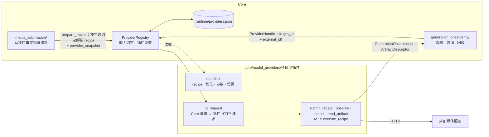
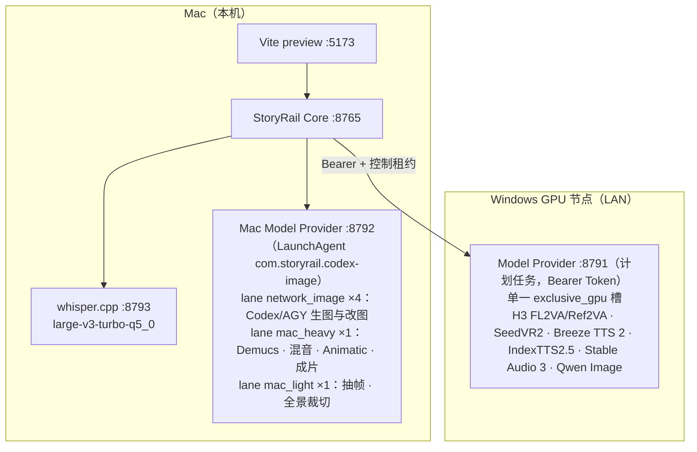
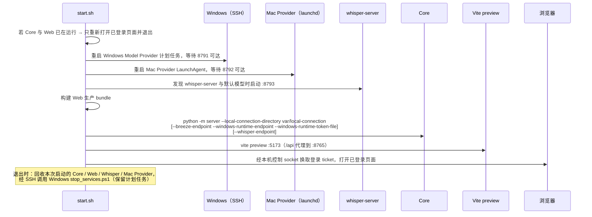

# 媒体 Provider 与部署

## Provider 插件模型

Model Provider 是 Core 侧插件：每个插件自行调用一个独立的外部 HTTP API，并把结果翻译成 Core 的 Generation 语义。外部服务不实现任何
公共工作流层，也不接收项目语义、任意文件路径、shell、eval、任意 URL 或任意模型路径。

Core 只理解封闭的**语义能力**（`image.generate`、`image.edit`、`voice.design`、`speech.synthesize`、`speech.recognize`、
`video.generate`、`video.upscale`、`audio.generate`、`audio.separate`）和**语义角色**（首帧、尾帧、参考图/音频/视频、参考音色、
文字稿、改图底图、来源视频/音频、提示词、朗读文本、语言、时长、画幅、seed、人声或背景 stem）。插件用 manifest 声明自己实现哪些 recipe、每个 recipe
使用哪些角色槽位，以及对 Core 不透明的参数和实例设置；Core 负责校验、持久化与下发，不解释机制字段的含义。



| 文件 | 职责 |
| --- | --- |
| `core/model_providers/manifest.py` | 语义能力、语义角色、Widget 词汇、manifest DSL（字段、槽位、recipe、默认规则）与 `ProviderSnapshot` |
| `core/model_providers/recipe.py` | `RecipeRequest`、槽位绑定的线上形状、机制参数保存与 manifest 校验；所有模型插件接收 `submit_recipe`，同步 ASR 接收 `execute_recipe` |
| `core/model_providers/registry.py` | 已安装插件实例、全局能力绑定、插件设置；`prepare_recipe` 按当前绑定解析 recipe并生成提交快照；历史 Generation 按自己保存的 `plugin_id` 找回原实现，不跟随后来的绑定 |
| `core/model_providers/settings.py` | `.runtime/providers.json` 的严格读写与原子替换 |
| `core/model_providers/contracts.py` | Core 确定性工具的提交请求（装配、Animatic、抽帧、全景裁切、混音）；模型 HTTP DTO 位于各插件包 |
| `core/model_providers/boundary.py` | 句柄 `ProviderHandle`、观察 `GenerationObservation`、产物描述 `ArtifactDescriptor`（视频可回报实测时长，Core 优先采用）、`ModelProviderError` |
| `core/model_providers/<插件>/manifest.py`、`plugin.py` | 插件声明与 `plugin_instance(...)` 安装工厂 |
| `core/structured_director/provider_ports.py` | recipe 任务与确定性工具的窄 Protocol；异步任务通过持久句柄观察、取消和取产物，ASR 同步返回文字 |

同一模型如果“重新生成”和“基于底图编辑”的请求语义或 endpoint 不同，必须使用不同的 recipe 与严格请求类型，不能塞进可选字段让
Provider 猜测。外部响应由插件按自己的严格规则校验。

## 安装与连接

插件实例 ID 等于包名，recipe ID 带插件前缀。启动参数装配默认插件，也可用
`--provider-plugin 包名=http://模型服务地址` 添加已经安装的插件包；工厂位于
`core.model_providers.<包名>.plugin.plugin_instance`，返回完整 manifest 与 recipe 实现映射。
例如 `--provider-plugin indextts2=http://模型服务地址` 安装 IndexTTS2.5，随后在设置页将 `speech.synthesize` 绑定到 `indextts2`。
默认 Windows 私有服务实现插件 [HTTP 契约](../core/model_providers/indextts2/README.md)，IndexTTS2.5 worker 在 WSL 中按需加载并服从 exclusive_gpu 调度。
额外插件 endpoint 与配置的 Windows runtime endpoint 相同时复用其受认证 transport 与控制租约。
连接信息来自本机启动配置，Provider 设置页只读展示 endpoint；能力绑定与机制设置由人类修改。
接入云端 API 的插件从 `STORYRAIL_<包名大写>_API_KEY` 环境变量读取凭据（写在 Git 忽略的 `start.local.env`），
凭据不进入 manifest、插件设置或 Generation 快照。开发新插件时让 coding Agent 使用仓库 Skill
[`storyrail-provider-plugin`](../.agents/skills/storyrail-provider-plugin/SKILL.md)。

manifest slots 声明媒体类型、数量、时长、必填说明、标签 namespace 与跨槽互斥（`distinct_slots`）；
params 声明类型、范围、默认值、组件标签与高级字段。带角色的参数由项目事实提供，机制参数由 recipe 保存。语言上下文缺失且插件声明自动语言默认值时使用 auto；其它语义事实缺失仍拒绝提交。
Playground 从同一声明生成完整参数表单与输入校验。

## 能力与插件

| 能力 | 插件实例（recipe） | 默认部署位置 | 用途 |
| --- | --- | --- | --- |
| `image.generate` / `image.edit` | `codex_image`（`codex_image.generate/edit`，默认）或 `agy_image`（`agy_image.generate/edit`），分别绑定 | Mac :8792 | 角色参考图与造型设定图、独立地点图片、Keyframe |
| `image.generate` / `image.edit` | `qwen_image`（`qwen_image.generate/edit`，Qwen Image 2.1 · NoctQ V4，备选） | Windows :8791 | 同上 |
| `voice.design` / `speech.synthesize` | `breeze_tts2`（`breeze_tts2.voice_design` / `breeze_tts2.clone`） | Windows :8791（按需拉起） | 音色设计、旁白 TTS、Voice Clone / Direction |
| `speech.synthesize` | `indextts2`（`indextts2.synthesize`） | Windows :8791（按需拉起 WSL） | 参考 WAV 克隆，语速与八维情感 |
| `speech.recognize` | `whisper_asr`（`whisper_asr.transcribe`） | 本机 whisper.cpp :8793 | 参考音色文字稿转写（仅人类按钮） |
| `video.generate` | `minimax_h3`（`minimax_h3.fl2va` 首尾帧视频 / `minimax_h3.ref2va` 参考视频） | Windows :8791 | Segment 视频；有对白默认 Ref2VA |
| `video.upscale` | `seedvr2_7b_sharp_fp8`（短边 720、长边 ≤1280） | Windows :8791 | 视频超分 |
| `audio.generate` | `stable_audio_3` | Windows :8791 | 文生音频，仅 Playground |
| `audio.separate` | `demucs_audio` | Mac :8792 | 人声 / 背景分离 |

Core 本地确定性工具没有可选实现，设置页只显示状态：

| 工具 | 插件 | 默认部署位置 | 用途 |
| --- | --- | --- | --- |
| `final_assembly` | `ffmpeg_final_assembly` | Mac :8792 | Scene 成片与最终成片 |
| `animatic` | `ffmpeg_animatic` | Mac :8792 | Scene Animatic |
| `video_frame` | `ffmpeg_video_frame` | Mac :8792 | 按帧号抽帧 |
| `pano_view` | `ffmpeg_pano_view` | Mac :8792 | 2:1 全景按 yaw/pitch/hfov 裁切为项目画幅透视 PNG |
| `audio_remix` | `ffmpeg_audio_remix` | Mac :8792 | 两轨增益后重新封装 MP4 |

`pano_view`（`Tool.PANO_VIEW`，标签“全景裁切”）把受控 2:1 等距柱状全景按一个透视机位裁成 PNG：

| 项 | 约定 |
| --- | --- |
| 输入 | PNG / JPEG，宽高比 2:1（±1 像素），宽 1024–16384，≤ 64 MiB；`yaw_deg` ∈ [0, 360)（0° 为全景正中，顺时针为正）、`pitch_deg` ∈ [-60, 60]（抬头为正）、`hfov_deg` ∈ [20, 120]、画幅 `16:9` / `9:16` / `2:1` |
| 输出 | 长边 2048，短边按画幅取偶数（2048×1152、1152×2048、2048×1024）；`v_fov = 2·atan(tan(hfov/2) · 高/宽)` |
| 确定性 | 单线程、lanczos 插值、`rgb24`、去元数据与 bitexact：同输入两次输出 SHA-256 相同，PNG 不含时间戳 |
| 协议 | `POST /ffmpeg/pano-views` → `view_id`；阶段 `queued / rendering / done / failed / cancelled`；产物 `image`；取消 `PUT …/abort` |

Core（`PanoViewRequest`）与媒体服务 worker 各校验一次签名、尺寸与参数。项目里只有地点室内视图使用它（结果直接写入视图
`crop_asset_id`），Playground 的 `image.pano_view` 用同一契约调试。

插件随 Core 安装，由 `server/__main__.py` 按启动参数显式安装：只有配置了对应 endpoint 的插件才会安装。`mock` 插件只用于测试。
WAV 截取与后处理不是 Provider，而是 Core 内的 `core/audio_effects` 同步处理。某个能力没有已安装或已绑定的插件时，相关命令返回
`provider_unavailable`。

## 全局 Provider 设置

能力绑定与插件实例设置是 Core 进程级设置，项目与 Playground 共用，原子持久化在 `.stories/.runtime/providers.json`：

```json
{
  "schema_version": 1,
  "bindings": {"image.generate": "agy_image"},
  "settings": {"minimax_h3": {"preset": "turbo_v2", "resolution": "720p", "sage_attention": true, "selflift": true}}
}
```

| 接口 | 作用 |
| --- | --- |
| `GET /api/settings/providers` | 每个能力的当前绑定与可选插件、每个已安装插件的 manifest / 生效设置 / 设置摘要、确定性工具状态 |
| `PUT /api/settings/providers/bindings` `{capability, plugin_id}` | 把能力绑定到实现它的已安装插件 |
| `PUT /api/settings/providers/plugins/{plugin_id}` `{settings}` | 以完整对象替换插件设置，按 manifest 严格校验（缺键、多键、取值非法都拒绝） |

- 只有 human + `workspace.manage` 可以读写；Agent 的请求在访问层被拒绝。
- 没有保存绑定的能力使用第一个已安装的实现；保存的绑定指向当前未安装的插件时，该能力不可用并提示重新选择，不会偷偷换成别的插件。
- 保存的设置与当前 manifest 不兼容时暂用默认值并在设置页提示，旧值原样保留直到人类重新保存。
- 修改绑定或设置只影响之后的提交：每次提交通过 `prepare` 读取当前绑定与设置，Generation（及 Playground run）在 `provider_snapshot`
  中记录插件、recipe、生效设置与摘要（如 “Turbo V2 · 8 步 · 1080p”），候选卡显示该摘要；已有候选不失效，历史任务仍按句柄回到原实现。
- Web 顶栏“Provider 设置”按 manifest 的 widget 渲染设置字段与能力绑定。

视频生成通过 `video.generate` 能力绑定解析 recipe。项目保存 `active_recipe` 与按 recipe 隔离的输入、机制参数；Core 提供提示词、时长、seed、画幅及首尾帧的语义角色。
视频专业工作集的 `context.shots` 按覆盖顺序给出 Segment 的每个 Shot；H3 Skill 据此写段内切镜软约束，首尾 Picture 只锚定首末 Shot。
H3 插件的请求 DTO、画布与采样换算、FL2VA/Ref2VA HTTP 实现和 `h3-prompt-writing` Skill 都位于 `core/model_providers/minimax_h3/`。
Web 视频卡按 manifest 渲染，专业工作集按当前插件交付 Skill；安装其它视频插件不增加厂商模式字段。

### MiniMax H3 设置

| 项 | 可选值 | 默认 |
| --- | --- | --- |
| `preset` | `hybrid_v2`（DaSiWa Hybrid V2 · 20 步）· `turbo_v2`（Turbo V2 · 8 步）；预设同时决定基础模型与步数 | `hybrid_v2` |
| `resolution` | `480p`（864×480）· `720p`（1280×704）· `1080p`（1920×1088）；9:16 宽高对调；2:1 依次为 960×480 · 1408×704 · 1920×960（长边上限 1920） | `720p` |
| `sage_attention` | true / false | true |
| `selflift` | true / false | true |

画布必须落在 32 像素网格（16 倍潜变量下采样后再 2×2 patchify）。生成模式（recipe）仍由 Segment（或 Playground run）决定。
manifest 另以 `soft_duration_limit_seconds = 15` 提示单段时长软约束，Core 不硬拦。

图片插件 Codex 与 AGY 都是 HTTP 图片插件，不是 Agent runtime；AGY worker 每个任务只开放 `generate_image` 与 `finish`，不获得项目写入、
MCP 或 Director 权限。

### Qwen Image 图片插件

`qwen_image` 是备选图片插件，基础模型固定为 Qwen Image 2.1 的社区微调 NoctQ V4。生图与改图在 Windows
服务中走同一张固定 Comfy Core 节点图：输入图按顺序进入文本编码器（改图时第一张是底图），画布始终由宽高决定。

全局设置（项目与 Playground 共用，设置摘要显示分辨率档位）：

| 项 | 可选值 | 默认 |
| --- | --- | --- |
| `resolution` | `1k` / `1_5k` / `2k`：画布长边 1024 / 1536 / 2048，短边按画面比例取整到 32 像素网格 | `2k` |
| `cfg` | 1–8；大于 1 时启用负向提示词，耗时约翻倍 | 3 |
| `steps` | 4–60 的整数 | 25 |
| `negative_prompt` | ≤4000 字；CFG 为 1 时不生效 | 空 |

recipe 参数：`prompt` / `aspect_ratio` / `seed` 由 Core 按领域事实填写；`width` / `height` 默认留空，Playground 可显式填写
256–2048 内 32 的倍数（须同时填写）以覆盖档位计算。采样器 euler / simple、参考图像素预算 1024、模型文件与 KV cache
由服务端固定。manifest 的 `image_prompt` 约定让 Core 用 `<imageN>` 提供实际输入标签、单图称“图片”、不写画幅句；
Core 不把输入清单、默认用途或参考方式指令拼入最终提示词，全局生图 Skill 要求人或看图后的 Agent 编写引用说明与正文。
随插件发布的 `qwen-image-prompt-writing` Skill（含 Qwen 官方文生图与编辑提示词模板）经 Keyframe / 地点规划工作集的
`image_prompt.plugin_skills` 交付给 Agent。

### 图片比例

图片插件的 `aspect_ratio` 参数取自 `IMAGE_ASPECT_RATIOS`（16:9、9:16、2:1、1:2、1:1、3:2、2:3、4:3、3:4、5:4、4:5、21:9、
9:21、3:1、1:3）。Keyframe 与普通地点图使用项目画幅；角色参考图可以指定其中任一比例；造型设定图与地点全景图固定 2:1。
造型设定图在 Codex / AGY 的提示词里另写 4K（4096×2048）分辨率要求，Qwen 沿用全局分辨率档位。Codex / AGY 把比例写进提示词，
并把产物裁成该比例内最大的区域（不缩放像素）；Qwen 按比例与分辨率档位计算画布。

### 图片 seed

声明 Seed 角色的图片 recipe（目前只有 `qwen_image`）由 Core 在每次提交时分配 seed 并记入 Generation：
首个 seed 由目标 ID 派生，同一目标之后的每次提交递增，失败、取消和隐藏的记录也消耗 seed；重试沿用原 seed。
同一张 Keyframe 重复生成因此得到不同候选。未声明 Seed 的图片插件（Codex / AGY）不记录 seed。

## 默认部署拓扑



- Windows 服务内部只有一个 `exclusive_gpu` 执行槽：同族任务复用驻留 runtime，切换模型族、取消、失败或服务关闭时释放。
  Breeze 不常驻，由同一调度器按需以 `--fast-all` 快速推理路径拉起（冷启动约 70 秒，之后约 0.5 倍实时）。
- **控制租约**：Core 启动时向 Windows 服务建立短期租约，每 5 秒心跳；正常关闭时主动释放。失联 20 秒后 Windows 停止接收新任务、
  取消运行中与排队任务并释放 GPU，任务记录明确标注 `controller_lease_released` / `controller_lease_expired`；Core 恢复后可显式重试。
- Mac lane 之间互不等待：生图可 4 并发，抽帧与全景裁切不等待音频分离或成片（二者共用 `mac_light`、互斥）。
- 排队任务的状态文案（“排队中：前面还有 N 个任务”）由私有服务生成，经插件 `observe` 显示，Core 不解析。
- 上述拓扑是当前开发部署选项，细节（模型版本、权重、节点图、安装脚本、Windows 防火墙、内存与显存约束）全部在
  [`default_model_providers_implement/README.md`](../default_model_providers_implement/README.md)，不属于 Core。

## `start.sh`



`start.sh` 启动时先读取仓库根目录的 `start.local.env`（Git 忽略所有 `*.local.env`，模板见
`start.local.env.example`），其中可设置下表变量；同名环境变量也可直接传入。

| 环境变量 | 默认 | 作用 |
| --- | --- | --- |
| `STORYRAIL_WINDOWS_RUNTIME_ENDPOINT` | 无 | Windows 服务地址；存在 Token 文件时必填 |
| `STORYRAIL_AUTOSTART_WINDOWS_PROVIDER` | `1` | 设为 `0` 跳过 Windows 远程启停 |
| `STORYRAIL_WINDOWS_SSH_TARGET` | 无 | 部署与诊断用 SSH 别名（不是产品协议）；自动启停时必填 |
| `STORYRAIL_WINDOWS_REPOSITORY_ROOT` | 无 | Windows 侧代码树；自动启停时必填 |
| `STORYRAIL_WINDOWS_LISTEN_ADDRESS` | 无 | Windows 服务绑定的 LAN 地址；自动启停时必填 |
| `STORYRAIL_AUTOSTART_MAC_PROVIDER` | `1` | 设为 `0` 跳过 Mac Provider 重启 |
| `STORYRAIL_MAC_PROVIDER_PORT` | `8792` | Mac Provider 端口 |
| `STORYRAIL_WHISPER_SERVER` / `_MODEL` / `_ENDPOINT` | 自动发现 | 覆盖 Whisper 可执行文件、模型与地址 |

- Windows 服务的 Bearer Token 只放在 Git 忽略的 `var/secrets/windows-model-service-token`；存在该文件时 Core 才接入 Windows 能力。
- 传入 `--access-policy-file` 时 `start.sh` 不启用本机一键接入（二者互斥），改用自定义 caller 策略。
- Core 只允许监听回环地址；LAN 上的模型服务必须绑定指定地址并强制认证。不得记录 SSH 私钥、SMB 密码或 Provider Token。

## 工程门禁

```bash
.venv/bin/ruff format --check .
.venv/bin/ruff check .
.venv/bin/python -m pytest -n auto
cd web && npm run typecheck && npm test && npm run build
git diff --check
```

等价的一键脚本是 `./scripts/ci_local.sh`（默认跳过 `slow`，`--full` 全跑）；GitHub Actions（`.github/workflows/ci.yml`）在推送 `main` 与 `refactor/**` 时运行同一套默认门禁，
另含 Web 合同与 fixture 新鲜度检查、Markdown 链接检查（`scripts/check_doc_links.py`）、token 基准防回归（pytest 内 `oracle/test_oracle_token_benchmark.py` 调用 `scripts/harness/benchmark/report.py` 的计量与冻结值比较）。
